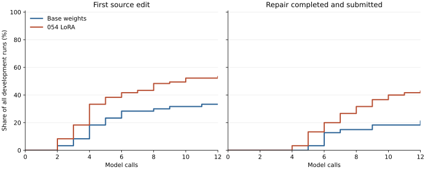

# One GPU LM

在一张工作站 GPU 上训练和评测编码模型。用同一批仓库任务、同一套工具和同样的预算对照底座与 LoRA，公开修复成功率、退步和实测卡时。

*Train and evaluate coding models on one workstation GPU. Rebuild the paired results from public measurements.*

[CPU 快速复算](#cpu-快速复算) · [27B 发布进度](docs/modelscope-release.md) · [实验索引](docs/experiment-index.md) · [如何贡献](#如何贡献)

## 公开结果

054 在六个新仓库家族的 60 道题上各跑三轮。底座修对并提交 **38/180（21.1%）**，LoRA 为 **77/180（42.8%）**。增幅 **21.67 个百分点**，配对 95% 区间为 **+6.67 至 +38.33 个百分点**，通过开发门槛。39 次净增全部来自单文件任务，11 道必要多文件题两组均未完成。[逐题结果、曲线与卡时](experiments/054-expanded-repair-sft/results/2026-11-26-development/)

独立最终验收的 72 道仓库题中，底座通过 **35/72**，LoRA 通过 **44/72**。LoRA 新增成功 12 道，同时有 3 道退步，未达到零退步的发布门槛。两组的 9 道函数回归均通过。[最终验收、曲线与硬件记录](experiments/054-expanded-repair-sft/results/2026-11-26-final/)



054 在一张 RTX PRO 6000 Blackwell 96 GB 上对 27B 底座做 LoRA 微调。50 次更新的训练循环用时 **16.1 分钟**，实测峰值显存约 **90 GiB**。上一轮 053 的开发配对区间跨零，结果和曲线也保留在仓库中。[054 训练曲线与硬件记录](experiments/054-expanded-repair-sft/results/2026-11-25-training/) · [053 开发结果](experiments/053-post-edit-recheck/results/2026-11-25-development/)

## CPU 快速复算

用公开的 054 匿名测量重算通过率、配对区间和开发门槛，核对逐次结果与曲线数值。使用 Python 3.10 或以上版本的标准库即可。

```bash
git clone https://github.com/CaptainGreenskin/one-gpu-lm.git
cd one-gpu-lm
python3 -B scripts/verify_development_report.py \
  experiments/054-expanded-repair-sft/results/2026-11-26-development
```

输出包含 `"base_successes": 38`、`"candidate_successes": 77`、`"development_gate_passed": true` 和单文件、多文件分组结果。054 的任务快照、推理和训练记录保存在私有实验目录。下面的入口可用自己的任务实际训练和评测。

## 换成自己的工作

| 可以复用什么 | 起点 |
| --- | --- |
| 在自己的中文文档上测过拟合和训练遍数 | [训练与留出文档各放一个目录](experiments/007-document-curves/#用自己的文档跑) · [独立测试上的早停对照](experiments/008-online-early-stop/) |
| 测 7B 配置在不同上下文长度下的显存和吞吐 | [全参数更新、LoRA 与重算的对照](experiments/010-7b-context-scaling/) |
| 用自己的仓库任务比较底座和适配器 | [任务格式、离线判分与恢复](repo_lab/) · [27B 训练操作手册](docs/27b-training.md) · [换底座的检查项](docs/model-upgrades.md) |

## 如何贡献

先试一次 CPU 复算。遇到差异时，提交操作系统、Python 版本和命令输出。也欢迎用自己的显卡、模型或文档复跑，分享运行命令、版本、耗时和可公开的指标。[贡献指南](CONTRIBUTING.md) · [提交复跑记录](https://github.com/CaptainGreenskin/one-gpu-lm/issues/new)

原创代码采用 MIT 许可，模型和数据遵循各自的许可。训练项目与知识笔记独立维护。[代码许可](LICENSE) · [InfraGuide 知识项目](https://github.com/CaptainGreenskin/infra-guide)
