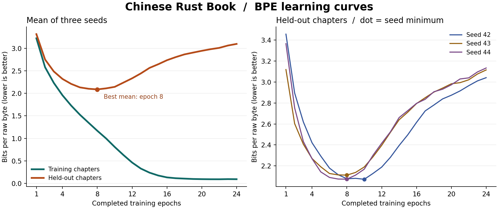

# 中文 Rust 语料上的 BPE 学习曲线

在单张 RTX PRO 6000 Blackwell 上，三个种子的平均验证分数在**第 8 遍**最低，为 **2.0874 bits/原文字节**。从第 9 遍起，平均验证分数逐遍升高，直到第 24 遍达到 **3.0968**。同期训练分数从第 8 遍的 1.1689 降到第 24 遍的 0.0942。模型对读过的章节预测得更准，对留出章节的预测却变差，符合在这份小语料上过拟合的表现。

同一个种子从头连续训练 24 遍，每遍结束用当前权重分别评估全部训练和留出章节。下表给出三个种子的算术平均，分数越低越好。训练耗时按种子平均，扣除逐遍评估的时间。

| 已训练遍数 | 训练 bits/原文字节 | 验证 bits/原文字节 | 累计训练秒数 |
| ---: | ---: | ---: | ---: |
| 4 | 1.9563 | 2.3193 | 44.4 |
| 7 | 1.3465 | 2.1014 | 77.1 |
| **8** | **1.1689** | **2.0874** | **88.1** |
| 9 | 1.0002 | 2.1101 | 99.2 |
| 10 | 0.8094 | 2.1436 | 110.3 |
| 12 | 0.4636 | 2.3335 | 132.4 |
| 24 | 0.0942 | 3.0968 | 262.2 |

逐种子应用实验前约定的规则：取验证最低点后，首次连续两遍出现“验证变差、训练改善”的第一遍。种子 42 在第 9 遍也曾短暂回升，第 10 遍又创下新低，因此仅凭一次回升会过早停止。

| 种子 | 验证最低的遍数 | 最低验证 bits/原文字节 | 连续分叉起始遍数 |
| ---: | ---: | ---: | ---: |
| 42 | 10 | 2.0722 | 11 |
| 43 | 8 | 2.1119 | 9 |
| 44 | 8 | 2.0732 | 9 |

与实验 005 逐种子核对了第 4 和 24 遍的六个采样顺序 SHA-256，全部相符。每遍完整处理 715,084 个训练原文字节、356,079 个 BPE token，做 238 次权重更新。每次验证覆盖相同的四个留出章节，共 267,047 字节。独立 GPU 重跑与 005 的六个验证分数有小幅差异，最大绝对差为 0.0469 bits/原文字节。报告里的最低点由本次验证集选出，适用范围为这本书、这套训练配置和三个种子。用其他语料选定停止时机后，可在另留的测试集上评估最终模型。

[72 条逐种子逐遍观测（CSV）](epochs.csv) · [均值、拐点与 005 复核差值（JSON）](summary.json) · [GPU 与运行环境](environment.json) · [复现训练、用现有数据重画或换用自己的语料](../../README.md) · [训练与判读协议的代码版本](https://github.com/CaptainGreenskin/one-gpu-lm/commit/ca4abc2)
