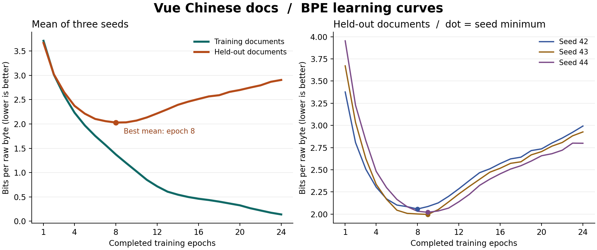

# Vue 中文文档复验：第 8 遍验证均值最低，第 9 遍开始分叉

把 Rust 书换成 Vue 官方中文文档后，中文 BPE 再次在第 8～10 遍出现过拟合迹象。用训练前固定的规则，种子 42 从第 9 遍起连续两遍验证变差、训练改善；种子 43 和 44 都从第 10 遍开始。三个种子的平均曲线在第 8 遍达到最低点（2.0299 bits/原文字节），从第 9 遍到第 24 遍验证均值逐遍升高。验证均值在第 8、9 遍只差 0.0037，两个种子的单独最低点实际都在第 9 遍。

| 同一组种子 42 / 43 / 44 | Rust（006） | Vue（007） |
| --- | ---: | ---: |
| 每遍训练原文字节 | 715,084 | 679,992 |
| 每遍 BPE token / 更新步数 | 356,079 / 238 | 404,892 / 226 |
| 平均验证曲线的最低遍数 | 8 | 8 |
| 平均曲线的持续分叉起点 | 9 | 9 |
| 各种子的验证最低遍数 | 10 / 8 / 8 | 8 / 9 / 9 |
| 各种子的持续分叉起点 | 11 / 9 / 9 | 9 / 10 / 10 |

两套语料各自回答的是在其留出文档上的停止区间。Vue 每遍原文字节少约 4.9%，但同一词表编码后的 token 数多 13.7%。种子沿用同一组编号，每套语料在各自文档上洗牌。此次只改变了语料与相应文档划分，未单独拆分主题、文体、验证难度或数据规模的影响。[Rust 逐遍结果](../../../006-bpe-epoch-curve/results/2026-11-05/)

| Vue 训练遍数 | 训练 bits/原文字节 | 留出 bits/原文字节 | 平均训练秒数 |
| ---: | ---: | ---: | ---: |
| 4 | 2.2340 | 2.3732 | 41.8 |
| **8** | **1.3728** | **2.0299** | **83.4** |
| 9 | 1.1966 | 2.0337 | 93.8 |
| 10 | 1.0244 | 2.0703 | 104.1 |
| 12 | 0.7166 | 2.2172 | 125.2 |
| 24 | 0.1389 | 2.9060 | 251.0 |

分数越低越好。从第 8 遍练到第 24 遍，平均每个种子多用 167.6 秒训练时间，训练章节分数进一步下降，留出文档分数却明显上升。计时只覆盖权重更新循环，每遍另外对训练和验证全文评分。三个种子各完成 24 遍，共 72 个观测，已逐遍验证原文字节数、token、更新步数，并独立重建洗牌顺序核对全部 72 个 SHA-256。

训练和验证分别有 60、20 篇文档，每遍验证同样的 187,227 个原文字节。固定边界的完整片段在两组之间有 0 个完全重复；Vue 与实验用 Rust 及维基数据也有 0 个相同的完整片段。这项核验覆盖精确重复，无法识别改写或部分重合。此结论适用于两套小型技术文档和同一套从零训练配置。事后定位的拐点可以帮助设置验证频率；部署自动早停还需要单独的测试文档评价所选 checkpoint。

[全部 72 条逐遍观测](epochs.csv) · [按种子与均值汇总](summary.json) · [固定的数据清单](manifest.json) · [环境](environment.json) · [换用自己的文档和复现命令](../../README.md) · [训练前固定的协议](https://github.com/CaptainGreenskin/one-gpu-lm/commit/7f3735e)
