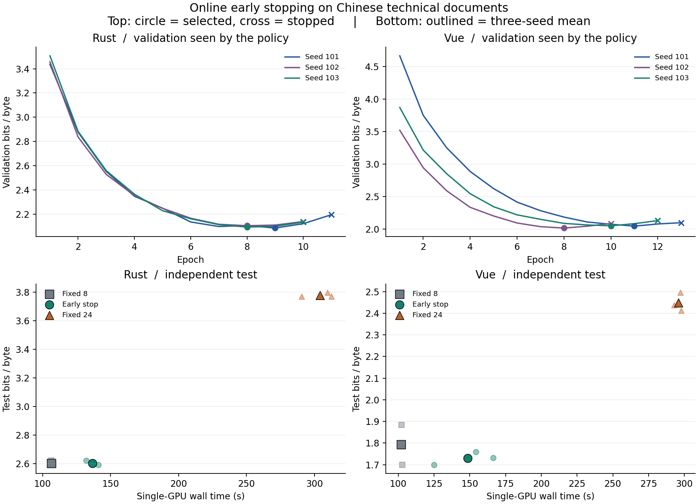

# 独立测试结果：比固定 24 遍省约一半卡时，比固定 8 遍更慢

在单张 RTX PRO 6000 Blackwell 上，在线早停相对固定 24 遍，Rust 节省 **55.0%** 卡时，Vue 节省 **49.8%**，两套新测试文档的分数都更好。与事先依据 006/007 选出的固定 8 遍比较，早停分别多用 **28.3%** 和 **45.5%** 卡时。Rust 测试分数几乎相同，Vue 测试平均改善 **0.0624 bits/原文字节**。早停的代价包含观察验证走势多跑的遍数。



| 语料 | 策略 | 平均单卡占用秒数 | 独立测试 bits/原文字节（越低越好） |
| --- | --- | ---: | ---: |
| Rust 附录 | 固定 8 遍 | 106.6 | 2.6020 |
| Rust 附录 | 在线早停 | 136.7 | 2.6019 |
| Rust 附录 | 固定 24 遍 | 304.2 | 3.7802 |
| Vue 教程 | 固定 8 遍 | 102.1 | 1.7931 |
| Vue 教程 | 在线早停 | 148.5 | 1.7307 |
| Vue 教程 | 固定 24 遍 | 295.9 | 2.4485 |

下表按同语料、同种子配对。时间取单次平均节省量，正数代表早停更快；分数差为早停减基线，负数代表早停预测更准。

| 早停对照 | 平均节省秒数 | 平均测试分数差 | 三个配对的分数差范围 |
| --- | ---: | ---: | ---: |
| Rust 对固定 8 遍 | −30.2 | −0.0001 | −0.0003 至 0.0000 |
| Rust 对固定 24 遍 | +167.4 | −1.1783 | −1.2056 至 −1.1485 |
| Vue 对固定 8 遍 | −46.5 | −0.0624 | −0.1513 至 0.0000 |
| Vue 对固定 24 遍 | +147.4 | −0.7178 | −0.7960 至 −0.6784 |

三个种子 101、102、103 的 **实际停机遍数 / 保留权重遍数** 在 Rust 上分别为 **11/9、10/8、10/8**，在 Vue 上分别为 **13/11、10/8、12/10**。与固定 8 遍比较，Rust 有两个种子选回相同权重并得到相同测试分数；Vue 有一个种子如此。四组比较均满足预先定义的实用标准，即每组三个种子的测试退化都不超过 +0.05 bits/字节。此结果描述这两份文档与三个种子。

测试由 6 篇 Rust 技术附录（37,688 字节）和 15 篇 Vue 交互教程（25,906 字节）组成，全部在 006/007 的训练和验证范围之外。逐遍重放规则得到相同的停止与选择；每个配对在公共训练前缀的采样哈希相同，逐遍末批损失最大绝对差为 0。18 个训练子进程实际累计占卡 **54 分 42 秒**。测试阶段含锁定哈希核验与独立评分，另用 **9.9 秒**。在测试输入交给评分程序前已公开 18 份选择及权重摘要。[训练前的规则](https://github.com/CaptainGreenskin/one-gpu-lm/commit/9d05daa) · [评分前公开的锁定记录](https://github.com/CaptainGreenskin/one-gpu-lm/commit/27a6419d3cb9a3c486870687eb27aa5ae17980b9)

[18 项实测 CSV](runs.csv) · [逐种子差值](paired.csv) · [逐文档测试分数](test-scores.json) · [汇总 JSON](summary.json) · [复现命令](../../README.md)

只用公开记录重算统计和出图（需 Python 3.10+ 及 Matplotlib，无需权重或 GPU）：

```bash
exp=experiments/008-online-early-stop
python "$exp/report.py" "$exp/results/2026-11-05" --out runs/008-replot
```
