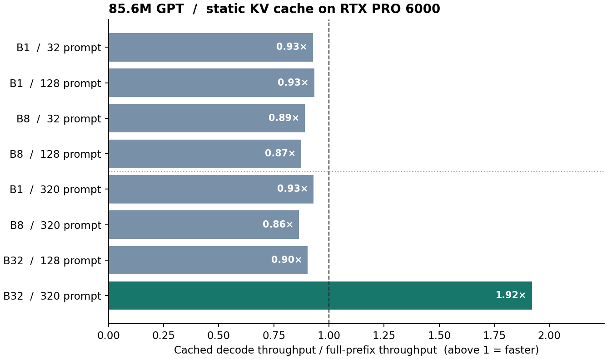

# 单卡训练、部署与 7B 容量实测

RTX PRO 6000 Blackwell 单卡完成了两项验收。第一项把 008 真实训练并独立测试的 **85,596,576 参数**模型从 checkpoint 导出为带分词器和校验信息的可加载模型包，实际启动 HTTP 续写服务并测量推理性能。第二项用 **7,013,068,800 个随机初始化参数**独立压测训练容量。部署与推理数据来自第一项，7B 的数据来自第二项。

## 7B 能更新多少参数？

| 7B 训练方式 | 参与更新的参数 | PyTorch 峰值分配 | 热身后 token/s | 四个更新步 |
| --- | ---: | ---: | ---: | ---: |
| BF16 主干，QKV LoRA + AdamW | 4,194,304 | 13.73 GiB | 2,366 | 均完成 |
| BF16 全参数，Adafactor | **7,013,068,800** | **26.82 GiB** | **507** | 均完成 |

7B 配置为 32 层、隐藏宽度 4096、32 个头、MLP 宽度 18048、共享输入与输出嵌入。两组均为一张卡、微批量 1、128 个 token，无 CPU 卸载；各加总后三步的 384 个 token 除以实际耗时，首步单列。全参数组所有参数张量都收到梯度，检查的权重元素确实发生了改变。该结果检验短序列、随机权重、合成输入下的容量与瞬时吞吐；长上下文、长期数值稳定性、真实语料质量和指令能力需要各自的实验。更换回 008 的 FP32 参数、梯度和 AdamW 两份状态，7.013B 参数仅这四项约需 104.5 GiB。[全参数逐步记录](full-adafactor.json) · [LoRA 逐步记录](lora-adamw.json)

## 训练到可调用模型

流水线采用预先选定的 Vue / 种子 101 / early 权重。它在第 13 遍实际停机，第 11 遍为保留权重。模型有 12 层、每层 12 个头、隐藏宽度 768、上下文上限 384 个位置。三种子的早停训练更新吞吐在 Rust 上为 29,835、Vue 上为 35,129 BPE token/s；加入初始化、验证、保存及退出开销后分别为 26,909、31,804 token/s。并行处理整批训练位置与自回归解码是不同工作负载，各自按实读或实生成 token 计量。[训练吞吐](training-perf.json) · [008 的测试与权重选择](../../../008-online-early-stop/results/2026-11-05/)

模型包记录权重和分词器的哈希，权重保存在工作站。CUDA 进程在本机回环地址实际启动，健康检查通过，HTTP 续写请求返回 200 并生成 8 个 token，超出上下文的请求返回 400。单次观测的启动至健康检查为 2.91 秒，首次续写端到端 0.398 秒。验收后该进程已结束，复现命令可启动持续服务。[模型包清单](bundle.json) · [HTTP 验收](http.json)

## KV cache 什么时候更快？

固定同一组输入，每组再测 32 个解码步。表中是五次热身后测量的中位数，token/s 按整个批次计。首段提示处理耗时与显存另见原始记录。上半表为预先安排的四组；看到短上下文的缓存均较慢后，追加下半表，检验更长的前缀与更大批次。

| 批大小 | 提示 token | 全前缀重算 token/s | 静态缓存 token/s | 缓存 / 重算 |
| ---: | ---: | ---: | ---: | ---: |
| 1 | 32 | 286 | 265 | 0.93× |
| 1 | 128 | 285 | 266 | 0.93× |
| 8 | 32 | 2,268 | 2,020 | 0.89× |
| 8 | 128 | 2,301 | 2,011 | 0.87× |
| 1 | 320 | 287 | 267 | 0.93× |
| 8 | 320 | 2,276 | 1,968 | 0.86× |
| 32 | 128 | 8,993 | 8,129 | 0.90× |
| **32** | **320** | **4,354** | **8,366** | **1.92×** |

在最后一组，PyTorch 峰值分配从 457 MiB 增至 803 MiB，首次处理提示从 6.65 ms 增至 7.77 ms。收益出现在后续解码。较小工作负载下，当前逐层写入缓存的 PyTorch 实现更慢；这组计时本身无法分解每项开销。HTTP 入口逐请求串行服务，批大小 8/32 是设备基准，并非 HTTP 并发压测。

正确性对照覆盖一段提示、多 token 后缀、逐 token 增量解码及缓存位置偏移。在相同的两行输入（每行 42 个位置）上，CPU FP32 最大 logit 绝对差为 0.00000572；GPU BF16 最大差为 0.125，84 个位置的首选 token 都一致。一个提示下的 24 个贪心续写 token 也全部相同。[初始推理记录与一致性核验](inference.json) · [追加四组记录](extended.json) · [源码及部署步骤](../../README.md)
