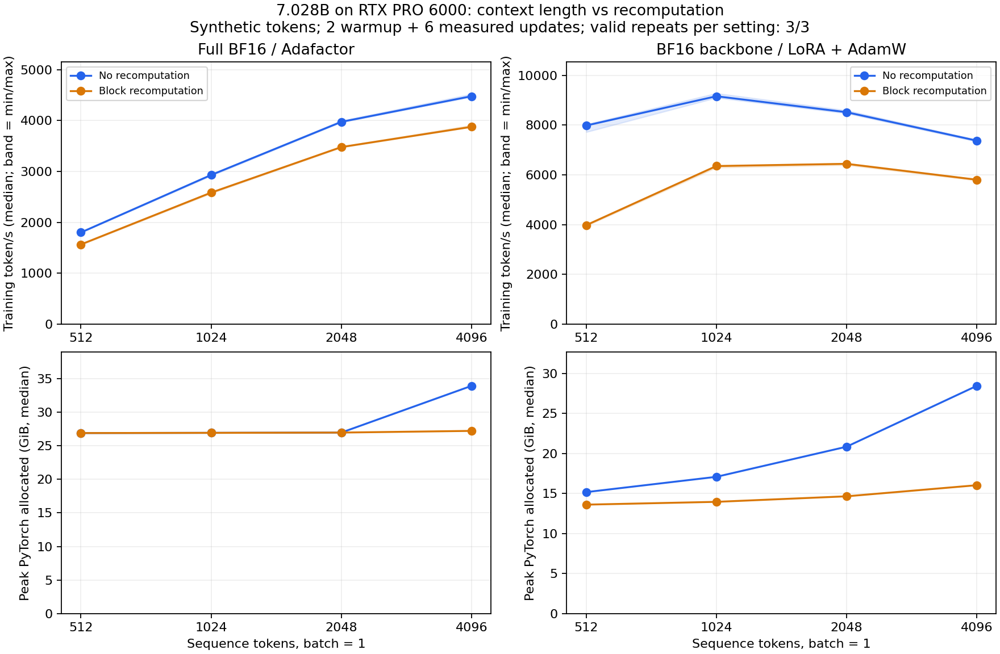

# 010 · 7B 上下文与重算实测

同一随机初始化的 7,028,273,152 参数 GPT，batch 1，合成 token。表格仅纳入通过数值与输入审计的完整配对，报告进程重复中位数。

完成状态：`completed`；记录 48 个进程，状态 `{'ok': 48}`，有效配对 24/24。
实际起止（UTC）：2026-11-09T03:30:53.755165+00:00 至 2026-11-09T03:36:48.221742+00:00；总计 354.5 秒。

| 更新方式 | 长度 | 重算 | 完整配对 | token/s | 峰值 allocated GiB |
| --- | ---: | --- | ---: | ---: | ---: |
| full-adafactor | 512 | 关 | 3 | 1800.1 | 26.90 |
| full-adafactor | 512 | 开 | 3 | 1564.3 | 26.90 |
| full-adafactor | 1024 | 关 | 3 | 2930.3 | 26.93 |
| full-adafactor | 1024 | 开 | 3 | 2583.5 | 26.93 |
| full-adafactor | 2048 | 关 | 3 | 3975.1 | 26.97 |
| full-adafactor | 2048 | 开 | 3 | 3479.3 | 26.97 |
| full-adafactor | 4096 | 关 | 3 | 4479.4 | 33.92 |
| full-adafactor | 4096 | 开 | 3 | 3877.6 | 27.22 |
| lora-adamw | 512 | 关 | 3 | 7984.5 | 15.17 |
| lora-adamw | 512 | 开 | 3 | 3974.5 | 13.61 |
| lora-adamw | 1024 | 关 | 3 | 9162.9 | 17.08 |
| lora-adamw | 1024 | 开 | 3 | 6354.3 | 13.96 |
| lora-adamw | 2048 | 关 | 3 | 8520.7 | 20.84 |
| lora-adamw | 2048 | 开 | 3 | 6443.6 | 14.65 |
| lora-adamw | 4096 | 关 | 3 | 7376.6 | 28.44 |
| lora-adamw | 4096 | 开 | 3 | 5804.4 | 16.03 |

最高已测长度的取舍（两侧分别取中位数）：

- `full-adafactor`，4096 token：重算使峰值 allocated 降低 19.8%，训练吞吐降低 13.4%。

- `lora-adamw`，4096 token：重算使峰值 allocated 降低 43.6%，训练吞吐降低 21.3%。

这是 batch 1 下的实测范围，不能当成显卡的最大上下文或最大 batch。是否开启重算，应按实际显存余量与吞吐取舍。

配对最大逐步 loss 差 0；最大梯度范数相对差 0。两种实现均有所有可训练参数的梯度和可测参数改动。

硬件采样 174 条，目标间隔 2 秒。
温度最高 64 °C，采样功率最高 552.4 W。这些值覆盖进程初始化和间隙，不只是更新步骤。

原始进程 JSON、配对审计 `summary.json`、扁平表 `runs.csv`、设备采样 `telemetry.csv` 与源码 SHA-256 `sources.json` 一并公开。峰值 allocated 不含驱动/其他进程，设备采样是离散点，不替代分配器峰值。耗时包含检查与裁剪，未包含合成数据生成与上传。

短测重复的范围不是统计置信区间。BF16 参数与 Adafactor 没有 FP32 主权重；本结果不证明该精度方案长训稳定，也不代表现成 7B 架构的吞吐。没有把随机模型作为中文能力模型发布。

复现与重画见[实验入口](../../README.md)。

首批未启用确定性算法的测量在数值审计失败后中止，整批排除在上述结果之外。[失败记录与修订说明](aborted-nondeterministic/) 保留原始协议和指标。
