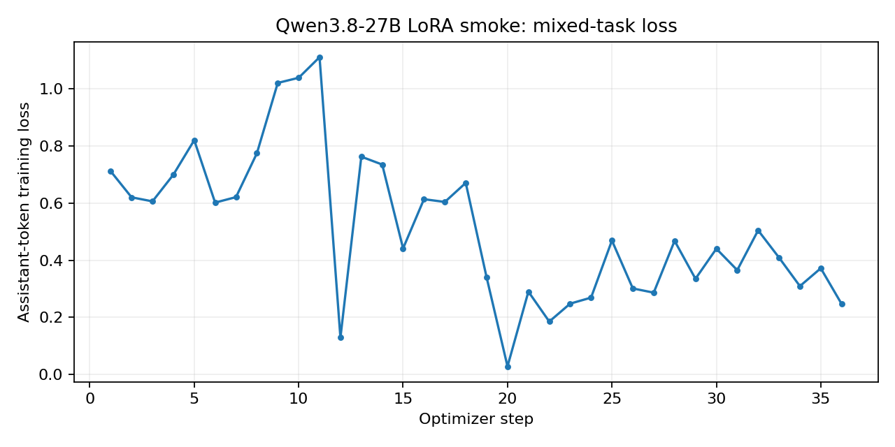

# Coding pilot result

This is a **pipeline smoke test**, not a coding benchmark or evidence of state-of-the-art ability.

- Base: `Qwen/Qwen3.8-27B` at `37561816e66b5b9153b1b64c10968c18c1e6f4a0`.
- Actual UTC interval: 2026-11-09T06:33:05.067441+00:00 to 2026-11-09T06:40:17.948807+00:00; 432.9 s total.
- Parameters: 27,356,728,560; trainable: 58,363,904.
- Training: 36 updates, 80.2 s, peak allocated 52.38 GiB.
- Sequence lengths actually used: 71–127; profile maximum is only a limit, not tested context capacity.
- 18 private training tasks; 9 held-out tasks; single seed.
- Same prompt, greedy decoding and generation budget before/after. A task passes only if all its cases pass in the offline sandbox.

| Language | Base | LoRA |
| --- | --- | --- |
| cpp | 3/3 | 2/3 |
| javascript | 3/3 | 2/3 |
| python | 3/3 | 3/3 |

Improvements: 0; regressions: 2. Small, simple fixtures can saturate and are not representative of repository work. This run does not establish a quality improvement and does not qualify the adapter as a daily-use model. Test results were not used for gradient updates, early stopping or choosing a checkpoint. Training uses the predeclared 2 epochs.

A separate saved-adapter on/off diagnostic rechecked 2 regressed tasks: enabled 0 passed; disabled 2 passed. It made no training updates. See [control.json](control.json) for exact output reproduction checks and its separate timing. This is a diagnosis of this run, not an independent final holdout.

Frozen parameter sample unchanged: `True`; frozen gradients absent: `True`; adapter changed: `True`; save/reload greedy ID equality: `True`. The frozen sample check is not a full hash of all frozen parameters.

The curve mixes different training tasks and is not a validation/generalization curve. Cold compilation and startup costs are included where incurred; generation timings are end-to-end single requests, not separate TTFT/steady-state decode measurements. See `curve.json`, `baseline.json`, `adapted.json`, `environment.json`, `loading.json`, `source.json` and `telemetry.csv` for evidence. Input provenance and hashes are in [DATA_CARD.md](DATA_CARD.md); limitations and loading identity are in [MODEL_CARD.md](MODEL_CARD.md).

Rebuild these artifacts: `python -m training_lab.report --run <this-directory>`. Raw tasks, generated code and adapter weights remain private; hashes alone do not make this exact run independently reproducible. The public harness accepts the documented input contract so other users can run their own authorized tasks.
