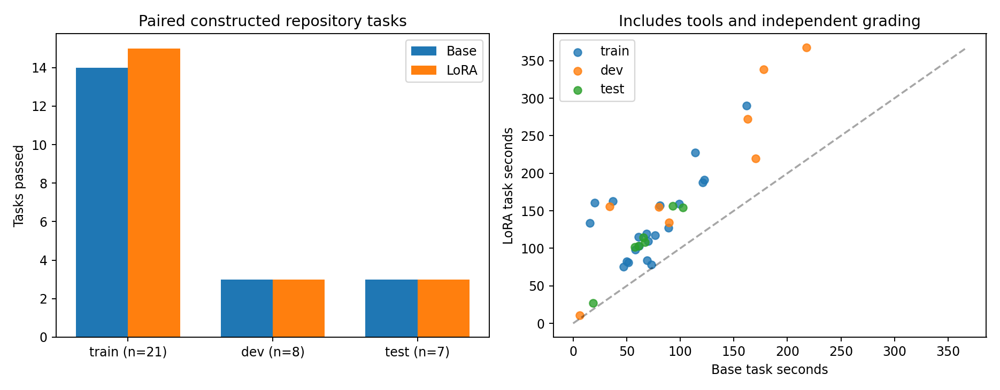
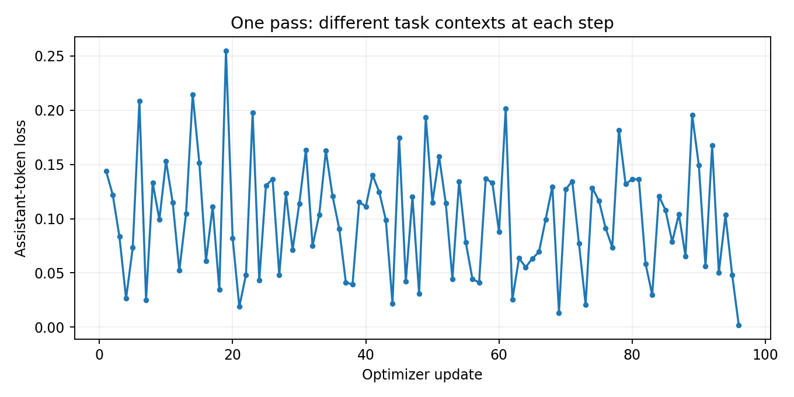

# 012 · Repository agent / controlled posttraining

Does not pass the predeclared screening gate; retain the unmodified base as the candidate reference.

These are **constructed defects in real repositories**, not historical issue results, SWE-bench scores or evidence of advanced general coding ability. Training/dev/test repositories and task families are disjoint for this experiment; upstream exposure during the base model's pretraining is unknown. Tests are visible, and the grader reruns the declared upstream test scope from a fresh copy. There is no additional secret test suite.

| Partition | Base | LoRA | Improved | Regressed |
| --- | --- | --- | --- | --- |
| train | 14/21 | 15/21 | 2 | 1 |
| dev | 3/8 | 3/8 | 0 | 0 |
| test | 3/7 | 3/7 | 0 | 0 |

Legacy function fixtures: 9/9 → 9/9. Gate details and every paired task are in [summary.json](summary.json). Train scores describe the supervision source, not generalization. Dev results are diagnostic; test results did not select examples, hyperparameters or a checkpoint. One seed and only 7 final tasks across two repositories cannot establish a broad capability gain.

## Actual execution

- Baseline UTC: 2026-11-09T09:17:21.066140+00:00 — 2026-11-09T10:06:39.320996+00:00.
- Candidate campaign UTC: 2026-11-09T10:14:58.850781+00:00 — 2026-11-09T11:43:12.204454+00:00.
- One LoRA pass: 96 updates, 208.3 update seconds, 6,280 supervised tokens; peak allocated 67.63 GiB.
- Selected supervision: 96 records covering 12/21 admitted training tasks; 49 excluded by frozen size/example budget. Kinds: `{"verified-local-base-trajectory": 96}`. Records include inspection and test commands, not only code repairs; record count is not the number of distinct solved tasks.
- Recovery at completed steps: `{"adapted": [{"calls": 12, "generated_tokens": 1181, "id": "boltons-slugify", "passed": true}], "base": [{"calls": 12, "generated_tokens": 1152, "id": "boltons-slugify", "passed": true}]}`. Independent deterministic continuous/restart contracts are recorded in the preflight receipts. This does not cover arbitrary mid-command crashes or context compression.
- Sampling: 1964 GPU readings every nominal 5 s; maximum gap 5.29 s; 0 gaps above 10 s. Observed peak 74 °C, 93561 MiB used, 562.1 W. Monitoring includes setup and the invalidated interface probe; it is not a training-only utilization benchmark.

Task time covers controller initialization through fresh grading; it excludes initial snapshot preparation and model loading. Generation and agent-tool durations are measured separately; the residual combines fresh grading with controller/RPC/checkpoint overhead and recovery pauses, because this run did not retain a separate final-grading wall timer. Model calls, generated tokens, grading outcomes and exit status are separate fields. A valid patch may pass after the call budget is exhausted; successful self-reported tests alone never count. Cold compilation and filesystem/kernel cache effects are included where incurred and were not independently controlled. Commands run sequentially on one GPU backend; these are not isolated serving TTFT, continuous-batching throughput or concurrency benchmarks.

This is assistant-token loss on different training contexts, **not a validation learning curve**. Frozen sample unchanged: `True`; frozen gradients absent: `True`; adapter changed: `True`; save/reload exact greedy IDs: `True`. The frozen sample check is not a whole-model hash.

## Scope, changes and reuse

Forty task controls admitted 36 tasks before formal model evaluation. Rejected tasks and narrow test-scope exclusions are disclosed in the protocol and admission receipts. `baseline-001` was stopped as an integration probe after only training-partition outputs: native Qwen XML tool syntax and a shared-UID thread limit required adapter/runtime fixes. Both formal campaigns use the same corrected code and budgets. The invalidated probe supplied no training examples or quality scores.

Source identities and file notices remain separate from the project's MIT orchestration license. No raw source corpus, task answers, trajectories, generated code or adapter weights are published. This report is not a ModelScope release or a legal clearance of upstream pretraining data. Private artifacts retain their applicable source notices.

Hashes alone do not make the private task corpus independently reproducible. Other users can run their own authorized tasks with [repo_lab](../../../../repo_lab/) and compare the same receipt formats. A future base must rerun this suite and new holdouts; changing a model ID alone does not validate loader, template, action parser, adapter target layers or inference performance.

Rebuild: `python -m repo_lab.report --run THIS_DIRECTORY`. Inputs and generated artifacts are allowlisted in `artifacts.json`.

## Action-interface audit

base: `{"no_supported_action": 4, "truncated_at_generation_limit": 3, "unsupported_or_malformed_parameter": 14, "unsupported_tool_name_case": 3}`.

adapted: `{"no_supported_action": 2, "other_unsupported_native_action": 1, "truncated_at_generation_limit": 6, "unsupported_or_malformed_parameter": 6}`.

These are heuristic interface categories. They distinguish missing actions, case/parameter mismatch and generation truncation; they do not assign all failures to the underlying coding model. See [action-audit.json](action-audit.json).
