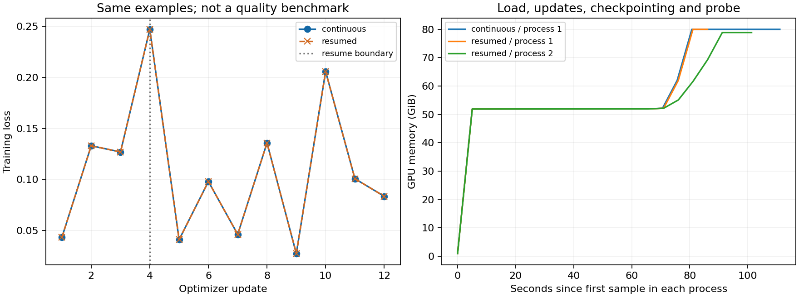
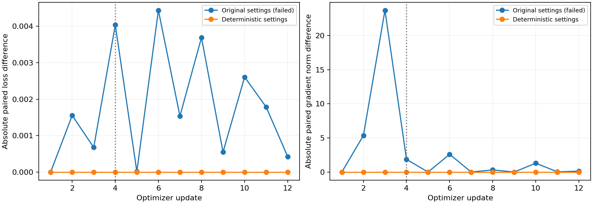

# 013：27B 单卡训练基础设施验收

恢复对照：**通过**。连续 12 步与第 4 步退出、换进程续到 12 步配对。这里只验收训练状态与运维链路，不据此宣称编码能力提高。



| 项目 | 连续训练 | 换进程恢复 |
| --- | ---: | ---: |
| 更新数 | 12 | 12 |
| 更新用时（秒） | 24.883 | 26.635 |
| 各进程墙钟之和（秒） | 188.328 | 336.694 |
| 更新阶段峰值 allocated（GiB） | 66.703 | 66.703 |
| 更新阶段峰值 reserved（GiB） | 79.039 | 79.037 |

连续训练北京时间 2026-11-09 21:33:21 至 2026-11-09 21:36:30；恢复组 2026-11-09 21:36:32 至 2026-11-09 21:42:10。墙钟包含预检、模型加载、保存和探针，更新用时只统计前向、反向及优化器更新。

可训练参数 58,363,904，底座冻结。两组都使用同一 12 条样本顺序，共输入 22,117 token、监督 559 token。不同步骤的样本不同，loss 折线不能解释为同一验证集的学习曲线。

## 恢复检查

Adapter 最大绝对误差 0；adapter 字节级状态一致：True；优化器字节级状态一致：True；逐步 loss 完全相同：True。

| 检查 | 结果 |
| --- | --- |
| `adapter_numerically_equal` | 通过 |
| `per_step_losses_equal_within_tolerance` | 通过 |
| `sample_order_equal` | 通过 |
| `steps_equal` | 通过 |
| `saved_reload_probes_pass` | 通过 |
| `final_greedy_probe_equal` | 通过 |
| `loaded_optimizer_rng_and_adapter_match_checkpoint` | 通过 |
| `final_optimizer_state_equal_within_tolerance` | 通过 |
| `final_rng_state_exact` | 通过 |

恢复位置：[4]。容差预先固定：adapter/loss atol=1e-7、rtol=1e-6；优化器 atol=1e-10、rtol=1e-6。原始 [comparison.json](comparison.json) 保留具体判定。

## 硬件采样

| 组 / 进程 | 样本 | 采样错误 | 最大间隔秒 | 温度峰值°C | 功率峰值W | 显存峰值GiB |
| --- | ---: | ---: | ---: | ---: | ---: | ---: |
| continuous / 1 | 23 | 0 | 5.11 | 46 | 542.77 | 79.987 |
| resumed / 1 | 18 | 0 | 5.39 | 47 | 542.24 | 79.985 |
| resumed / 2 | 21 | 0 | 5.24 | 46 | 544.01 | 78.870 |

每 5 秒采样一次，包含加载、训练、保存和探针。预检和进程间停机不在采样区间；各进程首末时间、覆盖时长和均值见 [summary.json](summary.json)，原始记录见两组 `telemetry.csv`。它不是满载性能基准或长时间稳定性测试。

## 检查点与环境

两个训练组各保留 4 个完整检查点（含第 0 步）。连续组占用 2.177 GiB，恢复组占用 2.177 GiB；具体大小见 [checkpoint-storage.json](checkpoint-storage.json)。

独立 Python 3.10 环境安装与 pip check 通过；61 包版本见 [environment.lock.txt](environment.lock.txt)。43 项 CPU/Linux 检查通过。完整版本约束根据这次实际安装生成，并做离线解析核对；未声称对加约束后的脚本再次执行了全新下载安装。

## 已有函数回归

- base: 9/9。
- adapted: 9/9。

这些是已有的九道回归题，非新的独立测试，不能用于日用模型晋升。生成文本、任务原文与权重均未公开。

## 失败和复现范围

正式配对前两次预检拒绝：一次为依赖名称规范化问题，一次为旧 venv 中同名包的遮蔽识别问题；均未执行优化器更新。随后使用独立 venv，安装时的网络中断另留记录。失败、修复与后续尝试见 [integration.json](integration.json)。数值阈值、训练数据、步数预算未因失败而调整。

初次完整 GPU 配对也未通过：[失败比较](failed-pairs/recovery-v3/comparison.json)。初始 adapter、优化器、随机状态相同，第一步前向 loss 相同，但第一步梯度范数已经不同；第 2 步起 loss 分叉，发生在第 4 步中断之前。恢复加载的三个状态指纹仍全部匹配。因此这次失败首先揭示了非重复的训练计算，不能归为丢失优化器或样本顺序。

随后启用 PyTorch/cuDNN 确定性算法、固定 cuBLAS workspace、关闭 TF32，在新 run 中重做完整配对。数据、更新数、学习率和数值阈值均未改变；执行代码和数值设置身份改变并分别保留。未做单一开关消融，也没有确认具体上游内核缺陷，不能把修复归因于某一个开关。设置依据见 [PyTorch 确定性算法说明](https://docs.pytorch.org/docs/main/generated/torch.use_deterministic_algorithms.html)。



实际仅验证完整更新边界的进程退出和恢复；未宣称任意内核中断、整机断电、远程文件系统或多卡可恢复。CPU 另覆盖半写入、损坏/不兼容检查点和互斥锁。

从 [固定协议](../../protocol.json)、[运行手册](../../../../docs/27b-training.md) 和 [代码提交回执](launch.json) 复现。原数据为私有有来源的训练分区，外部读者需要按数据契约准备自己有权使用的记录，因此本公开包不支持逐样本完全重算。

```bash
python experiments/013-training-infrastructure/report.py \
  --results experiments/013-training-infrastructure/results/2026-11-09
```

报告生成需要 matplotlib；原始 JSON/CSV 的核对不依赖 GPU。公开包仅包含白名单证据，模型、adapter、优化器、数据和原始日志均保留在私有目录。
