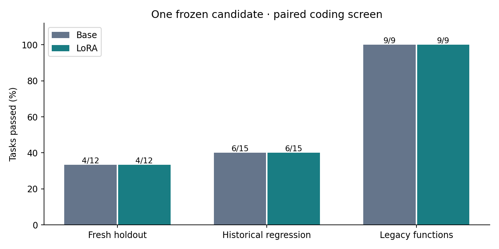
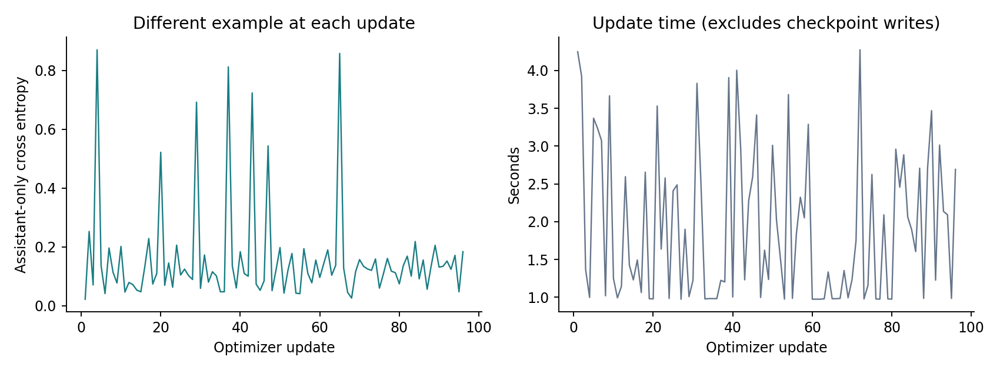

# 014 · Task-balanced 27B coding quality screen

**Does not pass the preregistered screen. Retain the unchanged base; do not promote this adapter.**

| Scope | Base | LoRA | Improved | Regressed |
| --- | --- | --- | --- | --- |
| New repository holdout | 4/12 | 4/12 | 0 | 0 |
| Historical regression | 6/15 | 6/15 | 0 | 0 |

Legacy function regression: 9/9 → 9/9. Every pair and gate is in [summary.json](summary.json); the rule was fixed in [protocol.json](protocol.json) before any model rollout.

These are constructed defects in pinned real OSS repositories, not historical issues or SWE-bench scores. The two fresh repositories did not enter posttraining; base pretraining exposure is unknown. Tests are visible. The grader checks allowed source changes against a fresh snapshot; no additional hidden test suite is claimed. The 15 previously observed dev/test tasks are explicitly historical regression, not fresh evidence. One seed and two small repository clusters cannot establish broad coding or long-task quality.

## Failure analysis

New-repository breakdown: JMESPath 0/6 → 0/6; stable JSON serialization 4/6 → 4/6.

The base / candidate had 6 / 8 `RepeatedFormatError` exits and 1 / 1 context-limit exits. Rejected outputs include missing command-parameter wrappers and unclosed tool-call markup; these are structural observations, not counterfactual successful repairs. The base / candidate had 17 / 17 nonzero final regression commands. The sandbox's raw `runtime_error` label includes ordinary nonzero test exits; it is not a count of GPU or controller crashes.

The [post-run audit](failure-audit.json) uses the frozen parser and exports categories and hashes only. It does not execute rejected commands, relax the parser, rerun tasks, or change scores. Interface/format and context failures limit what this screen says about latent coding ability. A future isolated interface/context experiment is a hypothesis, not evidence that those changes will solve the failed tasks. These now-observed holdout tasks must become historical regression for any further tuning.

## Training coverage and cost

The same 145 licensed source records were audited. Exactly 96 records cover 21/21 training tasks, including 7 verified reference repairs. Selection filters oversized actions and samples the full trajectories within task-balanced quotas. Task coverage alone does not mean every record is a patch; successful inspection/test actions remain in the dataset. No evaluation trace was added to training.

Frozen BF16 27B backbone, 58,363,904 trainable LoRA parameters; 96 updates, 7,665 supervised tokens, 183.5 update seconds. Total screen wall time 1.726 hours includes model loading, controls, evaluation, training and checkpoints. This is not a 27B full-parameter pretraining run. Peak training allocation 67.41 GiB; reserved 90.91 GiB. Saved adapter greedy probe matched before/after reload.

Loss is on different single examples at each step in one pass; it is not a heldout loss curve or evidence of improved coding quality. The comparison with 012 is observational: sample membership, action-length filtering and the deterministic 013 runtime differ, so gains cannot be attributed to balanced selection alone.

## Evaluation cost

Both campaigns use the same greedy decoding and per-task budgets. The candidate serves an unmerged LoRA adapter; its timing includes that overhead. Base / candidate generated 18,384 / 17,742 tokens in 1607.5 / 2782.0 successful generation seconds, with 243 / 236 calls. These are sequential task measurements, not a production serving throughput benchmark. Tool time and full controller durations are separately retained in the summary; failed-request waits are not represented as successful generation time.

## Hardware and completion

Actual UTC: 2026-11-09T15:11:03.253713+00:00 to 2026-11-09T16:54:36.833933+00:00. 1232 GPU samples, 0 collection errors, maximum sampling gap 5.23 seconds; sampled peak 68 °C and 556.3 W. The separate training sampler recorded 48 samples and a 69 °C maximum. The timestamped campaign record includes evaluation and loading as well as training. Five-second sampling can miss transient memory or power peaks; allocator peaks are reported separately. Sampled GPU energy estimate 0.359 kWh linearly interpolates between recorded samples; it excludes CPU/system power and time outside the sampled span. [telemetry.csv](telemetry.csv) and per-stage durations retain the measurement scope.

Raw tasks, answers, trajectories, source snapshots, host information and weights stay private. Public artifacts contain code, frozen configuration, provenance IDs/hashes and numeric evidence. MIT applies to original project code; upstream licenses remain separate. No ModelScope weight release or daily-use quality certification is implied.
