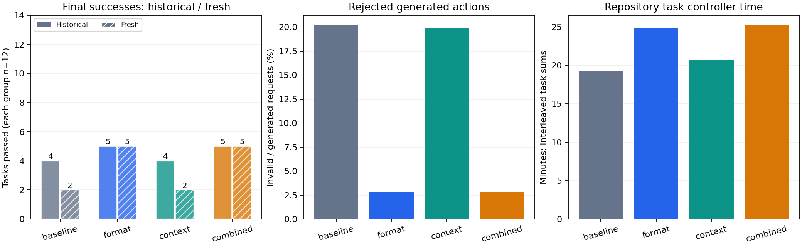
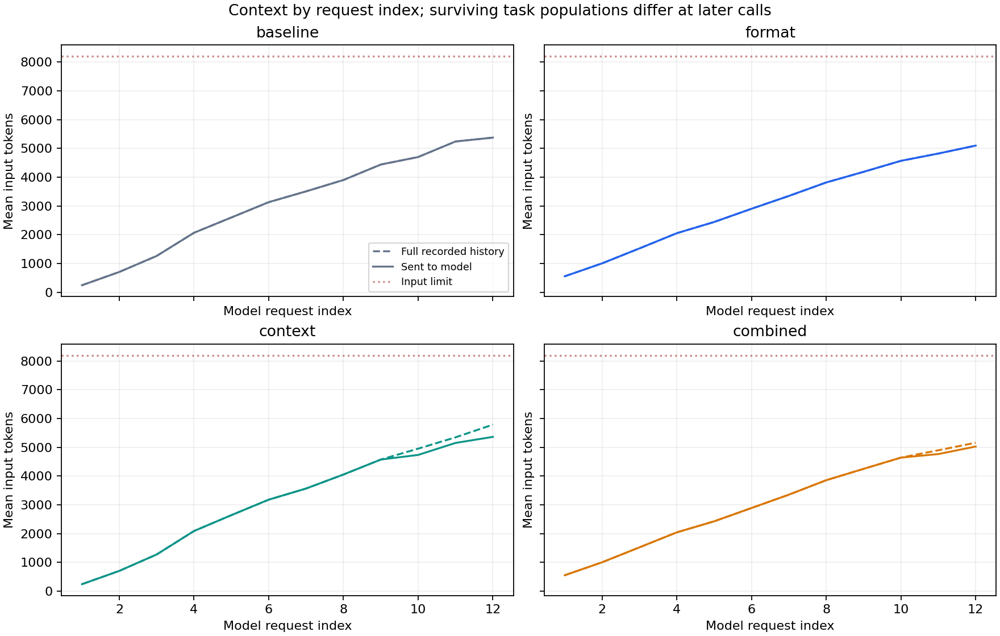

# 015 · Tool format and bounded context

**No policy passes the preregistered replication gate. No daily-use model certification is implied.**

The same unchanged Qwen27B base ran all four arms. No weights were updated. The protocol was public before any task rollout; [protocol.json](protocol.json), [preregistration.json](preregistration.json) and artifact hashes retain the identity.

| Policy | Historical | Fresh | Invalid / generated calls | Context-limit requests | Compacted generation calls | Task controller minutes |
| --- | --- | --- | --- | --- | --- | --- |
| baseline | 4/12 | 2/12 | 41/203 | 1 | 0 | 19.3 |
| format | 5/12 | 5/12 | 7/247 | 1 | 0 | 24.9 |
| context | 4/12 | 2/12 | 41/206 | 0 | 5 | 20.7 |
| combined | 5/12 | 5/12 | 7/248 | 0 | 2 | 25.2 |

Each scope has 12 tasks. Historical means the already observed 014 holdout. Fresh means 6 ItsDangerous and 6 qs constructed defects, with clean/broken/restored controls. Tests are visible; these are not historical issues or SWE-bench. Unknown pretraining exposure, two small repository clusters and one deterministic decode limit generalization. Every individual improved/regressed ID, five predeclared contrasts and the factorial interaction are retained in [summary.json](summary.json). All contrasts are reported; no post-hoc best-policy selection is hidden.

## Paired differences and repository coverage

| Contrast | Historical improvements / regressions | Fresh improvements / regressions | Fresh net gain | Task controller time change |
| --- | --- | --- | --- | --- |
| format-vs-baseline | 2 / 1 | 3 / 0 | +3 | +29.2% |
| context-vs-baseline | 0 / 0 | 0 / 0 | +0 | +7.4% |
| combined-vs-baseline | 2 / 1 | 3 / 0 | +3 | +31.0% |
| combined-vs-format | 0 / 0 | 0 / 0 | +0 | +1.4% |
| combined-vs-context | 2 / 1 | 3 / 0 | +3 | +22.0% |

Historical regressions against baseline: format: new-json-undefined; context: none; combined: new-json-undefined. A higher total does not erase an individual regression. The frozen gate requires at least two net fresh gains, no fresh regression and no historical regression.

| Repository | Role | Tasks | baseline | format | context | combined |
| --- | --- | --- | --- | --- | --- | --- |
| epoberezkin/fast-json-stable-stringify | dev | 6 | 4 | 5 | 4 | 5 |
| jmespath/jmespath.py | dev | 6 | 0 | 0 | 0 | 0 |
| ljharb/qs | test | 6 | 0 | 2 | 0 | 2 |
| pallets/itsdangerous | test | 6 | 2 | 3 | 2 | 3 |

Only 1 baseline and 1 format requests exceeded the input limit; bounded-history variants recorded 0 and 0. Context packing was used in 5 context and 2 combined generation requests. This limited exposure does not establish long-horizon robustness.

## What changed

Format supplies the pinned native chat template with one bash JSON tool schema and matching system/error instructions. The action parser and sandbox remain unchanged; no incomplete response is repaired into an executable command. This factor does not separate schema effects from prompt effects.

Context acts above 7168 actual template tokens: remove oldest complete interaction pairs toward 6144, retain system, full task and newest pair, and append an omission notice. The on-disk workspace and full private audit history persist. Same 8192 hard input limit. Losing history can harm repair quality; fewer context errors alone is not success.

The curves average requests at each call index, including recorded backend-limit failures. Later calls contain different surviving task populations, so they are descriptive rather than matched causal token curves. [call-metrics.csv](call-metrics.csv) retains every request's token counts, discarded rounds, parser outcome and generation timing. Full raw history may exceed the input limit while a packed request fits; this is expected for bounded-context arms.

## Failure and cost interpretation

Format-invalid calls include rejected generations before an agent eventually stops; repeated-format exit counts are separate. A nonzero final regression command is a failed repair, not a GPU crash. Per-arm backend errors, no-source-change failures, output-limit hits and exit categories are in the summary. Tokens per second measures successful sequential generation requests only, not production serving throughput. Task controller times include tools and grading; interleaving means they are sums, not the elapsed span of an arm. Packing time is separately recorded. Missing generation times on failed requests are not treated as zero-cost inference.

[failure-audit.json](failure-audit.json) checks every recorded response with the original parser and retains structural categories, tag-count shapes and private trace hashes. It exports no response text or commands, executes nothing, and cannot change scores. Marker-based categories are observations, not causal proof that a particular wrapper change would solve a task. Invalid responses hitting the output limit are explicitly separated from other malformed shapes.

Actual UTC: 2026-11-10T01:45:32.014394+00:00 to 2026-11-10T03:16:13.054567+00:00; total 1.511 hours. Hardware sampling: 1079 records, 0 collection errors, maximum gap 5.05s. Sampled peaks: 63C, 554.1W, 61357MiB. Sampled GPU energy approximately 0.436kWh, trapezoid interpolation excluding CPU/system power and time outside sampled coverage. Five-second sampling can miss peaks.

## Reuse and limitations

The initial environment packaging failures and their correction were recorded before model rollout in [preparation-recovery.json](preparation-recovery.json). No task or policy was selected using 015 scores. These fresh tasks become historical regression if future tuning uses their outcomes.

Reusable policies, frozen orchestration, scoring, context instrumentation and this report are in the [experiment workflow](../../README.md). Original code is MIT; upstream BSD-3-Clause/MIT rights remain separate. Raw tasks, source snapshots, answers, trajectories and model files remain private. Exact score reconstruction requires private inputs; others can run the workflow with their own authorized repositories. No ModelScope weight release occurred.
