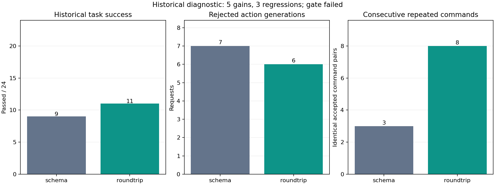
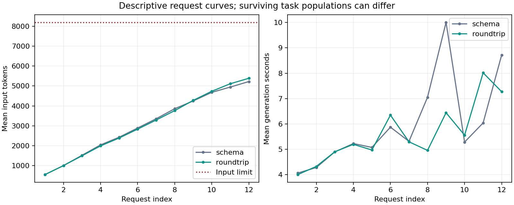

# 016 · Native tool round-trip results

**Does not meet the frozen diagnostic gate. No deployment or generalization claim.** All 24 tasks were already observed in 015. No weights were updated.

| Policy | Historical successes | Invalid / generated requests | Context-limit requests | Consecutive repeated commands | Task controller minutes |
| --- | --- | --- | --- | --- | --- |
| schema | 9/24 | 7/250 | 1 | 3 | 25.5 |
| roundtrip | 11/24 | 6/247 | 0 | 8 | 23.7 |

Paired improvements: new-json-undefined, fresh-signed-fallbacks, fresh-signed-serialize, fresh-signed-timestamp, fresh-query-plain-objects. Regressions: new-json-nonfinite, fresh-signed-url-compression, fresh-query-sort. Net gain: +2. Known target `new-json-undefined`: {'schema': False, 'roundtrip': True}. Controller time ratio: 0.928×. Every task is retained, including failures. Higher totals cannot erase individual regressions. [Paired outcome table](paired-outcomes.csv) includes each task's success, calls, generated tokens, recorded task seconds (including grading), tool seconds and previous control outcome.

| Repository | Historical tasks | schema | roundtrip |
| --- | --- | --- | --- |
| epoberezkin/fast-json-stable-stringify | 6 | 5 | 5 |
| jmespath/jmespath.py | 6 | 0 | 0 |
| ljharb/qs | 6 | 2 | 2 |
| pallets/itsdangerous | 6 | 2 | 4 |

The concurrent schema control compared with 015 format: improvements none; regressions fresh-signed-timestamp. This is a repeat-variation check, not a new randomized replicate or a best-of selection. A single greedy run can still vary with numerical/runtime behavior.

## Regression inspection

| Regressed task | Roundtrip exit | Final editable source files changed | Longest identical command streak |
| --- | --- | --- | --- |
| new-json-nonfinite | LimitsExceeded | 0 | 9 |
| fresh-signed-url-compression | LimitsExceeded | 0 | 1 |
| fresh-query-sort | LimitsExceeded | 0 | 1 |

The final editable-source state is compared with the initial defective workspace; zero does not exclude temporary edits later undone. The known target's repair is useful diagnostic evidence, but does not establish that the original failure was solely caused by message roles. Inspect new regressions and stalled progress before designing another frozen comparison. This run does not authorize automatic adoption, a new GPU run or a post-hoc change to the gate.

## Intervention and evidence

Both policies use identical native tool definitions and system/error prompts, the unchanged strict action parser, the same BF16 base and the same budgets. Roundtrip converts executed commands to assistant `tool_calls` and actual observations to `role=tool`, using the pinned template. This bundles call and result serialization. No anti-loop hint, extra calls, semantic summary or automatic action repair. Default policy remains unchanged. [Protocol](protocol.json), [public preregistration](preregistration.json), [tokenizer replay](template-roundtrip-probe.json), [failure audit](failure-audit.json) and [raw artifact hashes](raw-artifacts.json) retain provenance.

Repetition counts measure exact accepted command strings, not semantic equivalence or proven waste; legitimate repeated tests can count. The audit validates every native-turn receipt against actual executed history, without exporting commands or rerunning code. Failed grader commands indicate repair failures, not GPU crashes. [Summary](summary.json) retains errors, output limits, no-source-change failures and all paired outcomes.

Curves are descriptive means at each request index; surviving tasks can differ. Failed generation timings are missing, not zero. [Per-request metrics](call-metrics.csv) retain denominators and backend-limit failures. Controller time sums include tools and grading; interleaved arms do not have separate contiguous elapsed spans.

Actual UTC: 2026-11-10T23:26:36.824628+00:00 to 2026-11-11T00:16:38.610398+00:00; 50.03 minutes. Hardware: 596 samples, 0 collection errors, maximum gap 5.05s; sampled peaks 63C, 64165MiB and 557.8W. Sampled GPU energy 0.240kWh uses trapezoid interpolation and excludes CPU/system power; five-second sampling can miss peaks.

## Scope and reuse

These are constructed defects with visible upstream regression suites, not real issue resolution or SWE-bench. All tasks are historical, tests visible, base pretraining exposure unknown, and repository clusters small. A positive result only motivates a newly frozen independent study. [Reusable workflow](../../README.md). Original code is MIT; source/model rights remain separate. Raw tasks, source snapshots, commands, traces and model files remain private. Exact score reconstruction requires private inputs; the workflow supports others' authorized repositories. No model weights were published.
