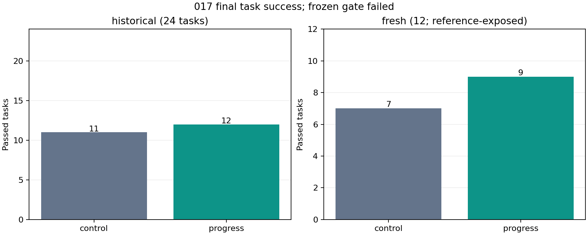
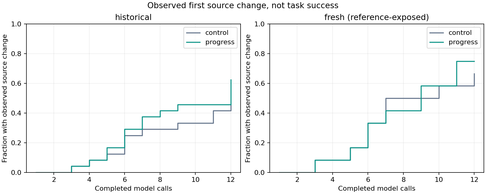

# 017 · Edit progress results

**Frozen numerical gate failed. No default policy change or deployment approval follows.** The same unchanged 27B BF16 base was used, with no weight updates. All 72 runs are retained: 24 historical and 12 fresh task pairs, with no tuning between stages. Both original fresh repositories have reference exposure, limiting the validation claim regardless of the gate result. See the [separate screened supplement](../../supplement/) for additional validation.

| Policy | Historical passes | Fresh passes | Failed without any observed edit | Reminder requests | Controller minutes |
| --- | --- | --- | --- | --- | --- |
| control | 11/24 | 7/12 | 17 | 0 | 37.2 |
| progress | 12/24 | 9/12 | 12 | 182 | 37.8 |

Passing means the independent grader accepts the final source. An agent can stop at a call or context limit and still leave passing code; its exit status and backend failures are retained separately. This is not a count of normal end-to-end agent completions.

| Exposure split | Improved pairs | Regressed pairs | Net gain |
| --- | --- | --- | --- |
| historical | 3 | 2 | 1 |
| fresh | 3 | 1 | 2 |

| Original target | control | progress | Candidate first edit call |
| --- | --- | --- | --- |
| `new-json-nonfinite` | fail | pass | 5 |
| `fresh-signed-url-compression` | fail | fail | none |
| `fresh-query-sort` | fail | pass | 12 |

| Frozen requirement | Result |
| --- | --- |
| fresh net gain | met |
| no fresh regressions | failed |
| no historical regressions | failed |
| all three targets pass | failed |

Overall task-controller time ratio 1.015×; this interleaved total includes tools and grading, not just generation. Tasks reaching the 12-call limit without any observed edit: control 17, progress 11. Within the historical split specifically, those counts are 13 and 9. All pair identities and outcomes are in [paired data](paired-outcomes.csv).

[Post-run case review](postrun-review.json): Progress reminders help some transitions from inspection to editing, but do not enforce action or ensure repair quality. Historical success rises by one net task, with two regressions; the frozen promotion gate fails.

`new-json-nonfinite`: The candidate makes its first edit on call 5 after the first reminder, passes the fresh grader, and submits on call 7. The control reaches12 calls without an edit.

`fresh-signed-url-compression`: The candidate receives reminders on calls 5 through 12 but continues inspecting/probing without a source edit. The admitted missing implementation remains and the grader fails.

`fresh-query-sort`: The candidate first edits on its last permitted call 12. The independent grader passes, despite the agent ending at its call limit. This is a repair, not an early-edit improvement.

`new-json-undefined`: The candidate first edits on call 7 versus control 11, then makes further edits and runs probes/tests. The final grader still rejects undefined-value handling in arrays. Earlier editing did not produce a correct repair.

`fresh-signed-serialize`: The candidate first edits on call 8 versus control 9, but the grader reports signing/round-trip assertion failures. Earlier editing did not produce a correct repair.

| Repository | Exposure split | Tasks | control | progress |
| --- | --- | --- | --- | --- |
| epoberezkin/fast-json-stable-stringify | dev | 6 | 5 | 5 |
| jmespath/jmespath.py | dev | 6 | 0 | 1 |
| ljharb/qs | dev | 6 | 2 | 3 |
| pallets-eco/blinker | test | 6 | 4 | 6 |
| pallets/itsdangerous | dev | 6 | 4 | 3 |
| sindresorhus/p-map | test | 6 | 3 | 3 |

These curves show the fraction ever observed with a valid editable-file byte difference after a tool call, with all tasks kept in each denominator. Temporary edits later undone count here; deleted/unsafe files do not. Neither an edit nor earlier editing earns task success. Only the separate grader's tests do. See [paired outcomes](paired-outcomes.csv), [request metrics](call-metrics.csv) and [curve data](first-edit-curves.csv).

## What was controlled

Same task inputs, model, strict parser, tool round trips, full history, 12 calls, 512 output tokens/call, 6,144 total output tokens, 8,192 input tokens and 900 seconds/task. Only the progress arm receives a generic temporary system reminder using current editable state and completed-call history. Reminder tokens count toward the input limit; there is no extra call, truncation, automatic patch or answer hint. Source-state observation runs in both arms. The reminder rule was locked before inspecting the new source repositories. [Frozen protocol](protocol.json), [intervention](intervention.json), [initial diagnosis](diagnosis.json), [pre-rollout public verification](preregistration.json).

The unchanged control versus 016 had 0 outcome improvements and 0 regressions. This repeat-variation check is descriptive; no better run was selected. Across arms, 143 matched calls had identical actual input-token hashes; 0 produced different output text hashes. Greedy decoding is not a guarantee of identical outcomes; one pair per task cannot isolate all execution variation. [Audit](failure-audit.json) re-encodes every actual request with the pinned tokenizer, checks its token hash, reminder trigger, native tool pairing, strict parser decisions and final source state without rerunning commands or changing scores. Intermediate file states are recorded by the frozen executor; the final workspace and initial state are checked independently.

## Hardware and failures

UTC 2026-11-11T02:00:20.468724+00:00 to 2026-11-11T03:16:06.138777+00:00; 75.76 minutes from controller start through scoring completion, within the original 3-hour ceiling. Backend cleanup and the subsequent CPU audit are separate. 902 hardware samples, 0 collection errors, maximum gap 5.06s. Sampled peak 64C, 63775MiB, 561.6W. Sampled GPU energy 0.361kWh uses trapezoid interpolation, excludes CPU/system power and can miss peaks. [Summary](summary.json) retains context/format failures and every outcome; raw hashes are in [raw-artifacts.json](raw-artifacts.json).

Before scoring, an added async-test plugin caused a historical clean test startup failure. [Preparation recovery](preparation-recovery.json) records the fix: preserve exact old test-package bytes as default and mount extra dependencies only for Blinker. No task, test, reminder or budget changed. All 36 original/broken/restored admissions and 6 GPU-loaded clean controls passed before task scoring.

## Reference exposure in p-map dependencies

After launch, dependency review found that the AVA test framework includes its own published p-map 7.1.1 package, mounted read-only but readable by both agents. The installed dependency's `index.js` is byte-identical to the unmutated target. This was found after launch but before fresh scoring; the [discovery receipt](../../dependency-exposure-discovery.json) records that boundary. [Dependency review](dependency-review.json) records both source hashes, equality, unmutated repair-fragment overlap and sanitized access indicators. There are {'control': 0, 'progress': 0} commands explicitly naming the dependency path and {'control': 0, 'progress': 0} bare-package import commands. These are text indicators, not file-access instrumentation: zero indicators cannot prove that no reference was accessed. AVA's internal runtime use of its dependency is not itself evidence that reference source was shown to the model.

The mounted system directories also contain an older Blinker implementation, discovered before fresh scoring. See its [discovery receipt](../../system-reference-discovery.json) and the system-copy hashes in the dependency review. Commands explicitly naming a system Blinker path: {'control': 0, 'progress': 0}. The same limitations of text indicators apply.

No running input, outcome, denominator or frozen gate was changed after these discoveries. All 12 original fresh pairs remain in the fixed aggregate, but neither repository establishes reference-free repair ability. A separately preregistered humanize supplement preserves the same rule, model and per-task budgets after reference screening; its results are not pooled into or substituted for this frozen gate. Preparation of that CPU-only supplement overlapped part of this run, so task time comparisons should also be treated as descriptive shared-host measurements.

## Limits and reuse

Fresh means two repositories unused in this project's earlier evaluation, not unseen by base pretraining or independent upstream authors. These are constructed defects with visible tests, small repository clusters and one greedy run per arm/task. No training, new default, model release or general coding certification follows automatically. [Reusable workflow](../../README.md) supports authorized private tasks; exact score reconstruction requires the private source/task inputs. Public artifacts omit commands, traces, source snapshots, weights and connection details. Original harness is MIT; upstream rights remain separate.
