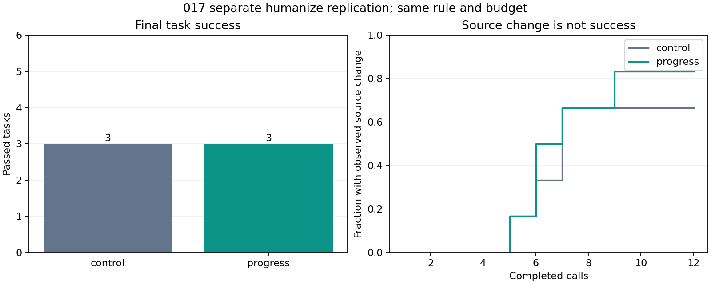

# 017 supplement results · humanize

**Separate descriptive replication. No default policy change, deployment approval or weight update.** All 12 runs completed after the primary run, using its identical model, rule and per-task budgets. These six new task pairs do not replace the original 72-run gate.

| Arm | Passed | 12 calls with no edit | Failed without any edit | Controller minutes |
| --- | --- | --- | --- | --- |
| control | 3/6 | 2 | 2 | 8.1 |
| progress | 3/6 | 1 | 1 | 9.9 |

Passing means the independent grader accepts the final source, not necessarily that the agent exits normally. Context-limit requests: control 1, progress 2; these are retained even when the final code passes. Invalid action formats: control 0, progress 1.

Paired outcomes: {'improved': [], 'regressed': []}. Task-controller time ratio: 1.213×. These interleaved times include tools and grading, not just generation. Curves retain all six tasks in each denominator and count temporary byte changes; they are secondary observations, never a substitute for passing the independent grader. [Paired data](paired-outcomes.csv), [curve data](first-edit-curves.csv), [full summary](summary.json).

The six constructed defects use the upstream number/filesize tests from pinned humanize 4.12.3. All original/broken/restored checks and the GPU-loaded clean control passed. The two arms each have 12 calls, 512 output tokens per call, 6,144 total output tokens, 8,192 input tokens and 900 seconds per task. The candidate receives only the generic progress reminder; the prompt tokens count toward the same input budget. No model scores were read during source/task selection, no rule was tuned and no scored task was repeated.

[Reference screening before](reference-screen.json) and [after](reference-screen-after.json) found no other package-name matches, duplicate selected source files or package names in zip/wheel archives across the same mounted namespace. Two entries were inaccessible to the sandbox UID, with error categories and path hashes retained. This bounded screen cannot rule out every renamed or embedded implementation, or exposure during base pretraining. One repository, six related tasks, visible tests and one greedy run per arm are limited evidence for general coding ability.

[Audit](failure-audit.json) independently re-encodes all actual requests, checks the input token hashes, reminder triggers, tool-history pairing and final source state. Intermediate source changes remain the frozen executor's observations. Across arms, 0 matched calls had identical input-token hashes but different output text hashes; one pair per task cannot isolate all execution variation. [Protocol](protocol.json) and [public preregistration](preregistration.json) were verified before this run. Raw commands, trajectories, tasks, source snapshots and weights are private.

Controller UTC 2026-11-11T03:17:37.703432+00:00 to 2026-11-11T03:36:07.513032+00:00, 18.50 minutes within the separate one-hour ceiling. 221 hardware samples, 0 sampling errors, maximum gap 5.06s. Sampled peak 63C, 59915MiB, 551.7W. Sampled GPU energy 0.089kWh excludes the rest of the system and may miss peaks. The post-run CPU audit and backend cleanup are separate from the scoring interval.
