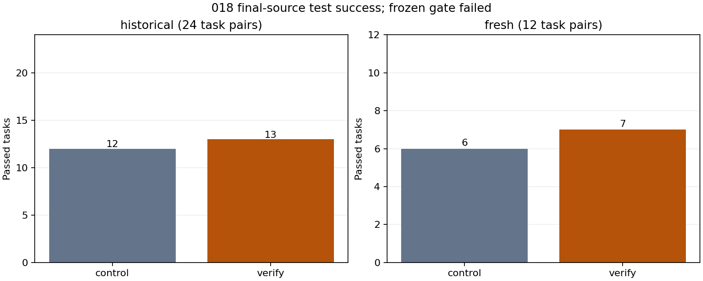
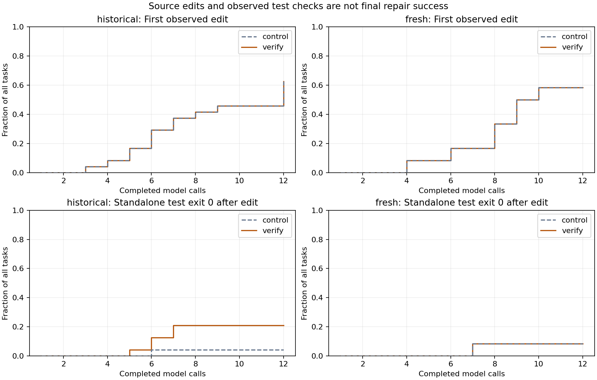

# 018 · Repair verification results

**Frozen numerical gate failed. No default policy change or deployment approval.** All 72 runs are retained: 24 historical pairs and 12 fresh pairs. Control is the explicit 017 progress policy; verify adds only the locked post-edit verification reminder. The unchanged 27B BF16 base received no weight updates.

| Policy | Historical passes | Fresh passes | Failed after an observed edit (all 36) | Verification reminders | Controller minutes |
| --- | --- | --- | --- | --- | --- |
| control | 12/24 | 6/12 | 4 | 0 | 37.9 |
| verify | 13/24 | 7/12 | 2 | 36 | 38.7 |

Passing means the independent grader accepts the final source, not necessarily that the agent exits normally. Call/context limits and format errors are retained separately. The edited-but-failed count is descriptive: an intervention can alter which tasks get edited, so this conditional behavior is not itself a causal success metric.

| Split | Improved pairs | Regressed pairs | Net gain |
| --- | --- | --- | --- |
| historical | 1 | 0 | 1 |
| fresh | 1 | 0 | 1 |

| Original 017 regression | control | verify | Verify first edit call | Final observed check status |
| --- | --- | --- | --- | --- |
| `new-json-undefined` | fail | pass | 7 | not_run |
| `fresh-signed-serialize` | fail | fail | 8 | not_run |

| Frozen requirement | Result |
| --- | --- |
| fresh net gain | failed |
| no fresh regressions | met |
| no historical regressions | met |
| both targets pass | failed |

[Post-run case review](postrun-review.json): Two improvements, no regressions, and one original target still failing. First-edit curves are identical. Across 336 matched actual input-token hashes, no output-text hashes differ, but this is still one greedy pair per task. The combined reminder is not decomposed into independently causal components. Both improved tasks finish without a fresh recognized standalone check: compound edit/test commands can provide useful evidence while remaining unknown/stale to the deliberately narrow recognizer. The frozen gate fails because fresh net gain is only one (required two) and the signing target still fails; no default policy or weight change follows.

`new-json-undefined`: Both arms first edit on call 7. Control alternates global/object handling and leaves the array case wrong (15/16 assertions pass). Verify receives five post-edit notices, removes status-masking pipelines from later compound edit/test commands, and on call 11 scopes the correction to array elements while preserving object omission; the final grader passes 16/16. It still does not issue a recognized standalone declared check: final observed status is not_run, despite successful tests inside a compound command. This improvement does not establish compliance with the standalone-check instruction.

`fresh-signed-serialize`: Both arms first edit on call 8, manually constructing a signer instead of using the existing configuration-preserving helper. The compound edit/test command fails. Verify receives four notices on calls 9–12 but spends all four reading signing code without another edit or a recognized standalone check. Both arms finish with byte-identical incorrect source and fail independent signing/round-trip checks. Generic verification reminders did not resolve this original regression.

`fresh018-pydash-drop-while`: Both arms first edit on call 8. After a failed standalone check on call 10, control uses call 11 for a no-op check and reads code on call 12; it leaves mutation of the list being iterated, causing skipped items and adjacent drop failures (9 failed, 526 passed). Verify receives four notices, replaces mutation during iteration with a counter and final slice on call 11, and runs the suite in the same compound command (535 passed); it submits on call 12 and the independent final grader also passes 535 tests. Its recognized-check status remains stale after that compound correction, so final repair success and strict verification recognition diverge.

| Repository | Exposure split | Tasks | control | verify |
| --- | --- | --- | --- | --- |
| dgilland/pydash | test | 6 | 3 | 4 |
| epoberezkin/fast-json-stable-stringify | dev | 6 | 5 | 6 |
| jmespath/jmespath.py | dev | 6 | 1 | 1 |
| ljharb/qs | dev | 6 | 3 | 3 |
| pallets/itsdangerous | dev | 6 | 3 | 3 |
| python-hyper/hyperlink | test | 6 | 3 | 3 |

Both curves retain every task in the denominator. An edit can later be reverted. A standalone test exit zero may not cover every requirement and can precede a later edit. These curves do not measure correctness at every call; only the final independent grade measures repair success. Compound edit/test commands, pipes and alternative spellings deliberately do not establish recognized verification. The final tool call is included even if no next model request occurs. Public [paired outcomes](paired-outcomes.csv), [call metrics](call-metrics.csv) and [curve data](verification-curves.csv) support the plots.

## Fixed-budget comparison

Both arms use 12 calls, 512 output tokens per call, 6,144 total output tokens, 8,192 input tokens, 2,400 tool-output characters and 900 seconds/task. Same parser, native tool round trips, full history, source observation, tasks and test dependencies. These are equal upper limits, not equal realized token usage. Actual input/output usage is reported; verification notices add 4225 input tokens across requests relative to the same histories without those notices (including rejected context-limit requests). Both keep the 017 no-edit reminder. Only verify receives temporary post-edit reminders computed from actual tool exit codes and editable-file hashes. Reminder tokens count toward the input limit. No extra test execution, automatic patch, oracle feedback, teacher model or history truncation. [Protocol](protocol.json), [locked rule](intervention.json), [two-task diagnosis](diagnosis.json), [public preregistration](preregistration.json).

Task-controller time ratio verify/control: **1.021×**. This includes tool execution and grading and is a descriptive interleaved shared-host measurement, not pure GPU generation speed. Compared with 017 progress, the repeated historical control had 0 improvements and 0 regressions; all are kept, with no favorable run selection. Across arms, 336 matched requests had identical actual input-token hashes; 0 produced different output text hashes. One greedy pair per task cannot separate all execution variation.

| Policy | Context-limit requests | Invalid formats | Output-limit hits | Calls | Output tokens | Processed input tokens |
| --- | --- | --- | --- | --- | --- | --- |
| control | 0 | 14 | 0 | 367 | 24596 | 1039478 |
| verify | 0 | 14 | 0 | 372 | 25078 | 1065156 |

## Input validity and screening

All 36 tasks passed original/broken/restored admission and all six loaded clean controls passed. A stricter pre-freeze review caught two draft Pydash stubs that accidentally damaged overload declarations, creating syntax errors; the constructor was fixed to select concrete implementations and reject invalid syntax. The [first admission](admission-before-overload-fix.json) is preserved. Final broken controls all return actual test failure (exit 1), not collection errors. The 24 historical defective byte hashes match 017 exactly. No model score was used for this recovery or task selection.

Ordered-set was rejected before scoring because its reference implementation is installed in setuptools. More-itertools was excluded because it was previously used in this project. Hyperlink and Pydash passed [before](reference-screen.json) and [after](reference-screen-after.json) namespace screens for known Python package/module/metadata names, exact selected source hashes and package paths in archives. Broad substring matches to office hyperlink icons and project logos are retained separately, not classified as Python reference copies; the [initial broad screen](reference-screen-broad.json) and [preparation plan](preparation-plan.json) retain the decision. Each scan records inaccessible paths by hash and error category. The post-run check reuses the pinned clean scan workspace with the same readonly dependency mounts; it does not inventory every model-created task-private file or instrument reads. This bounded check does not prove absence of renamed/embedded/semantic copies or pretraining exposure.

The [audit](failure-audit.json) independently replays every actual input-token hash, both reminder triggers, native tool pairing, parsed action identity, declared-check evidence and source endpoints without executing commands again. Intermediate source hashes are frozen executor observations; original defective and final graded source are checked independently. Test exit status remains evidence from the agent's working copy, not authority over the separate final grader.

## Hardware and scope

UTC 2026-11-11T06:20:40.200161+00:00 to 2026-11-11T07:38:03.803498+00:00; 77.39 minutes from controller start through scoring completion, within the original three-hour ceiling. Cleanup and CPU audit follow separately. 921 hardware samples, 0 sampling errors, maximum gap 5.06s. Sampled peaks: 64C, 63079MiB, 550.6W. Sampled GPU energy 0.377kWh excludes CPU/system consumption and may miss peaks.

Fresh means repositories unused in this project's previous evaluations, not unseen pretraining or guaranteed independent authorship. Hyperlink acknowledges ancestry in adjacent helper code from Boltons, which appeared earlier in the project; selected targets and the mounted namespace are documented in the [source ledger](sources.json). Twelve related Python tasks in two repositories, visible tests and constructed missing-function defects are limited evidence for general coding ability. No model training, default change or advanced-coding claim follows automatically. [Reusable workflow](../../README.md). Original harness is MIT; upstream rights remain separate. Public artifacts omit task mutations, raw commands/trajectories, source snapshots, weights and connection details. Exact replay requires authorized private inputs.
