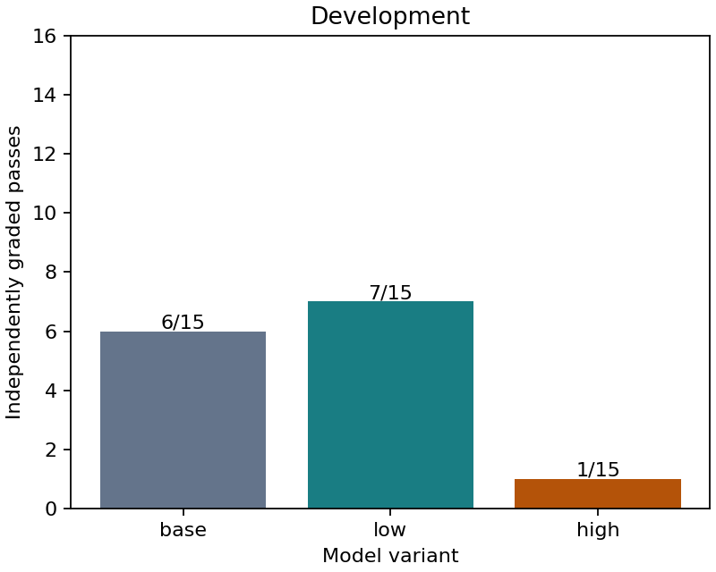
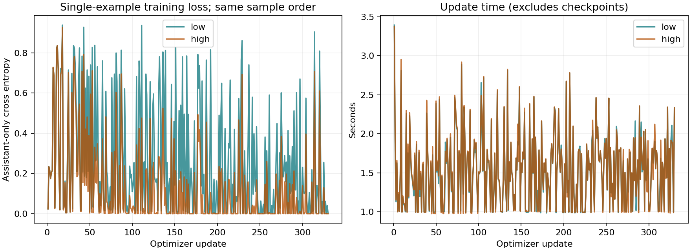

# 019 · Two-candidate 27B coding LoRA screen

**Does not meet the fixed release gates. Keep the base; do not publish candidate weights.**

This is a small executed repair-trajectory pilot, not full-parameter pretraining or a general coding/long-task certification. The exact base, 55 training tasks, 330 records, one-pass order, two learning rates, inference budgets and release gates were publicly frozen before weight updates. [Protocol](protocol.json), [preregistration](preregistration.json), [complete evidence and gates](summary.json).

| Candidate | Dev base | Candidate | Improved pairs | Regressed pairs |
| --- | --- | --- | --- | --- |
| low | 6/15 | 7/15 | 3 | 2 |
| high | 6/15 | 1/15 | 1 | 6 |

Selected using development only: **none**. Selection requires net gain >=1 and at most one regression, then most passes, fewest generated tokens, lower learning rate. Test scores never choose a candidate.

Final scores remain unopened because neither candidate passed development selection.

| Candidate | Updates | Trainable parameters | Supervised tokens | Update seconds | Peak allocation GiB |
| --- | --- | --- | --- | --- | --- |
| low | 330 | 58,363,904 | 21,760 | 502.2 | 62.94 |
| high | 330 | 58,363,904 | 21,760 | 503.4 | 62.94 |

Both candidates used the same 475,778 input tokens and sample-order hash. Each retains all 55 repair targets. The base is frozen BF16, rank-8 adapters use FP32 and learning rates 2e-6 / 1e-5. Both changed adapter weights, had no frozen-parameter gradients, passed a sampled frozen-weight integrity check, and matched greedy token IDs before/after adapter reload. This is not a full-backbone equality proof. The save/reload probe checks serialization, not task quality.

Every update uses a different example. These curves show training diagnostics, not heldout loss or generalization; a lower loss does not establish a better coding model.

| Evaluation arm | Passes | Model calls | Generated tokens | Invalid formats | Total task minutes |
| --- | --- | --- | --- | --- | --- |
| dev-base | 6/15 | 152 | 12334 | 4 | 29.39 |
| dev-low | 7/15 | 151 | 9763 | 2 | 31.63 |
| dev-high | 1/15 | 142 | 13204 | 5 | 49.21 |

| Evaluation arm | Failed with no observed allowed-source edit | Failed after an observed allowed-source edit |
| --- | --- | --- |
| dev-base | 6 | 3 |
| dev-low | 5 | 3 |
| dev-high | 14 | 0 |

Edit categories use the source snapshots after executed tools, not the model's claim that it made a repair. Only files allowed by the frozen task count; a change later reverted still counts as an observed edit. These counts describe the failure behavior and do not by themselves establish its cause.

Budgets are equal upper limits: 12 calls, 512 generated tokens/call, 6,144 generated tokens/task, 8,192 input tokens, and 900 seconds/task. Same native tool round trip, parser, full history and edit-progress policy. Actual usage differs and is retained. Candidate inference uses an unmerged adapter; sequential shared-host timings include that overhead and do not establish a production throughput comparison. [All paired outcomes](paired-outcomes.csv) retain regressions. Passing means the final independent grader accepts source changes in a fresh workspace, not simply an edit, an agent claim or a normal exit.

[Every improved and regressed pair](changed-pair-behavior.json) records the first observed edit, final changed-file count, format errors, call-limit/submit status and independent grader exit. A nonzero test exit labeled `runtime_error` is not automatically a GPU or controller failure. Conversely, a last-call repair can pass independent tests even when the agent then reaches its call limit. These are observed behavior differences, not a proven explanation of why training changed a result. There is one greedy rollout per task and arm; run-to-run and training-seed variability are not estimated.

Actual UTC: 2026-11-11T14:09:01.681024+00:00 to 2026-11-11T16:23:40.012193+00:00; 2.244 pipeline hours. Original 12-hour budget respected: True. 1602 hardware samples, max gap 5.08s, sampled peak 77C / 559.8W. GPU energy estimate 0.480kWh uses trapezoids between samples; it excludes CPU/system power and can miss transients. Allocator memory peaks are separate from sampled board memory.

Limitations: constructed Python/JavaScript defects, visible upstream tests, unknown base pretraining overlap, one training seed and four small fresh-repository clusters. The development set has 14 original defects and one pre-freeze corrected no-op defect. No advanced multilingual coding, long-context or daily-use claim follows. Reviewed base/source licenses and known-pattern secret scans are bounded evidence, not a legal warranty. Raw tasks, commands, trajectories, corpora, machine identifiers, optimizer states and candidate weights are absent from this public results bundle. Original code is MIT; upstream licenses remain separate.
