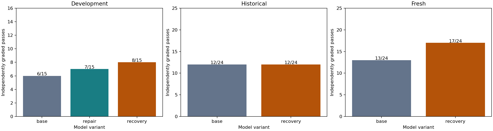
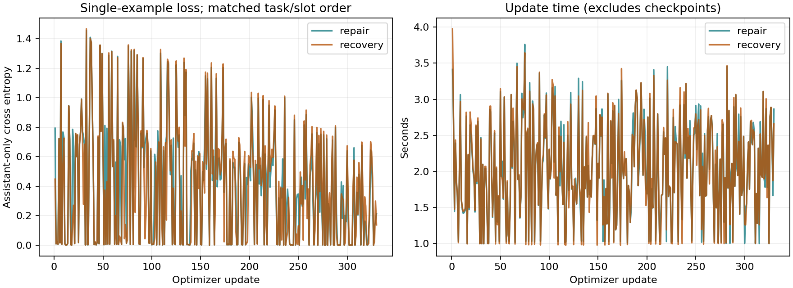

# 020 · Matched repair and failure-recovery curricula

**Does not meet the fixed release gates. Keep the base; do not publish candidate weights.**

This is a small executed repair-trajectory pilot, not full-parameter pretraining or a general coding/long-task certification. The exact base, 55 training tasks, 330 records, one-pass task/slot order, shared learning rate, inference budgets and release gates were publicly frozen before weight updates. [Protocol](protocol.json), [preregistration](preregistration.json), [complete evidence and gates](summary.json).

| Candidate | Dev base | Candidate | Improved pairs | Regressed pairs |
| --- | --- | --- | --- | --- |
| repair | 6/15 | 7/15 | 1 | 0 |
| recovery | 6/15 | 8/15 | 2 | 0 |

Selected using development only: **recovery**. Selection requires net gain >=1 and at most one regression, then most passes, fewest generated tokens, lower learning rate, then declared candidate order. Both learning rates are 2e-6. Test scores never choose a candidate.

| Final cohort | Base | Selected candidate | Improved | Regressed |
| --- | --- | --- | --- | --- |
| historical | 12/24 | 12/24 | 3 | 3 |
| fresh | 13/24 | 17/24 | 5 | 1 |

Legacy checks: 9/9 base; 9/9 selected candidate.

| Candidate | Updates | Trainable parameters | Input tokens | Supervised tokens | Update seconds | Peak allocation GiB |
| --- | --- | --- | --- | --- | --- | --- |
| repair | 330 | 58,363,904 | 653,649 | 41,649 | 674.3 | 64.95 |
| recovery | 330 | 58,363,904 | 653,046 | 41,542 | 674.2 | 64.96 |

Both candidates start from the identical pinned base and use the same 330 semantic task/slot IDs in seed-101 order. The 275 common records have identical model-visible token hashes; only 55 late-repair records differ. Three repair targets per task cover ordinary, stalled and late repair. Actual input and supervised token totals differ as reported above: this is not equal-token or equal-FLOP training. The base is frozen BF16; rank-8 adapters use FP32 and learning rate 2e-6 in both groups. Incorrect attempts are observed history only, never supervised targets. Both changed adapter weights, had no frozen-parameter gradients, passed a sampled frozen-weight integrity check, and matched greedy token IDs before/after adapter reload. This is not a full-backbone equality proof. The save/reload probe checks serialization, not task quality.

Every update uses a different example. Targets and history can differ in the 55 contrast slots, so pointwise losses are not an identical-example comparison. These curves show training diagnostics, not heldout loss or generalization; a lower loss does not establish a better coding model.

| Evaluation arm | Passes | Model calls | Generated tokens | Invalid formats | Total task minutes |
| --- | --- | --- | --- | --- | --- |
| dev-base | 6/15 | 152 | 12327 | 4 | 29.20 |
| dev-repair | 7/15 | 148 | 10162 | 0 | 41.68 |
| dev-recovery | 8/15 | 144 | 9932 | 0 | 37.13 |
| final-base | 25/48 | 450 | 31754 | 20 | 48.44 |
| final-selected | 29/48 | 439 | 28068 | 1 | 75.90 |

| Evaluation arm | Failed with no observed allowed-source edit | Failed after an observed allowed-source edit |
| --- | --- | --- |
| dev-base | 6 | 3 |
| dev-repair | 6 | 2 |
| dev-recovery | 3 | 4 |
| final-base | 16 | 7 |
| final-selected | 16 | 3 |

Edit categories use the source snapshots after executed tools, not the model's claim that it made a repair. Only files allowed by the frozen task count; a change later reverted still counts as an observed edit. These counts describe the failure behavior and do not by themselves establish its cause.

Budgets are equal upper limits: 12 calls, 512 generated tokens/call, 6,144 generated tokens/task, 8,192 input tokens, and 900 seconds/task. Same native tool round trip, parser, full history and edit-progress policy. Actual usage differs and is retained. Candidate inference uses an unmerged adapter; sequential shared-host timings include that overhead and do not establish a production throughput comparison. [All paired outcomes](paired-outcomes.csv) retain regressions. Passing means the final independent grader accepts source changes in a fresh workspace, not simply an edit, an agent claim or a normal exit.

[Every improved and regressed pair](changed-pair-behavior.json) records the first observed edit, final changed-file count, format errors, call-limit/submit status and independent grader exit. A nonzero test exit labeled `runtime_error` is not automatically a GPU or controller failure. Conversely, a last-call repair can pass independent tests even when the agent then reaches its call limit. These are observed behavior differences, not a proven explanation of why training changed a result. There is one greedy rollout per task and arm; run-to-run and training-seed variability are not estimated.

For each executed legacy function check, [post-run integrity](postrun-integrity.json) binds the exact prompt-token hash, task order, model flag and private generated-text file hash to the public numeric result. This read-only audit was added during the run; it neither regenerates answers nor replays grading. Frozen training/evaluation inputs, selection rules and quality thresholds are unchanged. Audit/report source hashes identify the postprocessing version.

Actual UTC: 2026-11-12T02:14:22.605896+00:00 to 2026-11-12T06:43:19.335741+00:00; 4.482 pipeline hours. Original 12-hour budget respected: True. 3200 hardware samples, max gap 5.72s, sampled peak 78C / 562.4W. GPU energy estimate 1.052kWh uses trapezoids between samples; it excludes CPU/system power and can miss transients. Allocator memory peaks are separate from sampled board memory.

Limitations: deliberately constructed training failure controls, reused development tasks with prior feedback, constructed Python/JavaScript defects, visible upstream tests, unknown base pretraining overlap, one training seed and four small fresh-repository clusters. The development set has 14 original defects and one pre-freeze corrected no-op defect. No advanced multilingual coding, long-context or daily-use claim follows. Reviewed base/source licenses and known-pattern secret scans are bounded evidence, not a legal warranty. Raw tasks, commands, trajectories, corpora, machine identifiers, optimizer states and candidate weights are absent from this public results bundle. Original code is MIT; upstream licenses remain separate.
