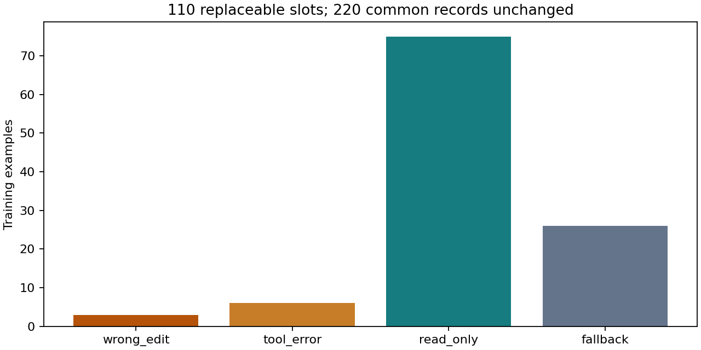
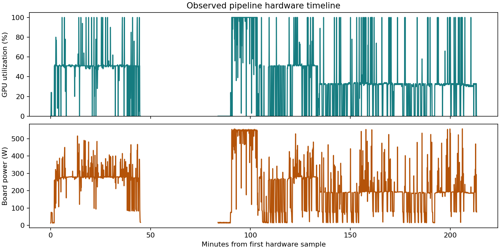
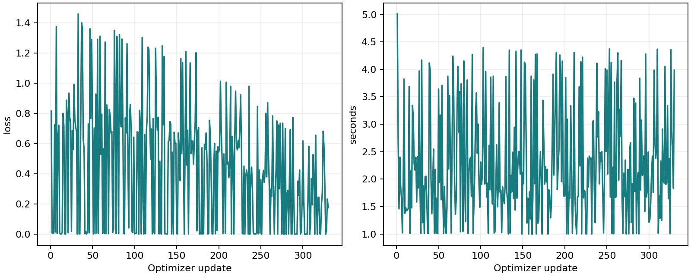
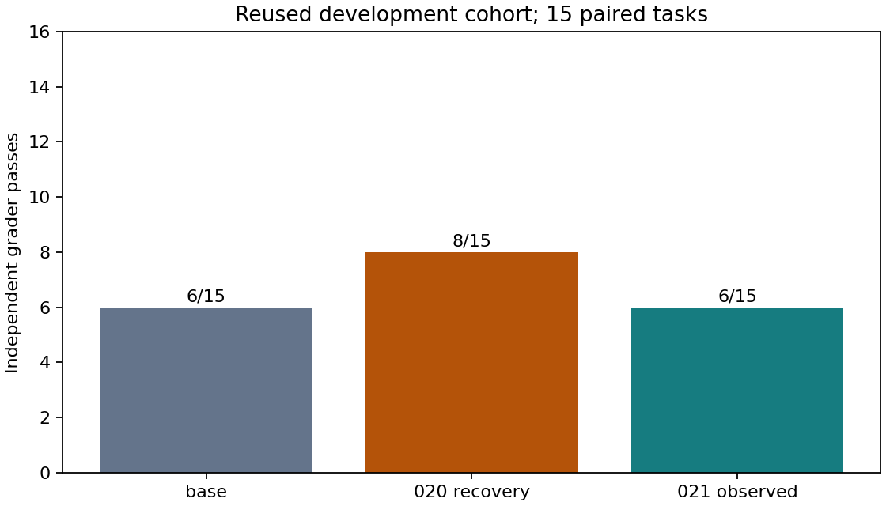

# 021 · Observed training-state recovery

Did not pass the fixed release gates. Keep the base; do not publish candidate weights.

This is one supervised repair experiment, not full-parameter pretraining or iterative RL. Rules and all task partitions were public before collection; exact derived inputs were fixed before optimizer updates. Raw tasks, traces, sources and weights are absent from this bundle.

Observed replacements: 84/110 across 46/55 training tasks. The first 220 examples are unchanged; unmatched slots retain the exact 020 examples. Full input and target limits are enforced without truncation. Only executed, independently verified corrections are supervised; base actions and teacher-run failing diagnostics are masked history.

| Evaluation arm | Passes | Calls | Failed without edit | Failed after edit |
| --- | --- | --- | --- | --- |
| dev-base | 6/15 | 152 | 6 | 3 |
| dev-reference020 | 8/15 | 147 | 3 | 4 |
| dev-observed | 6/15 | 149 | 7 | 2 |

| Final cohort | Base | Candidate | Improved | Regressed |
| --- | --- | --- | --- | --- |
Final cohorts were not opened.

The new candidate must gain at least one development task against each of the base and fixed 020 recovery, with at most one regression against each. Final release requires at least three fresh gains, zero fresh or historical regressions, all nine legacy checks and all engineering/source audits. Test scores never choose a candidate.

Training loss is a sequence of different examples, not heldout loss. Equal update/call/token ceilings do not imply equal token exposure or FLOPs. Adapter inference is unmerged, and sequential shared-host timing is not a production throughput comparison.

Actual UTC: 2026-11-12T07:43:21.944745+00:00 to 2026-11-12T11:16:35.325739+00:00; 3.554 hours. Original deadline respected: True. Hardware samples: 2076; maximum gap 2327.99s. Observed intervals cover 81.8% of the first-to-last sample span. Board-energy integration excludes gaps longer than 15s and all attempt boundaries; it is not total pipeline/system energy.

Recovery disclosure: the first CPU data builder failed before any update because a checked history list was later mutated. The corrected separate builder only deep-copies that prefix. Original sources, failed evidence, collection and deadline were preserved; no model collection or candidate was rerun. See derivation-recovery.json and the experiment recovery amendment.

Limitations: one training seed, one greedy collection rollout per training task, constructed defects, reused development, four small Python fresh-repository clusters, historical Python/JavaScript tasks and unknown pretraining overlap. These results do not certify general multilingual coding, long tasks or daily-use readiness. Read-only audits and reporting do not rerun models or change selection gates.

Public numerical evidence supports recomputing comparisons and plots. Exact end-to-end model replay requires the private task/trajectory inputs; the public repository alone is insufficient. To use your own authorized tasks, create a new admission and experiment freeze using the shared one_gpu_lm modules. Do not substitute inputs inside this frozen run.

[Complete evidence and decision](summary.json) · [Frozen protocol](protocol.json) · [Source provenance](sources.json)
[Paired behavioral observations](behavior-review.md)
