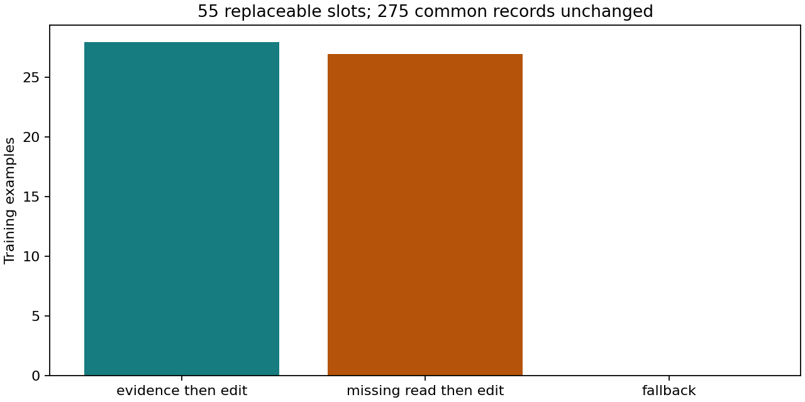
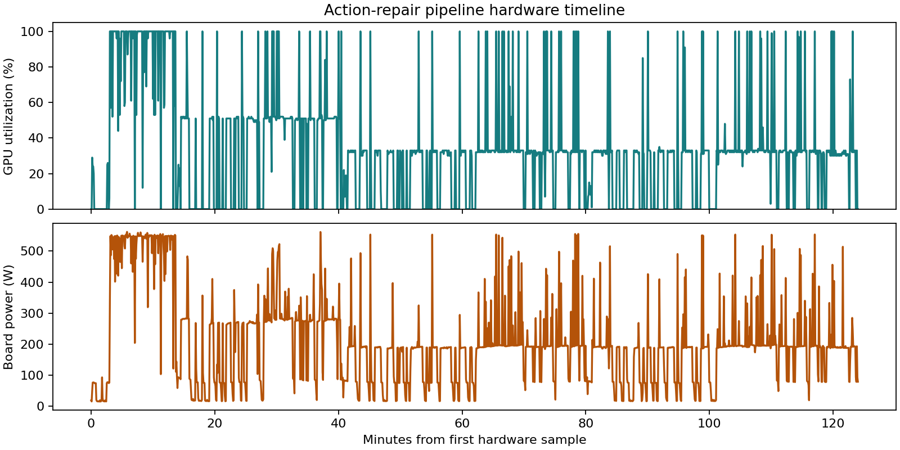
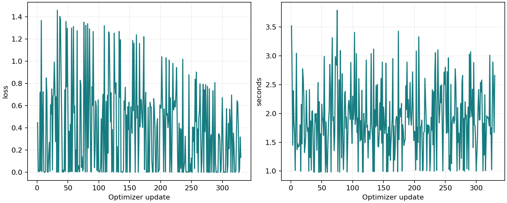
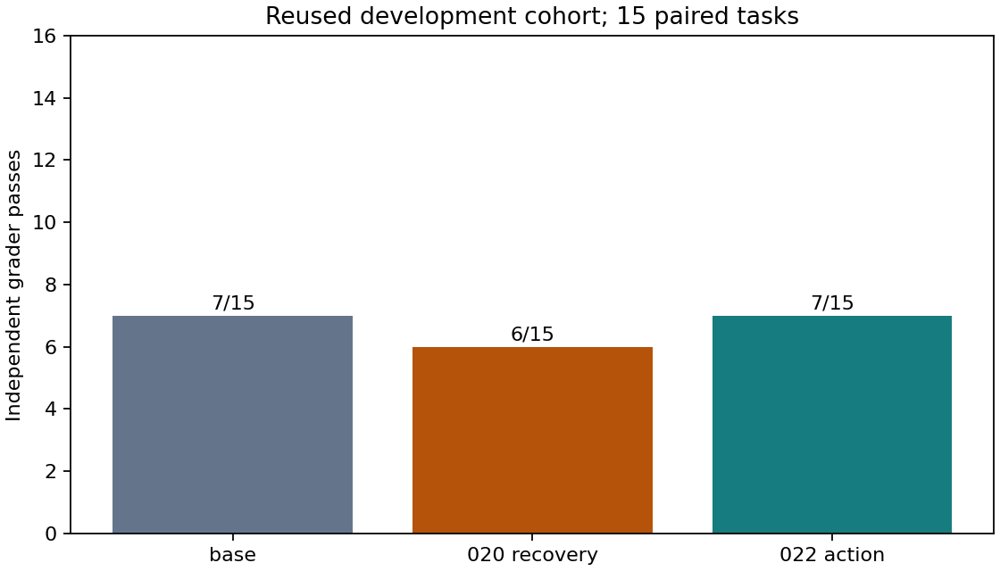
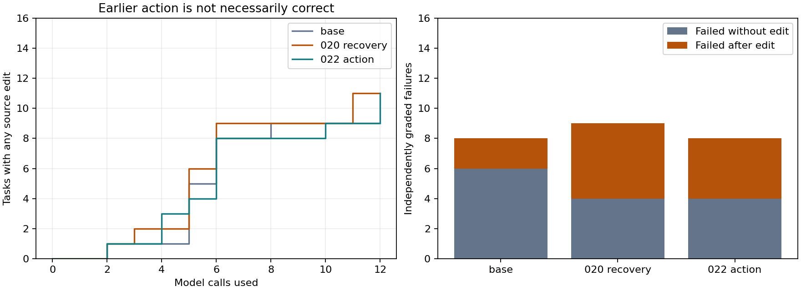

# 022 · Earlier evidence-backed repair

Did not pass the fixed release gates. Keep the base; do not publish candidate weights.

This is one supervised repair experiment, not full-parameter pretraining or iterative RL. Rules, inherited task partitions and exact CPU-derived inputs were publicly fixed before any new model rollout or optimizer update. CPU reference preparation is timed separately from the 12-hour model pipeline. Raw tasks, traces, sources and weights are absent from this bundle.

Verified early-action replacements: 55/55 across 55/55 training tasks. The other 275 examples are unchanged; unmatched slots retain the exact 020 examples. Full input and target limits are enforced without truncation. Only executed, independently verified corrections are supervised; reference-run failing diagnostics are masked history.

| Evaluation arm | Passes | Calls | Failed without edit | Failed after edit |
| --- | --- | --- | --- | --- |
| dev-base | 7/15 | 149 | 6 | 2 |
| dev-reference020 | 6/15 | 150 | 4 | 5 |
| dev-action | 7/15 | 149 | 4 | 4 |

Final cohorts were not opened.

The new candidate must gain at least one development task against each of the base and fixed 020 recovery, with at most one regression against each. Final release requires at least three fresh gains, zero fresh or historical regressions, all nine legacy checks and all engineering/source audits. Test scores never choose a candidate.

Training loss is a sequence of different examples, not heldout loss. Equal update/call/token ceilings do not imply equal token exposure or FLOPs. Adapter inference is unmerged, and sequential shared-host timing is not a production throughput comparison.

Actual UTC: 2026-11-12T12:46:35.454969+00:00 to 2026-11-12T14:50:38.044176+00:00; 2.067 hours. Original deadline respected: True. Hardware samples: 1476; maximum gap 5.07s. Observed intervals cover 100.0% of the first-to-last sample span. Board-energy integration excludes gaps longer than 15s and all attempt boundaries; it is not total pipeline/system energy.

CPU reference construction took approximately 11.06 minutes before the model pipeline (kernel start tick and completed-status timestamp; roughly one-second boot-epoch uncertainty). CPU audits and publication wait are separate from that construction time.

Terminology correction: the 55 preserved late-repair examples comprise 28 failed-anchor recoveries and 27 incorrect-edit recoveries. The frozen overview called them all wrong-edit examples; no data or rule changed. See [the terminology correction](../../ERRATA.md).

Limitations: one training seed, constructed defects, reused development, four small Python fresh-repository clusters, historical Python/JavaScript tasks and unknown pretraining overlap. These results do not certify general multilingual coding, long tasks or daily-use readiness. Read-only audits and reporting do not rerun models or change selection gates.

Public numerical evidence supports recomputing comparisons and plots. Exact end-to-end model replay requires the private task/trajectory inputs; the public repository alone is insufficient. To use your own authorized tasks, create a new admission and experiment freeze using the shared one_gpu_lm modules. Do not substitute inputs inside this frozen run.

[Complete evidence and decision](summary.json) · [Frozen protocol](protocol.json) · [Source provenance](sources.json)
[Paired behavioral observations](behavior-review.md)
