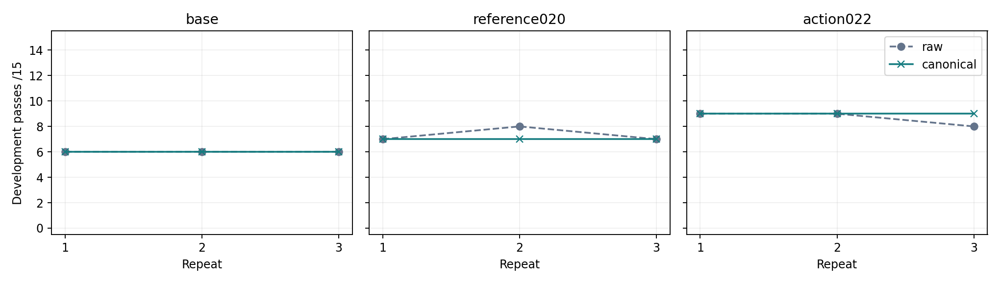
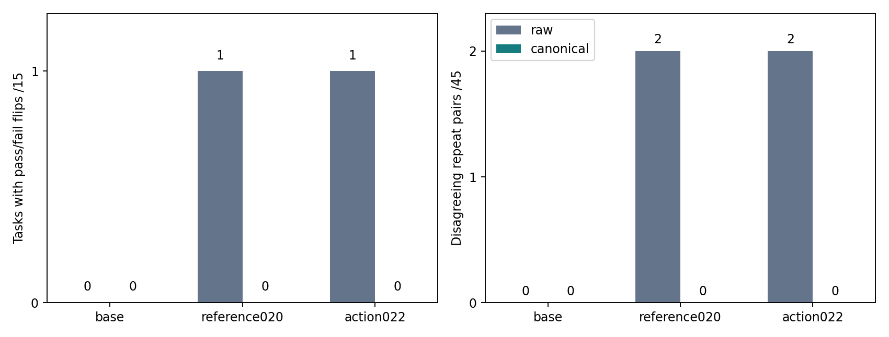
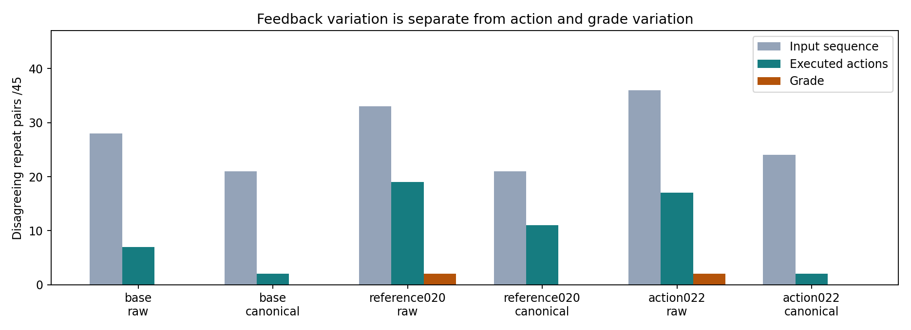
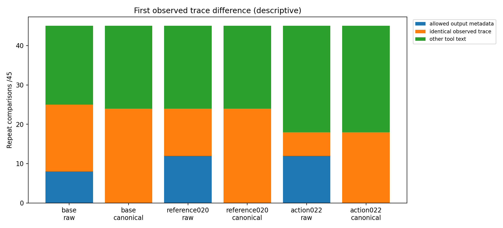
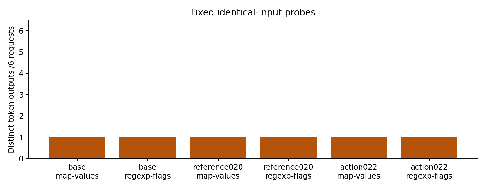
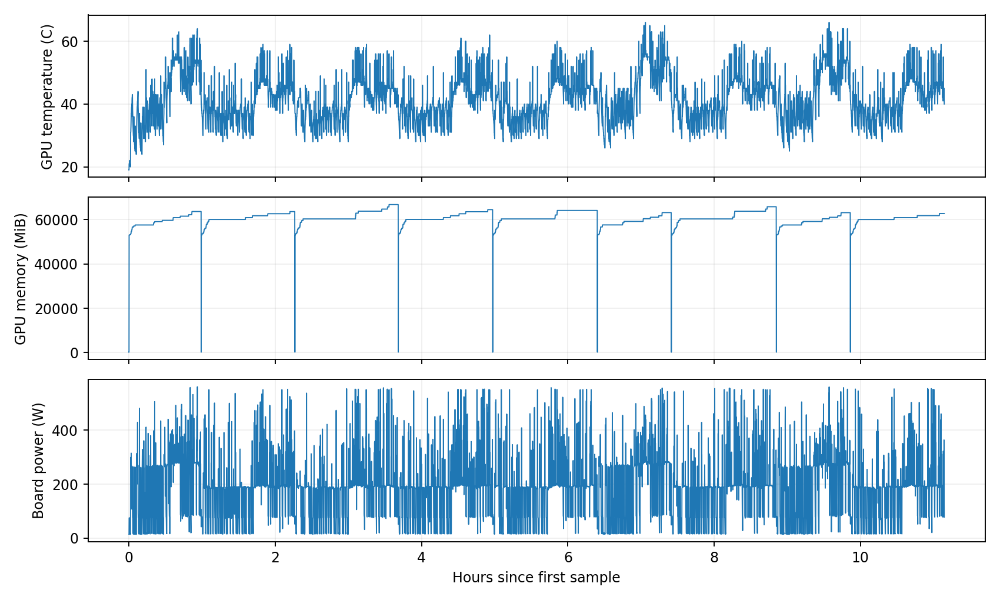

# 023 · Repeated evaluation stability

[中文结论与行为复盘](behavior-review.md)

Development-only diagnostic. No training, model selection, final-test opening or weight publication occurred. All 270 task runs and 36 fixed-input probes were retained. Three repeats use the same 15 development tasks across four repositories; they are not independent new tasks.

| Model | Output | Repeat passes /15 | Mixed outcomes /15 | Disagreeing pairs /45 |
| --- | --- | --- | --- | --- |
| base | raw | [6, 6, 6] | 0 | 0 |
| base | canonical | [6, 6, 6] | 0 | 0 |
| reference020 | raw | [7, 8, 7] | 1 | 2 |
| reference020 | canonical | [7, 7, 7] | 0 | 0 |
| action022 | raw | [9, 9, 8] | 1 | 2 |
| action022 | canonical | [9, 9, 9] | 0 | 0 |




| Model | Raw passes /45 runs | Canonical passes /45 runs | Canonical gains | Canonical regressions |
| --- | --- | --- | --- | --- |
| base | 18 | 18 | 0 | 0 |
| reference020 | 22 | 21 | 0 | 1 |
| action022 | 26 | 27 | 1 | 0 |

Stable behavior and higher task success are separate measurements. The table above counts 45 repeated runs per model and condition, not 45 independent tasks.

| Model | Output | Task | Repeat pass/fail | First edit call by repeat |
| --- | --- | --- | --- | --- |
| reference020 | raw | fast-deep-equal-map-values | [False, True, False] | [None, 10, None] |
| action022 | raw | fast-deep-equal-array-members | [True, True, False] | [6, 6, None] |

The table lists every within-condition pass/fail flip. [All 90 model/condition/task records](task-stability.csv) also retain stable successes and stable failures.

| Model | Output | Input differences /45 | Action differences /45 | Grade differences /45 |
| --- | --- | --- | --- | --- |
| base | raw | 28 | 7 | 0 |
| base | canonical | 21 | 2 | 0 |
| reference020 | raw | 33 | 19 | 2 |
| reference020 | canonical | 21 | 11 | 0 |
| action022 | raw | 36 | 17 | 2 |
| action022 | canonical | 24 | 2 | 0 |





| Model | Repeated exact-input groups | Calls in these groups | Groups with different output text |
| --- | --- | --- | --- |
| base | 138 | 784 | 0 |
| reference020 | 133 | 659 | 0 |
| action022 | 131 | 652 | 0 |

The exact-input grouping is an additional post-hoc descriptive check over task calls, within each fixed model. It checks decoded output text; the 36 preregistered probes separately compare output token sequences. Neither establishes determinism for all future inputs.

| Model | Output | Observations | Changed observations | Eligible fields | Applied fields |
| --- | --- | --- | --- | --- | --- |
| base | raw | 444 | 0 | {'js_summary_duration': 9} | {} |
| base | canonical | 444 | 9 | {'js_summary_duration': 9} | {'js_summary_duration': 9} |
| reference020 | raw | 438 | 0 | {'ls_timestamp': 204, 'js_summary_duration': 10} | {} |
| reference020 | canonical | 442 | 21 | {'ls_timestamp': 204, 'js_summary_duration': 9} | {'ls_timestamp': 204, 'js_summary_duration': 9} |
| action022 | raw | 425 | 0 | {'ls_timestamp': 204, 'js_summary_duration': 10} | {} |
| action022 | canonical | 433 | 21 | {'ls_timestamp': 204, 'js_summary_duration': 9} | {'ls_timestamp': 204, 'js_summary_duration': 9} |

Post-hoc residual-feedback review: {'test_duration_only': 84, 'unclassified_text_change': 120}. This diagnostic was added after observing the first pair and did not change model inputs or the preregistered primary analysis. See [every reviewed comparison](feedback-residual-review.json).

A stable score can still be wrong. A first differing tool response or generated action locates an observed boundary,not the sole cause of the final grade. The output intervention combines file-list dates and JS-summary durations; it does not isolate their individual effects or remove all possible variability.

The raw prefix is capped before normalization; file names, commands, source, return codes and independent grading remain unchanged. Raw/canonical conditions share the same upper bounds,not identical token counts or FLOPs.

Actual Beijing time: 2026-11-13T07:59:53.184190+08:00 to 2026-11-13T19:08:37.250141+08:00; 11.146 hours within the original deadline. The whole-run time includes model loading, controls and probes; [per-cell costs](repeated-scores.csv) separately count task runtime and generated tokens.

Hardware samples: 7955; maximum gap 6.48s. Sample-interval coverage: 100.00%. Sampled board-power estimate: 1.968 kWh. This covers sampled intervals only, not whole-system use. Sampler errors: 0.



Three repeats,15 reused development tasks and four repository clusters. No unopened final tasks or broad coding certification.
Greedy decoding is held fixed; deterministic CUDA settings are recorded but not changed. Canonicalizing two field types may leave other nondeterministic inputs.
Same per-task ceilings are not equal actual tokens,FLOPs or runtime. Sequential model blocks share one GPU. No training or release decision.

[Complete evidence](summary.json) · [Every paired comparison](paired-stability.csv) · [Per-repeat costs](repeated-scores.csv) · [Frozen rules](protocol.json)

From the repository root, verify the published numeric evidence with Python 3.10+ (standard library only):

```sh
python experiments/023-evaluation-stability/report.py --run experiments/023-evaluation-stability/results/2026-11-13 --check-only
```

Omit `--check-only` to regenerate tables and PNG/SVG curves; rendering also requires Matplotlib. No GPU, model weights or private task text is needed for this numeric recomputation. The private-input audits themselves require the original private journals and tokenizer.
