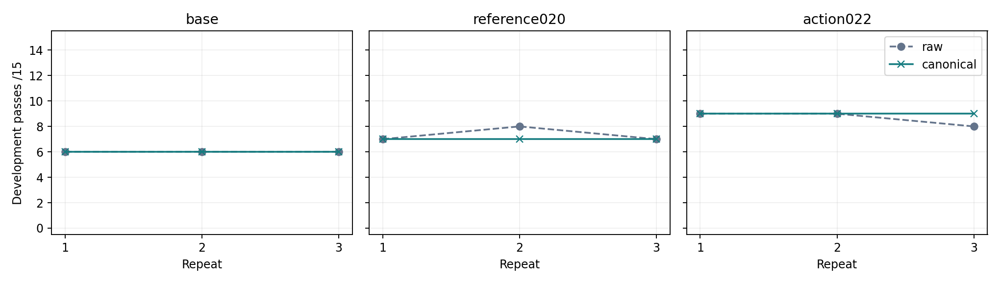
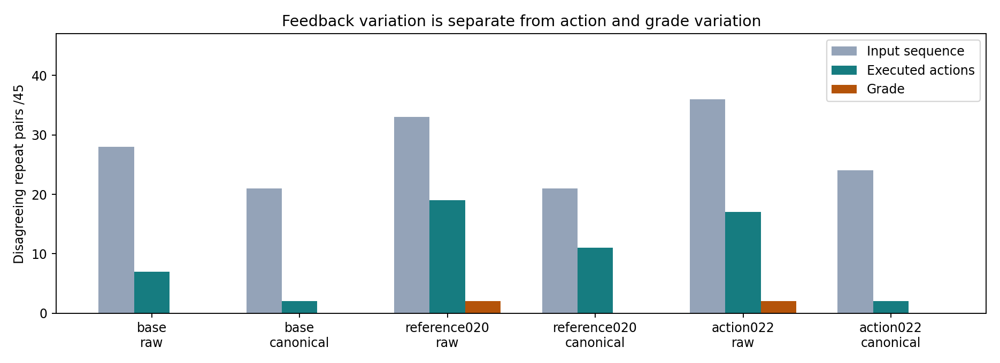

# 023：日期字段会改变修复轨迹；分数稳定还不等于能力提高

固定底座、020 和 022 权重，在相同调用与 token 上限下完成 270 次开发任务、36 次固定输入探针。没有训练、选择发布模型或打开最终测试。以下都是同一批 15 道开发题、4 个仓库、3 轮的描述性结果，不能当成 270 道独立新题。

| 模型 | 原始反馈三轮通过数 /15 | 规范化反馈三轮通过数 /15 | 原始反馈翻转任务 /15 | 规范化反馈翻转任务 /15 |
| --- | --- | --- | --- | --- |
| 底座 | 6、6、6 | 6、6、6 | 0 | 0 |
| 020 | 7、8、7 | 7、7、7 | 1 | 0 |
| 022 | 9、9、8 | 9、9、9 | 1 | 0 |

两道发生翻转的题不是只改变了最后一句回答，而是改变了是否修改源码：

- **020 / map-values**：原始反馈三轮为失败、成功、失败，首次编辑分别为无、第 10 次调用、无；规范化反馈三轮均失败。更稳定，但没有修好这道题。
- **022 / array-members**：原始反馈三轮为成功、成功、失败，首次编辑为第 6、第 6 次、无；规范化反馈三轮均成功。

这两题形成 4 个跨轮成败不一致配对。全部首次分叉都在第 1 次工具反馈：命令、执行前可编辑源码、返回码及状态相同，反馈差异仅在文件列表日期字段；规范化后反馈哈希相同。第 2 次请求的输入开始不同，第 3～5 次调用才出现生成文字差异。另两个同轮 raw/canonical 成败不一致配对也从同一类日期字段分叉。详见 [逐配对记录](paired-stability.csv) 和 [summary.json 中的 outcome_flip_boundaries](summary.json)。这是本次观察到的最早差异，不能把整条后续轨迹的成败归于单一字段；本轮也没有分别隔离日期和 JavaScript 耗时的独立效果。

相同输入是否也会随机变？预注册探针共 6 个模型/题目组合，每组跨 3 次加载生成 6 次，输出 token 序列都只有 1 种。事后对实际任务输入 token 哈希分组，共 402 个重复输入组、2,095 次调用，也没有发现同一模型在相同输入下生成不同文字。九次加载的运行设置一致，greedy、SDPA、seed 101 保持原样，未开启新的确定性选项。这支持优先处理工具反馈差异，**不能证明 CUDA 或所有未来请求绝对确定**。

规范化没有消除全部过程波动。每个模型/条件都有 45 个跨轮任务配对，动作不一致数由底座 7→2、020 19→11、022 17→2。规范化后总分相同，但仍可能用不同步骤修复，或者稳定地失败。原始与规范化同轮配对中，020 少成功 1 次、022 多成功 1 次，三模型合计都是 66/135 次成功；没有总体成功数提升。

输出变换实际覆盖 51/1,319 条规范化反馈，修改 408 个文件列表日期字段和 27 个 JavaScript 汇总耗时字段；没有额外截断。底座本轮没有命中日期规则，因此不能从底座结果估计日期规范化效果。Python 测试耗时、其他测试输出等仍未纳入冻结规则。事后分类器在 204 个首次“其他反馈”差异中认出 84 个纯测试耗时差异，另 120 个保留为未分类，未强行归因。该诊断不修改实际模型输入，也不属于预注册主指标。完整记录见 [反馈差异复核](feedback-residual-review.json) 与 [全部 90 个模型/条件/任务记录](task-stability.csv)。

实际执行为北京时间 **2026-11-13 07:59:53—19:08:37**，11 小时 8 分 44 秒，在原 16 小时截止内一次完成。任务生成 2,656 次调用、200,900 个输出 token；固定探针另用 36 次调用、1,500 个输出 token。相同预算指相同上限，不是实际耗时或 token 完全相等。任务中有 30 次格式无效输出，均保留在原任务预算内，未补跑替换；没有后端错误或控制器重启。中途本地 SSH 监控连接断开，重连确认原控制器继续运行，远端没有重启。

硬件采样 7,955 条，采样错误 0，最大间隔 6.48 秒；首末样本间隔覆盖 100%，不外推到未采样的起止边缘。最高温度 66°C，显存峰值 66,739 MiB（约 65.2 GiB），板卡功率采样峰值 561.42 W，采样区间板卡能耗估计 1.968 kWh，不代表整机耗电。结束后独立检查确认 GPU 计算进程为 0。详见 [硬件曲线](hardware-timeline.png)、[采样统计](summary.json) 和 [结束回执](completion-hardware.json)。

本轮保留的可复用成果是：明确边界的工具输出规范化、逐调用输入/输出/源码哈希、交错重复评测、相同输入探针，以及独立区分动作稳定性和任务正确性的报告工具。后续应在新冻结协议中使用这些能力，补充剩余反馈噪声验证，再评估训练收益；不会把 022 这次 9/15 自动当作通过之前的发布门槛。**72 道最终任务继续封存，不上传参数到 ModelScope。**

数值核验不需要 GPU、权重或私有题目，复现命令见 [完整报告](README.md)。重新审计原始请求与工具输出则需要原始私有轨迹；公开的是代码、哈希、数值、曲线和来源说明，不包含题目正文、生成代码、语料或权重。
