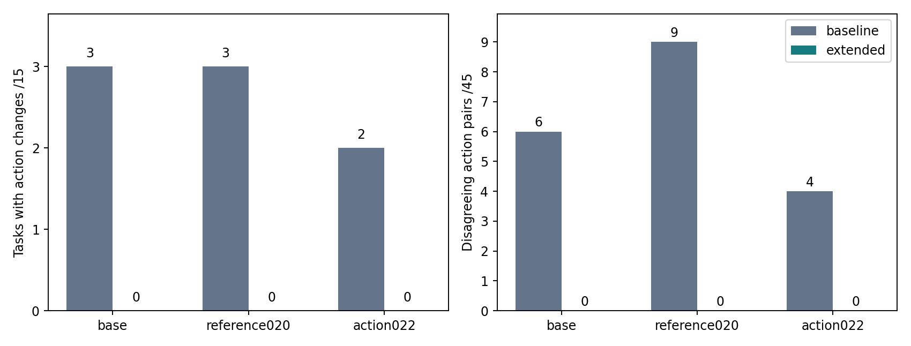
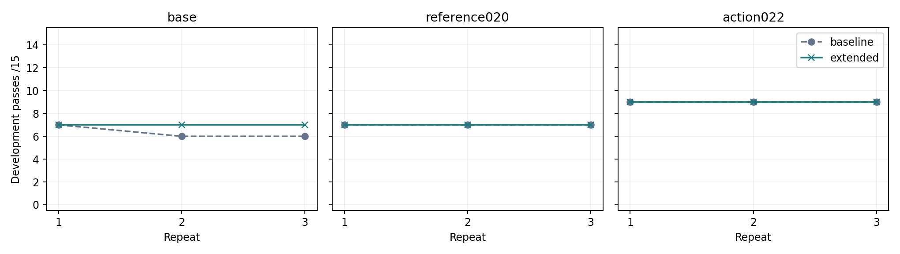
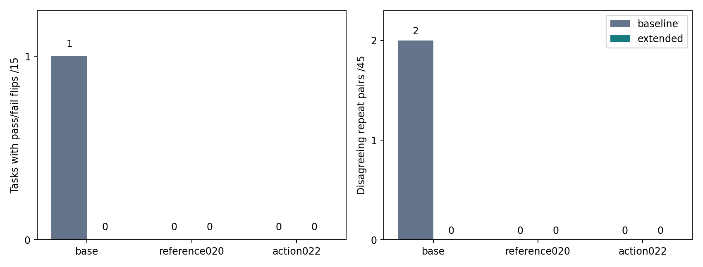
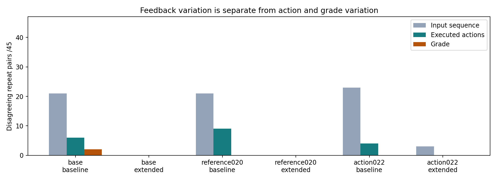
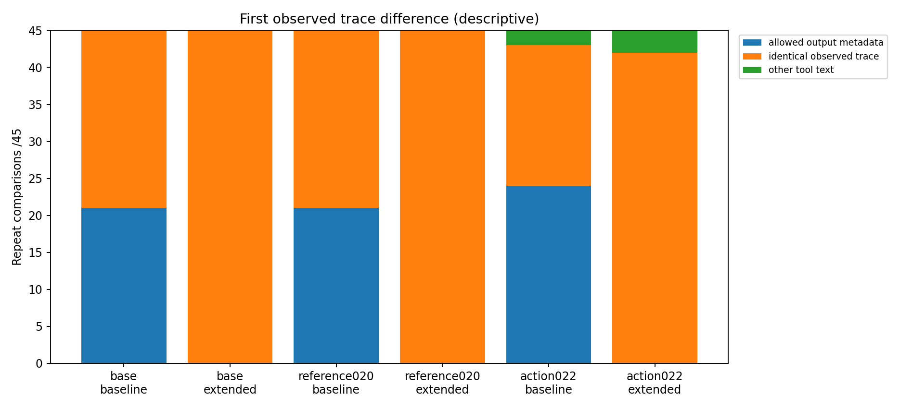
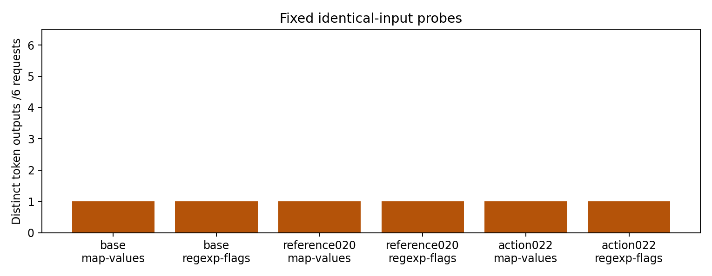
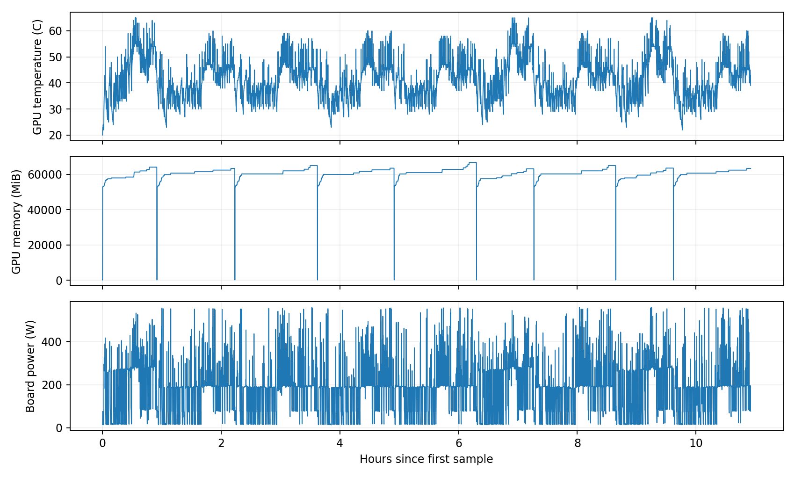

# 024 · Additional test-duration normalization

[中文结论与行为复盘](behavior-review.md)

Development-only diagnostic. No training, model selection, final-test opening or weight publication occurred. All 270 task runs and 36 fixed-input probes were retained. Three repeats use the same 15 development tasks across four repositories; they are not independent new tasks.

| Model | Output | Repeat passes /15 | Mixed actions /15 | Action disagreements /45 | Mixed outcomes /15 | Outcome disagreements /45 |
| --- | --- | --- | --- | --- | --- | --- |
| base | baseline | [7, 6, 6] | 3 | 6 | 1 | 2 |
| base | extended | [7, 7, 7] | 0 | 0 | 0 | 0 |
| reference020 | baseline | [7, 7, 7] | 3 | 9 | 0 | 0 |
| reference020 | extended | [7, 7, 7] | 0 | 0 | 0 | 0 |
| action022 | baseline | [9, 9, 9] | 2 | 4 | 0 | 0 |
| action022 | extended | [9, 9, 9] | 0 | 0 | 0 | 0 |





| Model | Baseline passes /45 runs | Extended passes /45 runs | Extended gains | Extended regressions |
| --- | --- | --- | --- | --- |
| base | 19 | 21 | 2 | 0 |
| reference020 | 21 | 21 | 0 | 0 |
| action022 | 27 | 27 | 0 | 0 |

Stable behavior and higher task success are separate measurements. The table above counts 45 repeated runs per model and condition, not 45 independent tasks.

| Model | Output | Task | Repeat pass/fail | First edit call by repeat |
| --- | --- | --- | --- | --- |
| base | baseline | more-itertools-split_at | [True, False, False] | [5, 5, 5] |

The table lists every within-condition pass/fail flip. [All 90 model/condition/task records](task-stability.csv) also retain stable successes and stable failures.

| Model | Output | Input differences /45 | Action differences /45 | Grade differences /45 |
| --- | --- | --- | --- | --- |
| base | baseline | 21 | 6 | 2 |
| base | extended | 0 | 0 | 0 |
| reference020 | baseline | 21 | 9 | 0 |
| reference020 | extended | 0 | 0 | 0 |
| action022 | baseline | 23 | 4 | 0 |
| action022 | extended | 3 | 0 | 0 |





| Model | Repeated exact-input groups | Calls in these groups | Groups with different output text |
| --- | --- | --- | --- |
| base | 152 | 842 | 0 |
| reference020 | 147 | 807 | 0 |
| action022 | 147 | 805 | 0 |

The exact-input grouping is a preregistered descriptive check over task calls, within each fixed model. It checks decoded output text; the 36 preregistered probes separately compare output token sequences. Neither establishes determinism for all future inputs.

| Model | Output | Observations | All changed observations | Additional v2 changes | Eligible fields | Applied fields |
| --- | --- | --- | --- | --- | --- | --- |
| base | baseline | 441 | 9 | 0 | {'pytest_summary_duration': 37, 'js_summary_duration': 9, 'ava_test_duration': 25} | {'js_summary_duration': 9} |
| base | extended | 441 | 48 | 39 | {'pytest_summary_duration': 36, 'js_summary_duration': 9, 'ava_test_duration': 26} | {'pytest_summary_duration': 36, 'js_summary_duration': 9, 'ava_test_duration': 26} |
| reference020 | baseline | 441 | 21 | 0 | {'pytest_summary_duration': 30, 'ls_timestamp': 204, 'js_summary_duration': 9, 'ava_test_duration': 25} | {'ls_timestamp': 204, 'js_summary_duration': 9} |
| reference020 | extended | 441 | 51 | 30 | {'pytest_summary_duration': 27, 'ls_timestamp': 204, 'js_summary_duration': 9, 'ava_test_duration': 27} | {'pytest_summary_duration': 27, 'ls_timestamp': 204, 'js_summary_duration': 9, 'ava_test_duration': 27} |
| action022 | baseline | 435 | 21 | 0 | {'pytest_summary_duration': 44, 'ls_timestamp': 204, 'js_summary_duration': 9, 'ava_test_duration': 114} | {'ls_timestamp': 204, 'js_summary_duration': 9} |
| action022 | extended | 429 | 66 | 45 | {'pytest_summary_duration': 30, 'ls_timestamp': 204, 'js_summary_duration': 9, 'ava_test_duration': 115} | {'pytest_summary_duration': 30, 'ls_timestamp': 204, 'js_summary_duration': 9, 'ava_test_duration': 115} |

Before any 024 model generation, all 2626 saved 023 observations passed exact baseline checks; v2 equalized 197 / 204 prior first residual feedback pairs. This is an offline coverage check, not a prediction that future actions or grades will match. See [frozen historical checks](historical-review.json).

Post-hoc review of every first residual feedback difference: {'v2_truncated_prefix_length': 7}. See [all 7 comparisons and their audited hashes](feedback-residual-review.json). This inspection was added after completion; it did not change any model input or primary metric. Both original feedback prefixes were truncated; after v2, the shorter payload exactly prefixes the longer. This does not establish equality beyond the original output cap.

A stable score can still be wrong. A first differing tool response or generated action locates an observed boundary,not the sole cause of the final grade. Both conditions retain the exact 023 file-list date and JS-summary rules. The added intervention combines pytest/unittest aggregate times and optional AVA row-end times; it does not isolate individual fields or remove all variability.

The raw prefix is capped before normalization; file names, commands, source, return codes and independent grading remain unchanged. Baseline/extended conditions share the same upper bounds,not identical token counts or FLOPs.

Actual Beijing time: 2026-11-13T19:45:55.194678+08:00 to 2026-11-14T06:41:12.685472+08:00; 10.922 hours within the original deadline. The whole-run time includes model loading, controls and probes; [per-cell costs](repeated-scores.csv) separately count task runtime and generated tokens.

Hardware samples: 7796; maximum gap 5.13s. Sample-interval coverage: 100.00%. Sampled board-power estimate: 1.929 kWh. This covers sampled intervals only, not whole-system use. Sampler errors: 0.



Three repeats on15 reused development tasks across four repositories; no new holdout score or release decision.
metadata_v2 only changes complete recognized duration rows. Other timestamps, addresses, output order and unmatched noise remain untouched. Same-shaped source text can match; all transformations are independently audited.
Existing greedy/SDPA/seed101 settings retained, deterministic CUDA switches not changed. Equal ceilings do not mean equal actual tokens,FLOPs or runtime.

[Complete evidence](summary.json) · [Every paired comparison](paired-stability.csv) · [Per-repeat costs](repeated-scores.csv) · [Frozen rules](protocol.json)

From the repository root, verify the published numeric evidence with Python 3.10+ (standard library only):

```sh
python experiments/024-feedback-noise/report.py --run experiments/024-feedback-noise/results/2026-11-14 --check-only
```

Omit `--check-only` to regenerate tables and PNG/SVG curves; rendering also requires Matplotlib. No GPU, model weights or private task text is needed for this numeric recomputation. The private-input audits themselves require the original private journals and tokenizer.
