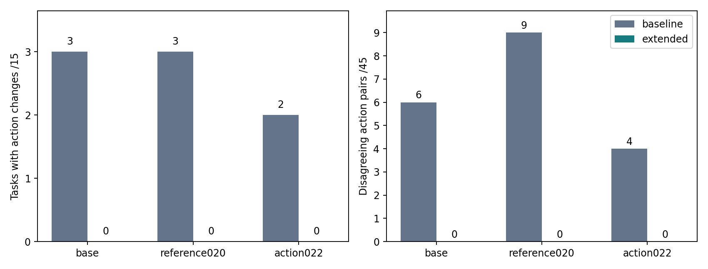
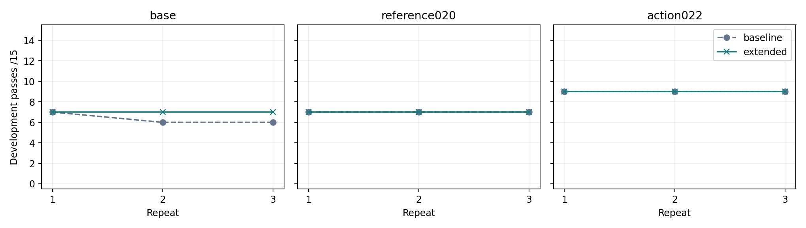
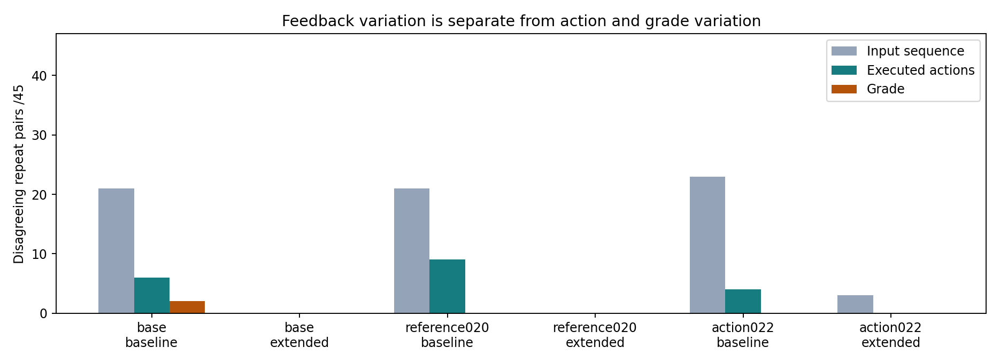
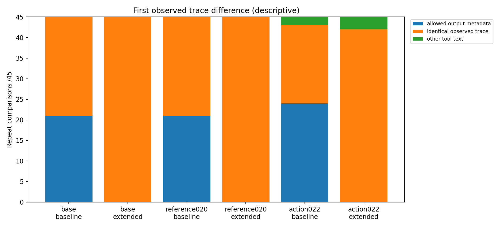
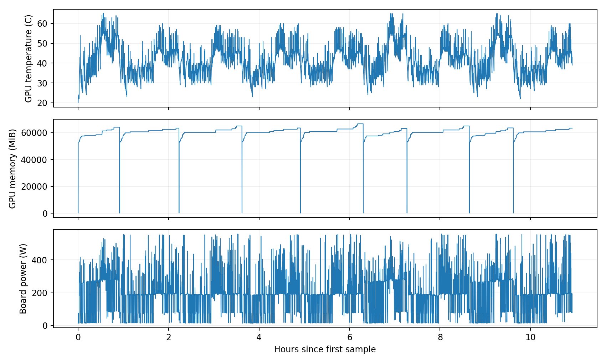

# 024：处理测试耗时后，动作是否更稳定？

**本轮观察到动作和评分更稳定，但没有证据表明模型获得了普遍的新能力。** 在 15 道既有开发题、4 个仓库、3 轮重复中，新增耗时规范化组没有出现跨轮工具动作分歧或评分翻转。三模型合计通过次数从 67/135 增至 69/135，两个新增通过都来自底座在同一道题上的重复运行。没有训练、开启最终测试或发布权重。

本轮对照是 **023 已有规范化规则 vs. 在其上增加耗时规则**，不是原始输出 vs. 规范化输出。baseline 保留文件列表日期和 JS 汇总耗时处理；extended 额外处理识别到的 pytest/unittest 汇总耗时、AVA 测试行末耗时。规则在任何本轮模型生成前冻结，9 次模型加载均使用原有 greedy / SDPA / seed 101 设置。

| 模型 | baseline 三轮通过数（每轮 15 题） | extended 三轮通过数 | 跨轮动作分歧（每组 45 对） | 跨轮评分分歧（每组 45 对） |
| --- | --- | --- | --- | --- |
| 底座 | 7、6、6 | 7、7、7 | 6 → 0 | 2 → 0 |
| 020 | 7、7、7 | 7、7、7 | 9 → 0 | 0 → 0 |
| 022 | 9、9、9 | 9、9、9 | 4 → 0 | 0 → 0 |

每组的 45 对 = 15 道题 × 三轮之间的 3 种配对；同一道题的配对相互关联，不能当成 45 道独立题。三个模型合计的跨轮动作分歧为 19/135 → 0/135。022 在这里的 9/15 也不能直接与历史单轮成绩相减，宣称训练获得了提升。

## 唯一评分翻转题发生了什么

底座在 `more-itertools-split_at` 上，baseline 为通过、失败、失败；extended 三轮均通过。两组的首次源代码修改都发生在第 5 次调用，因而本例不是“没有动手修改”的问题。

审计保留了全部四组评分不同的配对：两组是 baseline 内部跨轮比较，两组是相同轮次的 baseline/extended 比较。它们的首次反馈差异都位于第 5 次调用：命令、此前可编辑源代码状态、返回状态相同，识别到的 pytest 汇总耗时不同，经过 v2 后该反馈一致；首次模型输入和生成输出分歧出现在第 6 次调用。这个边界支持耗时反馈影响本题后续行为的解释，但不证明它是最终评分变化的唯一原因。

同轮对照中，底座通过次数为 19/45 → 21/45，020 为 21/45 → 21/45，022 为 27/45 → 27/45，观察到 2 次改善、0 次退步。所有稳定失败仍计入分母；extended 中底座每轮仍有 6 道题失败且未修改源代码，020 为 4 道，022 为 3 道。规范化没有解决这些能力问题。

## 反馈与生成仍需分开看

extended 的底座和 020 输入序列在跨轮配对中一致；022 仍有 3/45 对输入序列不同，但对应的工具动作和评分一致。不能将“动作稳定”写成“全部模型输入相同”。

完成后的只读复盘检查了全部 7 组首次残余反馈差异（baseline 内部 2 组、extended 内部 3 组、同轮对照 2 组）。它们都来自 022 的 `p-limit-arguments`，没有动作或评分变化。原始反馈先截断到 2,400 字符，再应用规范化；两个前缀都带原始截断标记，经过 v2 后，较短内容是较长内容的精确前缀，载荷长度为 2,341 或 2,349 字符。现有证据无法推断截断位置之后的内容是否相同。

这项[残余反馈诊断](feedback-residual-review.json)是明确标注的事后分析：初始行顺序假设未得到支持，随后检查了实际观察到的前缀长度关系。没有重新运行模型、重排测试输出、修改规范化规则或改写主要指标；原始收集清单保持不变，补充诊断单独记录在 [posthoc-collection.json](posthoc-collection.json)。

36 次预先规定的固定输入探针，6 组各重复 6 次，没有发现输出 token 序列变化。此外，实际任务中共有 446 组重复的精确输入 token 哈希，覆盖 2,454 次调用；同一模型同一输入组内，没有发现解码输出文本变化。两项检查的口径不同，也都不能证明所有未来输入或 CUDA 运行完全确定。

## 规则实际覆盖了什么

extended 共收到 1,311 条工具反馈，相对 baseline 规则额外改变 114 条反馈：处理了 93 个 pytest 汇总耗时字段、168 个 AVA 行末耗时字段，未观察到 unittest 匹配。字段数和反馈条数不是同一单位。一条反馈可能包含多个字段，旧规则改变的内容另行统计。

v2 没有引入额外截断，但原始 2,400 字符截断仍然存在。未匹配的时间、地址、输出顺序等不作泛化清洗；同样形状的源代码文本也可能命中正则，故全部实际转换都保留哈希审计。当前覆盖仅支持本轮观察，不能外推为任意项目日志都安全、完全稳定。

## 成本、硬件与完整性

- 实际北京时间：**2026-11-13 19:45:55 至 2026-11-14 06:41:12**，共 **10 小时 55 分 17 秒**。在原始 16 小时截止前结束，只有一次执行尝试，无补跑、无延期。
- 保留全部 270 次开发任务和 36 个探针。任务模型调用 2,658 次、生成 196,655 token；探针另生成 1,500 token。累计任务运行时间 38,244.887 秒，整轮时间另含模型加载、检查与探针。
- 每任务上限相同：12 次模型调用、6,144 个生成 token；每次输入上限 8,192 token、输出上限 512 token。相同上限不代表实际 token、FLOPs 或耗时相同。
- 无后端调用错误；30 次非法动作格式均保留计数，不能写成“零错误”。采样器错误为 0。
- 共 7,796 个硬件样本，最大间隔 5.128 秒；在 39,316.556 秒采样跨度内，按既定间隔规则覆盖率为 100%。GPU 最高 65°C，峰值显存 66,671 MiB，采样峰值功率 558.07 W，利用率中位数 32%。
- 采样区间内板卡能耗估计 **1.929 kWh**，不包含整机用电，也不外推未采样时间。显卡利用率受工具执行等环节影响，此数据本身不足以定位性能瓶颈。
- 执行后核验 93 个冻结文件、模型及适配器身份、独立判分与真实请求输入；最终任务规格和测试产物未进入本轮目录。模型权重、任务内容、原始轨迹和连接信息不公开。

## 对下一阶段的含义

024 完成了一个有限的稳定性诊断。当前证据支持在后续独立实验中沿用这些经过核验的反馈处理规则，同时记录截断边界；没有必要为了追求“所有输入完全一致”而无限扩大日志清洗。

下一轮应将主要投入转向新仓库上的可执行任务、经过验证的教师轨迹，以及参数和执行流程分开的同预算对照。现有 15 题已多次用于诊断，不再担当新能力提升的独立证据。最终测试继续封存，模型发布条件不因本次稳定性结果而降低。

[汇总及哈希](summary.json) · [全部配对](paired-stability.csv) · [逐轮成本](repeated-scores.csv) · [全部任务稳定性](task-stability.csv) · [冻结协议](protocol.json) · [复算方式](README.md)
