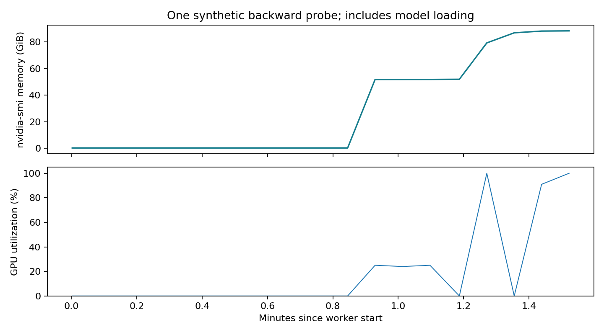

# 025：8K 训练容量探测

**通过预登记容量门槛**。这是合成输入的一次反向传播，没有优化器更新、学生权重或编码能力评分。

北京时间 2026-11-15 09:23:59 至 2026-11-15 09:25:33。监督进程超时：False；worker 退出码：0。

| 项目 | 观测 |
| --- | --- |
| 序列 token 数 | 8192 |
| 监督后缀 token 数 | 512 |
| LoRA 可训练参数 | 58363904 |
| 前向、反向及裁剪秒数 | 21.112714654998854 |
| 优化器步骤 | 0 |
| adapter 参数全部未变 | True |
| 冻结参数抽查未变 | True |
| 冻结参数无梯度 | True |
| 协议输入文件未变 | True |
| PyTorch 峰值 allocated | 83.54 GiB |
| PyTorch 峰值 reserved | 86.16 GiB |
| 设备总量减峰值 reserved | 8.80 GiB |
| 设备总显存 | 94.97 GiB |
| nvidia-smi 采样峰值 used | 88.29 GiB |
| 设备总量减采样峰值 used | 6.68 GiB |

预分配了两份 AdamW moment 形状缓冲，但没有创建或执行优化器；8 GiB 的预留门槛未调整。完整软件版本、数值、错误状态见 [result.json](result.json)。合成 loss 与梯度只作数值/容量检查，不能解释为任务质量。

硬件采样 19 次，最大相邻间隔 5.40 秒，采样错误 0 次。图中 nvidia-smi 显存与 PyTorch allocator 统计口径不同，不能互相替代。

局限：只执行一次最长形状的合成 batch，冻结基模只做参数抽查和无梯度检查。总量减 PyTorch reserved 的余量不等于实际可用显存；nvidia-smi 为稀疏采样，也不保证捕获真实峰值。真实数据、完整优化器更新、持续训练碎片和非 PyTorch 分配仍需正式训练验证。此结果不授权开发集提前评分或参数发布。

[固定规则](../../capacity-protocol.json) · [方法](../../capacity.md) · [监督进程回执](supervisor.json)
