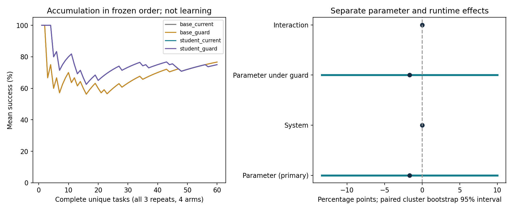
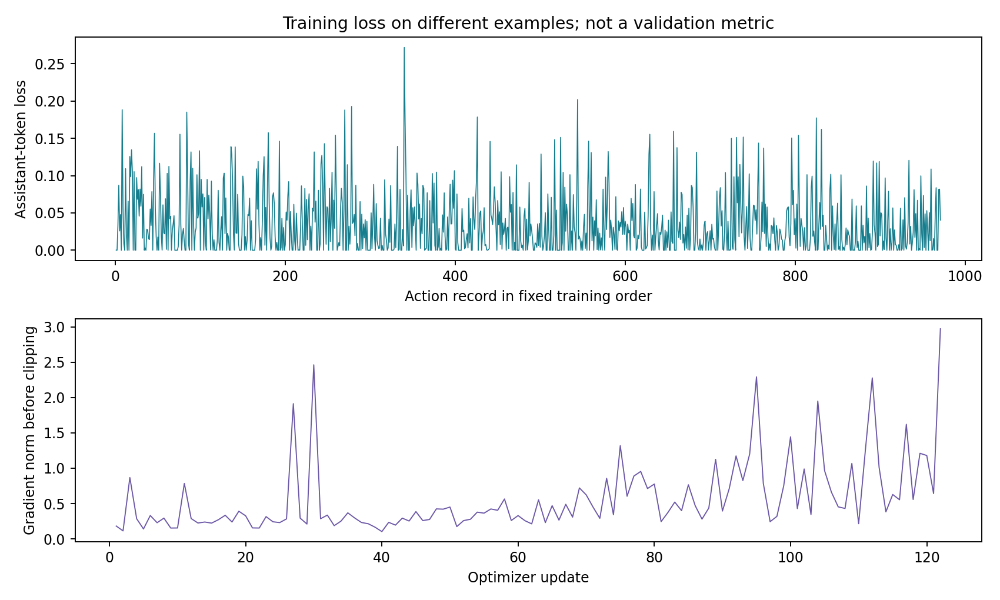
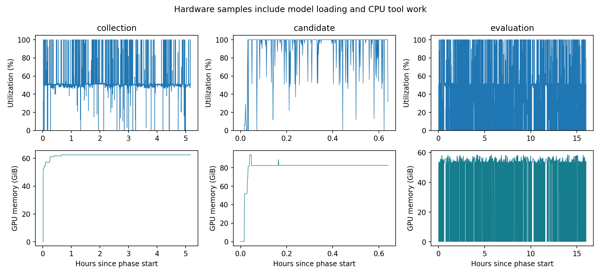

# 025：可验证自蒸馏四臂开发集结果

**预登记参数提升门槛：未达成。**

完整配对 60/60 道独立任务；每题三次重复。重复运行不算额外独立任务。
参数收益以 student_current − base_current 为主指标；系统收益与交互单列。缺失或未核验配对不能支持达标，普通失败计入分母，全部已知消耗保留。

| 组别 | 完整配对平均成功率 | 核验通过的运行数 | 已知调用 | 已知生成 token |
| --- | --- | --- | --- | --- |
| base_current | 76.67% | 180 | 1266 | 104565 |
| base_guard | 76.67% | 180 | 1530 | 113007 |
| student_current | 75.00% | 180 | 1335 | 76998 |
| student_guard | 75.00% | 180 | 1500 | 82275 |

| 效应 | 百分点 | 95% 配对分层区间 |
| --- | --- | --- |
| parameter | -1.67 | [-13.33, +10.00] |
| system | +0.00 | [+0.00, +0.00] |
| parameter_under_guard | -1.67 | [-13.33, +10.00] |
| interaction | +0.00 | [+0.00, +0.00] |

| 验收项 | 结果 |
| --- | --- |
| all_runs_accounted | 通过 |
| all_tasks_paired | 通过 |
| all_registered_families | 通过 |
| input_and_generation_audit_passed | 通过 |
| frozen_inputs_unchanged | 通过 |
| primary_gain_target | 未通过 |
| primary_interval_lower_above_zero | 未通过 |
| no_excess_repository_regression | 通过 |

| 阶段 | 单卡流水线小时 | 后端加载次数 | 已完成加载秒数 |
| --- | --- | --- | --- |
| collection | 5.170 | 未单独记录 | 未单独记录 |
| candidate | 0.641 | 未单独记录 | 未单独记录 |
| evaluation | 15.988 | 449 | 12513.66 |

覆盖三个阶段的日历跨度为 21.977 小时，已记录程序耗时合计 21.800 小时，阶段之间另有 0.177 小时。后者可能包含审计、发布等待和空闲时间，不能据此推算 GPU 利用率或账单。

卡时口径为本轮正式采集、唯一候选训练和四臂评测各自的控制器起止时间，包含加载、CPU 工具和判分，不等于 GPU 核函数活跃时间。此前试跑、校准和容量检查的成本保留在各自报告，不在此表中重复累计。未完成或未单独计时的后端加载不会被算作零成本，其耗时仍在流水线内；未知在途生成成本单独记录。
训练损失来自依次消费的不同动作样本，不能当作验证能力曲线。结果累计曲线仅按固定顺序加入完整任务，不用于选择 checkpoint。

逐题、逐仓库配对见 [pairs.csv](pairs.csv) 和 [families.csv](families.csv)；不修改代码、错误修改、非法提交、超预算以及未完成/未核验状态见 [runs.csv](runs.csv)。动作和结果的重复波动、硬件采样覆盖及所有已知成本见 [summary.json](summary.json)。

局限：仅六个仓库家族上的短构造故障，不能据此声称通用编码、长任务或先进小模型水平。公开源码可能进入底座预训练；仓库隔离不等于预训练去污染。任务定义保持私有，外部可重算公开统计、复用流程，但无法原样重跑全部私有任务。
本轮属于同底座高预算轨迹的自蒸馏。既有最终测试仍封存，开发结果不授权发布 ModelScope 参数。

统计复算：`python -m one_gpu_lm.verified.cycle_report --results <本目录>`；安装 matplotlib 后生成图，`--no-figures` 可仅用标准库复算表格与结论。
