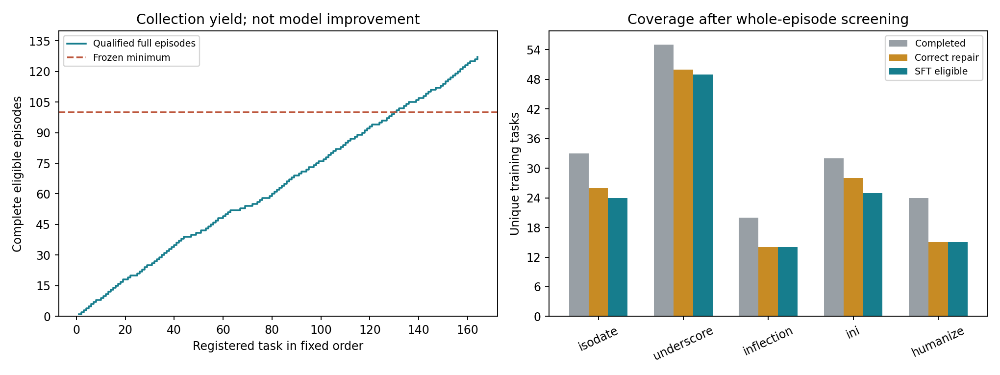
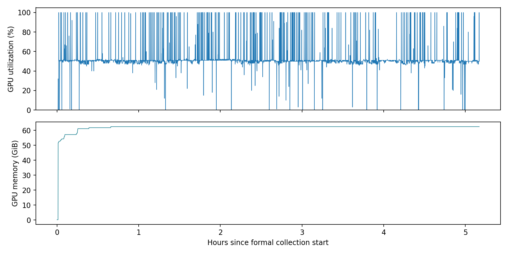

# 025：正式训练轨迹采集结果

**采集与审计：通过。** 本阶段没有更新学生参数，也没有新开发集评分。

固定 164 题、每题一次，完成 164 题，正确修复 133 题。整条轨迹通过执行取证和完整编码检查的有 127 条，对应 971 条动作记录；动作数不当作独立轨迹数。
北京时间 2026-11-15T09:43:27.600947+08:00 至 2026-11-15T14:53:40.247449+08:00，单卡流水线 5.170 小时，包含模型加载、CPU 工具和判分。原时限 12 小时，结束时间超过原截止 0.00 秒；监督收尾宽限 30 秒。

全部已知调用 1,926 次，生成 token 211,373，输入 token 5,847,793。未知在途生成 0 题，未运行 0 题，部分运行 0 题；未知成本不算零。

| 检查 | 结果 |
| --- | --- |
| data_gate_passed | 通过 |
| all_tasks_completed | 通过 |
| all_generation_cost_accounted | 通过 |
| supervisor_finished_normally | 通过 |
| backend_stopped | 通过 |
| within_original_supervised_time_limit | 通过 |
| frozen_files_unchanged | 通过 |
| no_parameter_or_heldout_work | 通过 |

| 仓库 | 登记 | 完成 | 正确修复 | 合格完整轨迹 |
| --- | --- | --- | --- | --- |
| gweis/isodate | 33 | 33 | 26 | 24 |
| jashkenas/underscore | 55 | 55 | 50 | 49 |
| jpvanhal/inflection | 20 | 20 | 14 | 14 |
| npm/ini | 32 | 32 | 28 | 25 |
| python-humanize/humanize | 24 | 24 | 15 | 15 |

逐题成本和失败见 [tasks.csv](tasks.csv)，完整编码及请求复核见 [audit.json](audit.json)，硬件采样覆盖、原截止与其他计数见 [summary.json](summary.json)。采集未运行新开发题，未重用此前试跑轨迹。
合格轨迹只允许进入单独冻结的唯一候选训练准备，不证明参数收益。外部可复算公开数字并复用流程；原始语料、题目、生成轨迹和权重保持私有，不能据此原样重跑所有私有任务。公开上游源码可能已进入预训练，仓库隔离不等于预训练去污染。
最终测试继续封存，不根据本轮训练数据产出发布 ModelScope 参数。

复算：`python -m one_gpu_lm.verified.collection_report --results <本目录> --no-figures`。安装 matplotlib 后省略 `--no-figures` 可重绘曲线。
