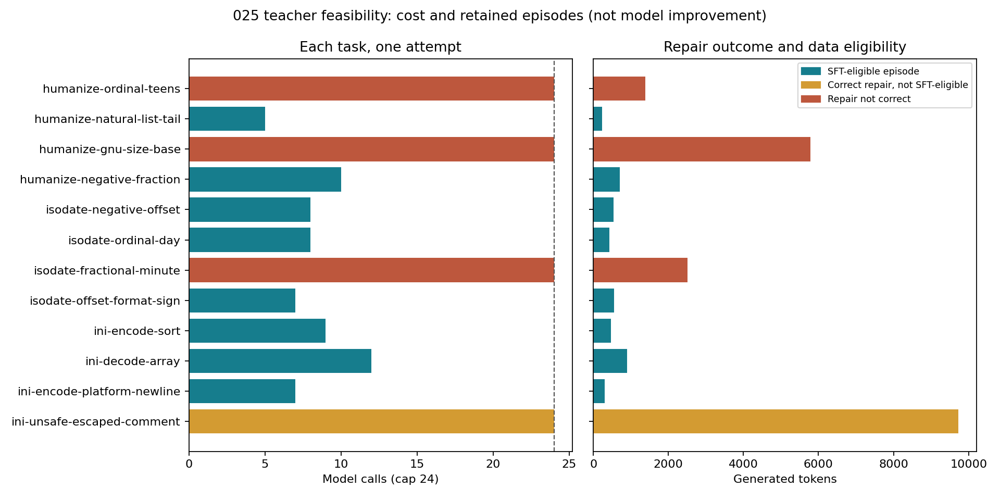
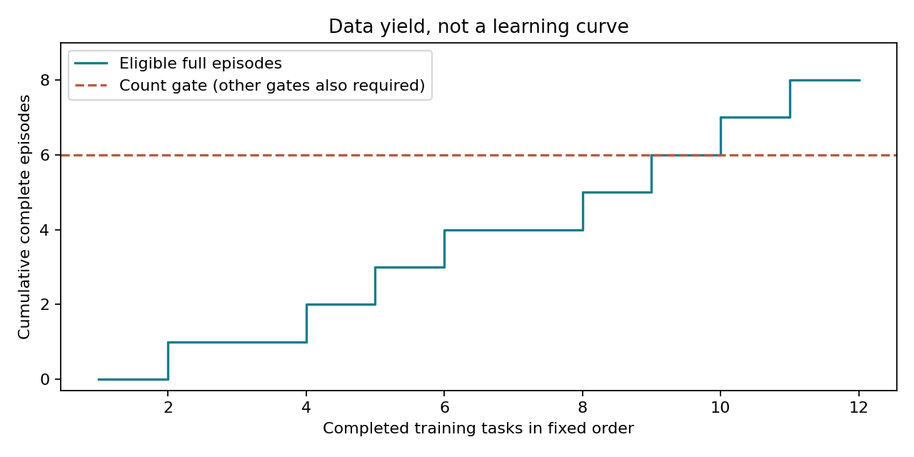
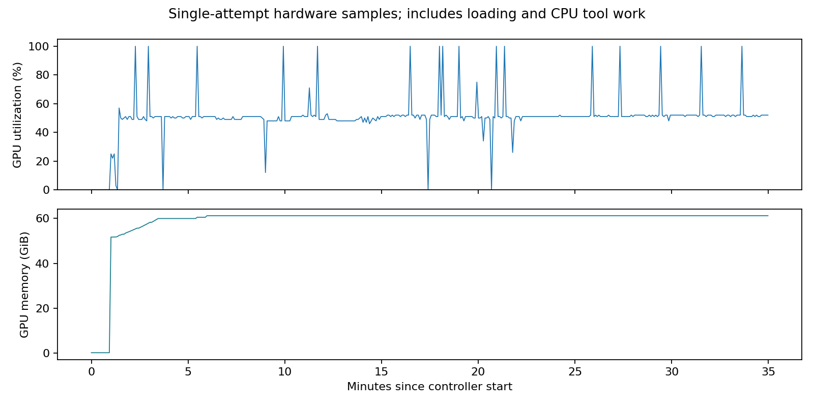
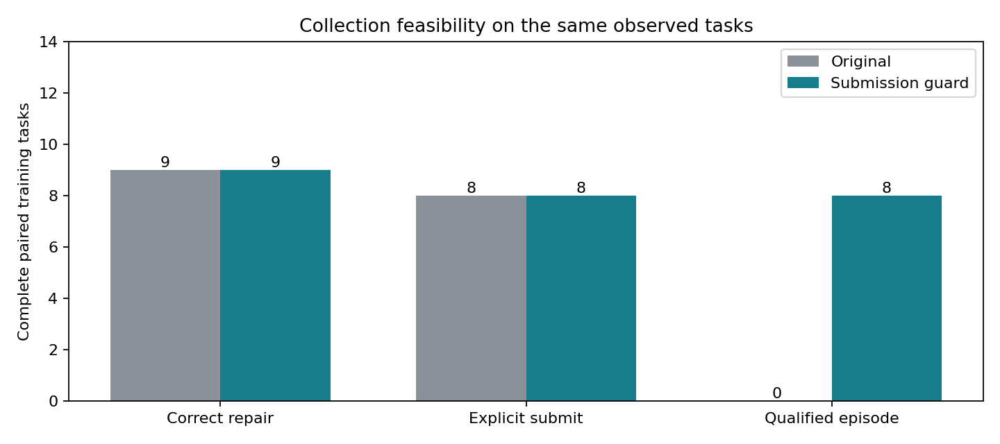

# 025：提交验证校准结果

本次可行性门槛：**通过**。独立判分通过 9/12 题；完整且通过训练编码筛查的轨迹 8 条。模型参数未训练，不能据此声称学生能力提高。

北京时间 2026-11-15 08:41:03 至 2026-11-15 09:16:04，控制器持续 35.02 分钟。共登记 12 道训练题，完成 12 道；本次协议每题尝试一次。此前首次试跑也完整保留，两个协议各自计数。
完整任务累计 162 次调用、23,548 个生成 token；保留全部失败。存在未完成或在途成本时，见 summary.json 的不完整列表，不能将其成本记为零。

| 检查 | 结果 |
| --- | --- |
| complete_single_attempt | 通过 |
| no_unaccounted_generation | 通过 |
| minimum_full_episodes | 通过 |
| repository_coverage | 通过 |
| language_coverage | 通过 |
| frozen_inputs_unchanged | 通过 |

合格完整轨迹对应 55 条有效动作编码；动作记录数不当作完整轨迹数。
请求审计使用实际模型 tokenizer 重建每次输入，核对输入/输出 token 摘要和完整目标编码。隐藏判分在新工作区执行，模型不可见参考修复和隐藏用例。

修复正确与轨迹合格分别计数。原规则要求单独执行完整的指定回归命令；带 cd 前缀或组合命令即使实际运行了检查，也不满足本次严格取证规则。不能据此说模型不会修复，也不回改门槛把旧轨迹算成合格。
后验诊断只描述已执行记录，不改变评分或采样：no_edit=3, executed_verified_episode_before_encoding_screen=8, correct_repair_without_strict_verification=1。详见 [diagnosis.json](diagnosis.json)。

硬件共 417 次采样、0 次采集错误，最大相邻采样间隔 5.22 秒；起止边界未覆盖 2.78 秒。平均利用率含权重加载与 CPU 工具时间，不代表持续训练吞吐。

局限：仅 3 个训练仓库上的 12 道构造故障，主要是局部修复，不代表真实长任务或独立仓库成功率；公开源码可能已进入底座预训练，不能证明预训练去污染。教师是同一个底座的高预算版本。未比较新开发集，未打开最终测试，未发布权重。

下一步仍须完成训练数据扩充、仓库家族隔离的新开发集、唯一学生候选及四臂同预算对照。试跑通过只说明采集方法在这批训练题上可行。

[固定规则](../../calibration-protocol.json) · [逐题数据](tasks.csv) · [完整摘要](summary.json) · [输入和编码审计](audit.json)

## 与首次试跑配对

完整且请求审计通过的配对 12 个；排除 0 个不完整或未核验配对，普通修复失败仍纳入。两次尝试的所有已观测成本与不确定成本另行保留。
修复改善 0 题，修复退步 0 题。本次明确拒绝、未执行的提交请求 8 次，计入调用和 token 成本，排除出正例监督目标。

干预反馈前的逐调用输入/生成摘要对照：shared_prefix_identical_without_rejection=4, shared_prefix_identical_through_first_rejection=8。这只能描述本次记录，不能证明未来运行完全确定。
相同训练题按时间先后运行，没有随机化交错，也没有更新模型参数；合格轨迹增加属于采集改进，不能写成独立模型能力提升。

[逐题配对](comparison.csv) · [配对、全部成本与前缀审计](comparison.json) · [保留的首次试跑](../2026-11-15/)
