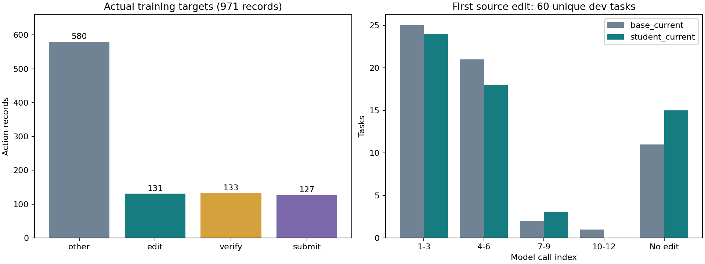

# 026：动作分配与未修改代码的诊断

**这是 025 的事后诊断，不是新训练成绩，也没有修改原来的评分或验收门槛。**

读取并校验全部 164 条采集轨迹及 720 次开发评测；轨迹哈希、工具元数据、原始反馈重算及 79 个冻结文件均核对。新增模型调用、优化器更新、任务命令执行均为 0。

开发表只使用第 1 次重复的 60 道独立题；完整三次重复仍保留在数字回执中，不把 180 次运行算成 180 道题。

## 五道退步题

| 任务 ID | 底座首次修改 | 学生调用 | 学生首次修改 | 上下文裁剪次数 | 生成触顶次数 | 反馈截断次数 | 查阅形态动作 |
| --- | --- | --- | --- | --- | --- | --- | --- |
| url-percent-case | 5 | 12 | 无 | 0 | 0 | 5 | 11 |
| packaging-missing-micro | 5 | 12 | 无 | 0 | 0 | 5 | 11 |
| url-zero-port | 4 | 12 | 无 | 0 | 0 | 0 | 9 |
| markup-replacement-escape | 5 | 12 | 无 | 0 | 0 | 1 | 12 |
| platformdirs-site-config-key | 9 | 12 | 无 | 0 | 0 | 3 | 11 |

这五题没有触发上下文裁剪或单次生成上限，学生都在 12 次调用内没有修改源码。反馈截断在部分题上存在，但不能仅凭相关性断言它导致了退步。查阅命令不同于完全相同命令的循环；“持续阅读”和“机械重复”需要分开。

## 实际训练目标分配

| 审计动作类型 | 动作记录 | 监督 token | 训练时平均逐记录损失 |
| --- | --- | --- | --- |
| edit | 131 | 17646 | 0.032703 |
| other | 580 | 34079 | 0.050000 |
| submit | 127 | 4318 | 0.000534 |
| verify | 133 | 4256 | 0.003906 |

127 条完整轨迹共 971 条动作记录。其中 580 条为原始审计的 other；本次按保守命令语法进一步识别出 420 条查阅形态动作，其余不能直接叫作无效阅读。源码修改为 131 条，只有 4 条完整轨迹包含多次源码修改。

教师首次修改的中位调用是第 4 次；11 条轨迹到第 8 次后才首次修改，3 条超过第 12 次。16 条完整教师轨迹使用了超过 12 次调用，而学生开发预算为 12 次。

这些数字提示需要核查两件事：训练时是否过多奖励继续查阅，以及是否缺少学生失败状态下的修复示范。它们不能单独证明损失权重、学习率或过拟合是原因。平均损失来自不同样本，也不能作为各类动作的能力分数。

严格“先修改 → 单独执行指定回归且失败 → 再修改”的计数为 0；这个规则不包含复合命令里的测试，也不包含返回码为 0 的自定义打印诊断，因此**不能解释为没有任何纠错示范**。多次修改也不自动等于纠错。

## 下一步实验设计

优先准备训练分区内的同状态接手采集：先让 025 学生运行；在预先固定的第 3 次完整工具反馈后，若尚未修改源码，保存当时可见历史及工作目录。底座教师从同一状态继续，原学生也继续，以相同剩余调用和 token 上限比较。教师不得获得参考修复、隐藏判分反馈或开发题。

这将验证能否产生有用的修复示范；它尚不是学生参数提升实验。所有失败、教师额外成本和任务重叠都要保留。只有执行与编码审计通过的训练侧接手轨迹，才可进入下一轮候选数据准备。开发轨迹仅用于诊断，不能转成训练目标。具体的训练侧样本清单及边界见 [接手试跑设计](../../recovery-pilot-design.json)。

本阶段没有训练新适配器、调用外部教师服务或打开最终测试。下一次 GPU 采集尚未启动，执行器与启动协议仍需完成后冻结。

复算：`python -m one_gpu_lm.verified.behavior_report --results <本目录>`；加 `--no-figures` 可只用标准库生成 [summary.json](summary.json)、[pairs.csv](pairs.csv) 与本报告。来源为 [diagnosis.json](diagnosis.json)；原始任务、命令、模型文本及权重不公开。
