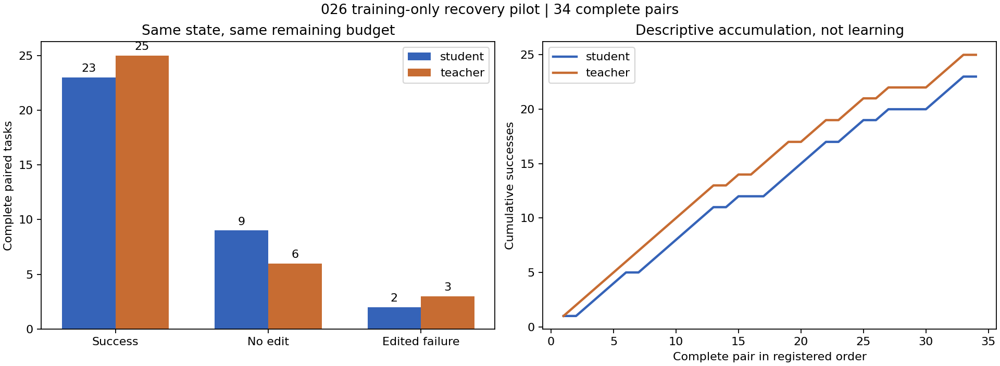

# 026: live-state recovery pilot

This is a training-data feasibility experiment, not a new model-quality evaluation. Tasks may overlap the 025 student's training. No student parameter update or final-test access occurred.

- Registered training tasks: 48; complete audited pairs: 34.
- Student successes: 23/34; base teacher successes after student prefix: 25/34.
- Teacher gains / regressions: 3 / 1; net gain: 2.
- Qualified unique teacher continuations: 21 across 4 training families.
- Preregistered data-feasibility gate passed: **False**. This gate does not authorize model or weight release.
- Repository-cluster bootstrap interval: -8.00 to 16.67 pp (5 repository clusters). Five available families and deterministic synthetic repair tasks limit generalization; this is descriptive uncertainty, not a significance claim.

Both branches restore the same live state after three student calls. No edit at call three is a sampling rule, not proof that the student is stuck. Each receives at most nine additional calls, with generated tokens and actor time deducted from the same prefix. Actual collection cost charges that prefix once. Backend loading is excluded from actor caps and included in pipeline duration. Early edits, early completion, nonserializable states and incomplete attempts are retained in the audit; only completed eligible pairs enter the paired comparison.

The snapshot preserves file contents, empty directories, modes and mtime plus the complete visible history. Inode, ctime, atime, external clock and process memory are not preserved. No hidden/reference files are mounted in the actor. Identical snapshots do not imply perfectly identical hardware timing.

Positive continuation targets include every actually executed teacher action in a qualified continuation, including earlier failed commands. Malformed outputs and policy-rejected unexecuted requests remain in history and exclusion counts. Student prefix actions are never teacher targets. An encoding failure rejects the whole continuation; targets are not silently truncated.

The cumulative plot follows the preregistered task order and is **not a training learning curve**. Raw prompts, commands, tasks, source documents, credentials and weights are not published. `audit.json`, `execution.json` and `telemetry.csv` regenerate the numeric report with `python -m one_gpu_lm.verified.recovery_report --results <directory>`.
