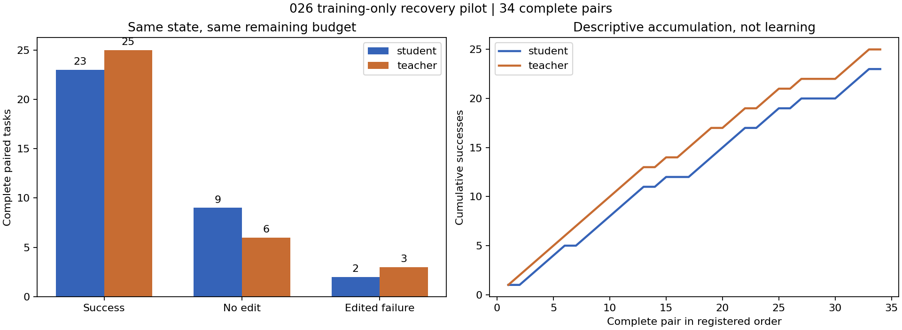

# 026：同一现场，学生继续还是底座接手？

**未通过预设的采集可行性门槛；本轮结果不足以支持直接扩大这套采集方案。** 本轮验证训练数据采集方法，尚未训练新的候选模型，不能据此宣称模型能力提升或发布参数。

| 项目 | 结果 |
|---|---:|
| 固定训练任务 | 48 |
| 完整、审计通过的配对 | 34 |
| 未配对、仍保留学生结果的任务 | 14 |
| 学生继续：独立判分成功 | 23/34 |
| 底座接手：独立判分成功 | 25/34 |
| 教师带来的新增成功 / 反向退步 | 3 / 1 |
| 净新增成功 | 2 |
| 合格教师接手轨迹（按任务去重） | 21 |
| 合格轨迹覆盖训练来源家族 | 4 |
| 导出的教师动作记录 | 110 |
| 导出的监督 token | 8921 |

每道题先让现有 025 学生模型运行 3 次调用。前三次未修改源码、未结束且仍有预算时，保存其工作目录与可见历史，再分别让原学生和同版本底座继续。两边总上限都是 12 次调用、6144 个生成 token、600 秒执行时间，不能在接手时重置预算。前三次未修改源码只是采样条件，不能证明模型已经卡住。

两条路径都保留前三次学生行为，所以这里的“底座接手”是混合路径，并非从头运行底座的独立能力分数。按预定索引交替先运行哪一条分支；不按结果挑选或补跑任务。所有任务处置见 [audit.json](audit.json)。

图中的累积成功数按固定任务顺序展开，不是训练学习曲线。成功判分与合格训练示范分别统计：合格轨迹还必须实际修改源码、在最终源码上单独运行回归命令、显式提交，并通过完整编码审计。错误格式与未执行的请求保留在历史和排除记录中，不能成为正向动作目标；学生前三次动作不作为教师监督目标。

## 本轮学到了什么

预设的四项条件中，完整审计、至少 12 条合格示范、至少 3 个来源家族均通过；净新增成功只有 2 题，未达到至少 3 题的要求。不降低门槛，不增加题目补足分数，不直接进入候选训练。

- 三道新增成功分别是 `ini-parse-key-whitespace`、`isodate-time-comma-fraction`、`isodate-duration-negative-fixed`。这三题的学生一直未改源码，底座接手后完成了修改、验证和提交。
- 反向退步题为 `humanize-intcomma-grouping`：学生在第 9 次调用修改后通过独立判分，但耗尽预算，未完成最终验证和提交；教师接手仍未修改源码。因此它计入主要成功指标的退步，不能被删掉，也不能把学生路径当作合格训练示范。
- 双方都成功 22 题、都失败 8 题；其中 5 题双方都没有修改源码。教师仍有 6 题不修改源码、3 题修改后未修对，换回底座不能普遍解除这些失败。
- 另有 14 题在前三次调用内已经修改源码，按固定规则不配对，全部保留了学生结果与成本；这些学生路径最终均通过独立判分。它们不进入 34 组配对的分母。
- 教师通过独立判分的 25 题中，4 题缺少最终独立验证和显式提交，因此只导出 21 条合格接手轨迹。没有编码失败或截断目标；合格轨迹中的 19 次未执行或格式不合格请求不作为监督目标。
- 110 条导出动作包含 21 次修改、21 次单独验证、21 次提交、47 次其他动作。每条合格轨迹恰好一次修改，没有多次源码修改的成功纠错示范。这说明采集器能够得到有效接手样本，但这批样本仍未补足 025 诊断中发现的多次修改覆盖不足。不能把它解释成“已经解决改错后不会纠错”。

下一步应先利用已有记录检查这 8 道双方失败题的可见证据、失败反馈和剩余预算，并设计新的、只来自训练侧的纠错采样规则；同时验证新规则确实能产生经过执行验证的多次修改轨迹。上述建议尚未运行，也不使用开发题答案生成训练样本。当前 21 条示范只保留为私有、可审计的候选资料。

## 成本与硬件

- 北京时间：2026-11-16 10:52:57 至 2026-11-16 13:25:04。
- 整轮流程约 152.12 分钟，包含模型加载与切换；监督进程总时长约 152.16 分钟。
- 实际新调用 687 次，生成 56601 token，输入 1884702 token。共享前三次只计一次。
- 其中教师接手新增 246 次调用、26672 个生成 token。
- 累计实际 actor 时间约 118.84 分钟，单独列出；模型加载和独立判分不计入每条路径的 actor 上限。
- GPU 采样 1811 条，采样错误 0，最大采样间隔 5.31 秒。
- 采样最高温度 61℃，显存峰值 60.64 GiB，平均 GPU 功率 203.72 W。GPU 采样能耗约 0.517 kWh，不是整机插座电量。

本地只读 SSH 监控曾断开一次，恢复后核实原监督与采集进程仍在运行，截止时间不变，未重启采集。远端硬件采样持续记录，见 [观察记录](observation-notes.json)。

原始安全数字在 [summary.json](summary.json)、[hardware.json](hardware.json)、[execution.json](execution.json) 和 [telemetry.csv](telemetry.csv)。公开硬件 CSV 仅将换行符统一为 LF，所有行与字段值不变；原始与公开文件的哈希见观察记录。模型切换采用正常受控卸载，生命周期中的终止返回码应结合监督记录阅读。

## 结论的边界

- 本轮任务来自 5 个经审查的训练来源家族，与 025 的训练数据可能重叠，属于人为构造的修复任务。它不是独立开发集，也不能代表真实长任务的总体成功率。
- 配对成功率差值为 5.88 个百分点；按仓库家族重采样的描述性区间为 [-8.00, 16.67] 个百分点。家族数量少，不能把这个区间当作广泛编码能力的证明。
- 预设门槛同时要求至少 12 条按任务去重的合格接手轨迹、3 个来源家族、净新增至少 3 个成功任务，以及全部尝试和成本审计通过。门槛用于判断是否值得扩大数据采集，不是模型发布门槛。
- 快照覆盖持久工作目录 `/work` 的内容、空目录、权限和 mtime，以及完整可见历史与预算。只读运行时另行固定；`/tmp`、`/proc`、`/dev` 属于每次命令的沙箱状态，不承诺恢复整个操作系统、inode、ctime、atime、外部时钟或进程内存。
- 本轮新增优化器更新为 0，最终测试集继续封存，模型权重未发布。原始任务、命令、轨迹、源码与连接信息保持私有；公开数字可以复算报告，完整实验需要授权任务数据或自备符合接口的数据。

执行前已发布[固定协议](../../execution-protocol.json)和[选择规则](../../recovery-pilot-design.json)。公开报告复算命令见 [英文生成报告](README.md)。
