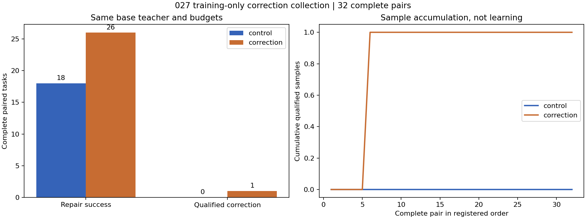

# 027: failure-conditioned corrective sample collection

This is a training-data feasibility comparison, not independent model-quality evidence. Both arms use the same pinned base teacher, fresh broken workspaces and the same 18-call budget. The correction arm adds a generic workflow prompt, actor-visible progress feedback and a mandatory standalone regression after every source edit. Their combined effect is measured; this experiment does not isolate each component.

- Registered tasks: 32; completed audited pairs: 32.
- Independent repair successes: control 18, correction 26.
- Qualified multi-edit corrective trajectories: control 0, correction 1.
- Correction arm qualified families: 1; qualified supplemental tasks: 0.
- Qualified gains / regressions: 1 / 0; net: 1.
- Preregistered collection feasibility gate passed: **False**.
- Actual physical model calls: 698; generated tokens: 58326.

Qualification requires an actual source edit, a standalone failing visible regression on that edited state, another distinct source change, final standalone passing regression, explicit submission, independent fresh grading, intact protected files throughout, complete request/feedback/cost audit and untruncated encoding. Timeout, rejected requests, an untouched original fault, compound-command exit codes and two edits without intervening regression failure do not qualify. A source change alone is not a semantic proof of repair.

Only the final successful edit and its subsequent executed verification/submission actions are positive training targets. Failed edits remain in context. The actual input for the final edit must retain both the failed edit and its failure feedback; context truncation cannot silently remove them. No deliberate mistakes are injected to obtain additional edits.

The right-hand curve is accumulation over fixed task order, not a training learning curve. Eight cases are selected from observed 026 failures; 24 additional training tasks are selected by fixed hash and repository round-robin, excluding all 026 tasks. Neither cohort is an independent development or final test set. The 18-call comparison must not be presented as a fair comparison against 026's 12-call results.

No student parameter update or final-test access occurs in this collection stage. A passed data gate only permits preparation of a separately frozen single-candidate training experiment; it does not establish model improvement or authorize weight publication. Raw source, tasks, prompts, commands, trajectories and weights remain private.

Numeric tables and figures regenerate with `python -m one_gpu_lm.verified.correction_report --results <directory> --protocol <execution-protocol.json>`. See `audit.json`, `execution.json`, `telemetry.csv` and `hardware.json` for recorded evidence. Hardware power is GPU telemetry, not wall-outlet electricity.
