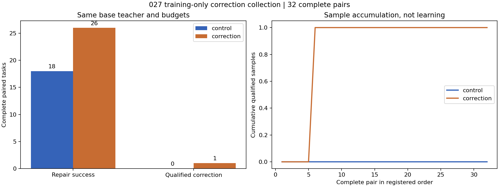

# 027：能否采到真实失败后修正成功的示范？

**未通过预设采集门槛，本轮不进入候选训练。** 本报告评价训练数据采集流程；本轮没有更新模型参数，不能据此宣称 27B 编码能力已经提升。

| 指标（32 组完整配对） | 原流程 control | 纠错流程 correction |
|---|---:|---:|
| 独立判分修复成功 | 18/32 | 26/32 |
| 合格多次修改纠错示范 | 0 | 1 |
| 合格示范来源家族 | 0 | 1 |
| 合格补充题 | 0 | 0 |
| 没有修改源码 | 14 | 6 |
| 修改后仍失败 | 0 | 0 |
| 实际调用 | 411 | 287 |

合格示范新增 1 道、反向减少 0 道，净增 1 道。完整配对见 [pairs.csv](pairs.csv)，逐项审计见 [audit.json](audit.json)。

按独立判分修复结果配对：新增成功 9 道，退步 1 道，净增 8 道。

- 新增成功：`underscore-difference-polarity`、`humanize-intcomma-string-groups`、`isodate-duration-fraction-components`、`isodate-duration-zero-format`、`humanize-delta-minute-rounding`、`isodate-duration-fraction-format`、`ini-unsafe-trailing-backslash`、`humanize-delta-millisecond-scale`、`underscore-size-null`。
- 退步：`underscore-indexof-negative-offset`。

图中曲线按固定任务顺序累计合格示范，不是参数训练的学习曲线。两边均使用同一个固定版本的底座教师，从全新故障源码开始，不继承 026 的学生前缀。统一上限为 18 次调用、每次生成 512 token、累计生成 9216 token、输入 8192 token、actor 900 秒；不能与 026 的 12 次调用分数直接比较。

## 哪些样本可以用

必须观察到真实链条：源码修改 → 在该修改状态上单独回归失败 → 后续再次修改 → 最终单独回归通过并提交 → 新工作目录独立判分通过。保护文件、实际请求、反馈、源码状态与预算都需审计。超时、拒绝执行、复合命令状态码、未改动的原始故障，或者没有中间失败的两次修改，都不充数。

纠错流程得到的 1 道合格任务，在私有导出中保留 4 条正向动作、378 个监督 token。只监督最后成功的源码修改及其后的实际验证、提交等动作；之前的错误修改和失败反馈只作为上下文。最后成功修改的实际输入必须仍包含错误修改与失败反馈；不截断目标来凑数量。

- 原流程：修复成功中只有一次源码修改的任务 18 道；编码不通过的候选 0 道。
- 纠错流程：修复成功中只有一次源码修改的任务 25 道；编码不通过的候选 0 道。

修复成功和多次修改纠错示范是两个指标。一次修对是好的任务结果，但不能充作“失败后纠错”样本。因此必须同时阅读成功率和合格样本产量，不能只追求修改次数。

| 流程 | 至少修改一次 | 至少修改两次 | 存在符合规则的中间失败 | 行为条件合格 | 编码与审计后合格 |
|---|---:|---:|---:|---:|---:|
| 原流程 | 18 | 0 | 0 | 0 | 0 |
| 纠错流程 | 26 | 1 | 1 | 1 | 1 |

“符合规则的中间失败”要求在已修改状态上单独回归失败，且随后还发生另一项不同源码修改；该列不统计所有报错。行为合格还要求最终验证、提交、独立判分和保护文件条件。编码审计再检查失败上下文和完整监督目标。

## 原来双方都失败的 8 道题

| 诊断任务 | 本轮原流程 | 本轮纠错流程 | 纠错流程合格示范 |
|---|---|---|---|
| `underscore-difference-polarity` | 失败；修改 0 次；调用 18 次 | 成功；修改 1 次；调用 7 次 | 否 |
| `humanize-delta-negative` | 成功；修改 1 次；调用 15 次 | 成功；修改 1 次；调用 9 次 | 否 |
| `ini-nested-section-boundary` | 失败；修改 0 次；调用 18 次 | 失败；修改 0 次；调用 18 次 | 否 |
| `inflection-camelize-lower-first` | 成功；修改 1 次；调用 8 次 | 成功；修改 1 次；调用 6 次 | 否 |
| `humanize-intcomma-string-groups` | 失败；修改 0 次；调用 18 次 | 成功；修改 1 次；调用 6 次 | 否 |
| `isodate-duration-fraction-components` | 失败；修改 0 次；调用 18 次 | 成功；修改 2 次；调用 11 次 | 是 |
| `underscore-partial-dynamic-context` | 失败；修改 0 次；调用 18 次 | 失败；修改 0 次；调用 18 次 | 否 |
| `inflection-humanize-id-anchor` | 成功；修改 1 次；调用 16 次 | 成功；修改 1 次；调用 7 次 | 否 |

这里比较的是 027 中重新从故障状态出发、预算相同的两条路径。026 的学生接手状态、调用上限与本轮不同，不能把两轮的修复比例差异归因于本轮规则。

## 预设门槛与覆盖

| 条件 | 判定 |
|---|---|
| 全部配对与成本审计 | 通过 |
| 至少 6 道合格任务 | 未通过 |
| 至少 3 个来源家族 | 未通过 |
| 至少 3 道补充题 | 未通过 |
| 合格示范净增至少 3 道 | 未通过 |
| 修复成功总数不净下降 | 通过 |

| 任务来源 | 流程 | 修复成功 | 合格纠错示范 |
|---|---|---:|---:|
| 8 道诊断题 | 原流程 | 3/8 | 0 |
| 8 道诊断题 | 纠错流程 | 6/8 | 1 |
| 24 道补充题 | 原流程 | 15/24 | 0 |
| 24 道补充题 | 纠错流程 | 20/24 | 0 |

8 道诊断题按 026 已观察到的失败选取；24 道补充题按预先固定的哈希和仓库轮转选取，排除全部 026 题。两组都是训练侧构造任务，可能与早期训练数据重叠，不是独立开发集或真实长任务能力认证。本轮合并改变了通用提示、进度反馈和修改后强制单独回归，不能拆分各组件的因果贡献。

## 本轮得到什么，下一步该改什么

在这 32 道训练题上，流程改动把修复成功率从 56.25% 提高到 81.25%，实际调用从 411 次降到 287 次，减少约 30.2%。两边的预算上限相同，成功后正常结束，所以实际成本可以不同。这是流程对照结果，尚未证明学生参数或独立仓库泛化能力提高。

真正的多次纠错样本来自 `isodate-duration-fraction-components`：第 4 次调用修改源码，第 6 次单独回归失败，第 8 次再次修改，第 9 次单独回归通过，第 11 次提交并通过独立判分。错误修改和失败反馈保留在第 8 次调用的实际输入中；导出的正向动作是第 8～11 次调用，最长编码 4296 token，无目标截断。这验证了采集和编码通路确实能得到一条自然产生的纠错示范。

产量不足的主要可见原因是**题目大多一次修好，或者一直没有改动**。纠错流程 26 道成功里有 25 道只改一次；其余 6 道失败均耗尽 18 次调用而没有修改源码。行为合格和最终编码合格都是 1 条，不是审计丢掉了大量本来合格的样本。补充 24 题贡献了 20 次成功，却没有新增合格纠错链。

唯一退步题 `underscore-indexof-negative-offset` 中，原流程第 2 次调用修改、共 6 次调用完成；纠错流程耗尽 18 次调用仍未修改，工具格式错误为 0。该失败发生在首次修改之前，因此不能归因于“修改后的强制回归”消耗了调用。通用流程提示仍可能改变行动路径，本次合并干预无法进一步分辨各提示的影响。

下一阶段更值得检验的是：按预先固定规则筛选训练轨迹中**已经实际修改、已见回归失败且尚未修好**的状态，再让教师接手，并保留相同状态、相同剩余预算的对照。这样直接针对真实错误补丁的覆盖缺口，不人为制造错误，也不通过要求多改几次来凑样本。本轮没有启动这一新实验，也没有降低当前采集门槛。

## 成本与完整性

- 北京时间 2026-11-16 13:54:48 至 2026-11-16 15:21:51，流程耗时 87.06 分钟，包含模型加载、工具与独立判分。
- 共 698 次实际模型调用、58326 个生成 token、2008905 个输入 token；没有共享前缀，不重复使用 026 调用计入本轮成果。
- 实际累计 actor 时间 85.59 分钟；未知生成成本记录 0。
- GPU 采样 1036 条，采样错误 0，最大间隔 5.07 秒；峰值温度 66℃，显存峰值 66.08 GiB。
- GPU 平均采样功率 297.81 W，采样能耗约 0.432 kWh；这不是整机插座电量。工具等待会影响平均 GPU 利用率，本轮不是满载性能压测。
- 冻结输入未改变，按预定顺序保留全部尝试。公开 CSV 只统一 LF 换行，字段值不变；原始与公开哈希、观察连接情况见 [observation-notes.json](observation-notes.json)。

安全数字与复算入口见 [生成报告](README.md)、[summary.json](summary.json)、[hardware.json](hardware.json)。原始任务、命令、轨迹、源码、连接信息和模型权重均未发布。最终测试继续封存；采集门槛通过也不等于通过模型发布门槛。
