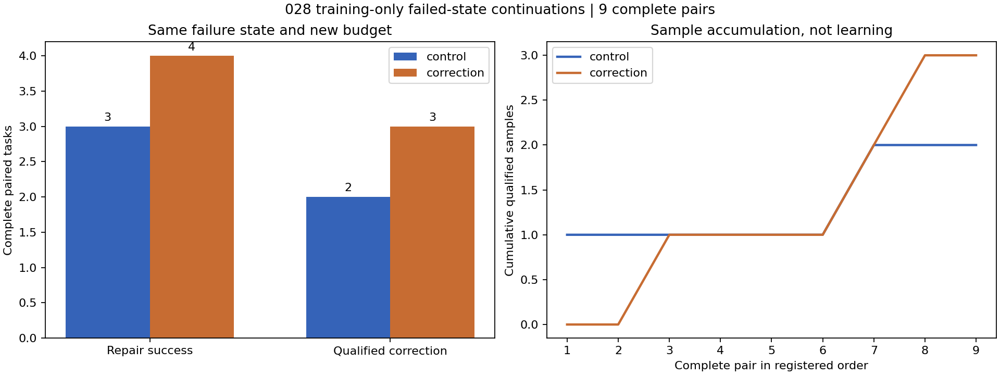

# 028: continuations from admitted historical failure states

Training-data feasibility only. No model parameter update or final-test access.

- Complete audited pairs: 9 / 9.
- Repair success: control 3, correction 4.
- Qualified corrective continuations: control 2, correction 3.
- Correction qualified families: 3; qualified task IDs beyond the previously qualified 027 task: 3.
- Preregistered data gate passed: **False**.
- Actual new model calls: 184; generated tokens: 22873.

Both branches restore identical newly reconstructed snapshots and full visible historical prefixes. A recorded standalone visible revalidation confirmed that each modified state still fails. The historical system message is retained in both branches; one prefix already includes 027 guidance. Control adds only a shared continuation-budget and validation notice. Correction additionally adds generic guidance and requires a standalone visible regression after every new source edit. This is a bundled continuation-policy comparison, not isolated component causality.

Each arm receives 12 new calls, at most 512 generated tokens per call and 6144 in total, 8192 input tokens and 600 actor seconds. Historical generation costs are reported separately and are not new calls. Snapshot reconstruction preserves current content/modes/mtime for equal forks, not the old inode, external clock or process memory.

Qualification requires a new source correction, final standalone passing regression, explicit submission, fresh independent training-task grading, protected files and complete request/state/cost replay. The final successful edit input must still contain the actual historical failed-edit action and the recorded revalidation feedback. Only the final successful new edit and subsequent executed actions are positive targets; old actions and earlier new failed edits are context only. Whole continuations with missing context or truncated targets are rejected.

These are selected training failures, possibly previously used training tasks. They do not establish independent model quality or long-task competence. A passed collection gate permits a separately frozen candidate training/development stage, not weight release.

Regenerate numeric outputs and the plot with `python -m one_gpu_lm.verified.failure_report --results <directory> --protocol <execution-protocol.json>`. Raw tasks, source, commands, histories and weights remain private. GPU telemetry is not wall-outlet electricity. The curve is cumulative sample yield, not a training learning curve.
