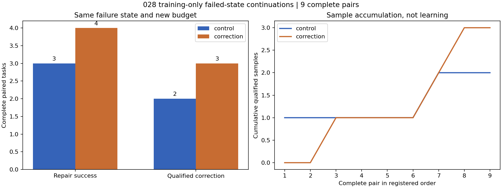

# 028：从真实错误补丁状态接手的结果

**未通过预设数据采集门槛，本轮不启动候选训练。** 这是训练数据采集实验；当前采集阶段参数更新为 0，最终测试保持封存，不能把本报告的修复率当成新模型能力。

| 指标（9 组完整配对） | control 接手 | correction 纠错接手 |
|---|---:|---:|
| 独立判分修复成功 | 3/9 | 4/9 |
| 合格纠错示范 | 2 | 3 |
| 合格来源家族 | 2 | 3 |
| 合格题中不属于 027 唯一合格题 | 1 | 3 |
| 没有新的源码修改 | 4 | 3 |
| 新修改后仍失败 | 2 | 2 |
| 新增模型调用 | 96 | 88 |

独立修复结果新增成功 1 道、退步 0 道。

主指标检查预算内最终源码能否通过独立判分；没有显式提交的路径也可能在这项指标上通过。合格训练示范还必须完成可见验证与提交，不能把两项计数混为一谈。

- control：独立判分通过但没有显式提交 1 道；判分通过但没有在最终源码上完成单独可见验证 1 道。
- correction：独立判分通过但没有显式提交 1 道；判分通过但没有在最终源码上完成单独可见验证 0 道。

- 新增成功：`underscore-flatten-depth`。
- 退步：无。

曲线按登记任务顺序累计合格样本，不是参数训练的学习曲线。完整配对见 [pairs.csv](pairs.csv)，资格与成本审计见 [audit.json](audit.json)。

## 先证明现场确实还没有修好

在 025、026、027 的 310 条已审计训练轨迹中，按每条轨迹内部的源码状态去重，找到 24 个修改后报错的候选，涉及 11 道题。跨轨迹再按“题目＋源码哈希”去重是 21 种状态，不能把重复历史计成独立样本。隔离重放核对源码、保护文件和规范化反馈后，再单独执行原有可见回归：22 个候选仍失败，对应 19 种题目＋源码状态；最终按任务去重选择 9 道题、4 个来源家族。

`humanize-clamp-callable-marker` 与 `isodate-equality-month-conversion` 两个候选单独回归通过，因此被排除。它们说明：复合命令返回非零不能直接作为错误补丁证据。准入共执行 218 条 CPU 命令，耗时 24.76 秒，没有模型调用，也没有使用隐藏检查判定状态资格。[完整准入记录](../../preparation/admission.json)

每题按预先固定规则取第一个确认状态，不根据后续历史是否修好来选。两组恢复同一份新快照，文件内容、权限、mtime 与可见历史一致。这些是经过重建和当前回归确认的现场，不等于保存了原来的 inode、时钟和进程内存。

## 接手预算与训练目标

两边均使用同一个固定版本的 27B 底座，每条路径最多 12 次新调用、每次生成 512 token、累计生成 6144 token、输入 8192 token、600 秒 actor 时间。历史调用成本单列，不扣减这份新增预算，也不再次算作模型执行。

control 保留历史提示与提交前验证规则，增加共用的预算和当前回归确认反馈。correction 再增加通用纠错提示、进度反馈、每次新修改后先单独回归的约束。源自 027 的一份前缀本来就有纠错指导，两组都继承它；这是相同历史上的新增接手干预，不是完全无指导模型与有指导模型的比较。

新修正必须改变错误源码并通过单独回归、显式提交与新目录独立判分。只监督最后成功的新修改及其后实际执行的动作；历史动作和之前的新失败修改均只作上下文。最后成功修改的实际输入必须保留原来的错误修改和确认失败反馈；编码不完整就拒收整条轨迹。

- control：行为合格 2 道，最终合格 2 道，编码错误候选 0 道。
- correction：行为合格 3 道，最终合格 3 道，编码错误候选 0 道。

correction 私有导出包含 3 道合格任务、13 条正向动作、1307 个监督 token。原始历史、源码、命令和训练记录没有公开。

## 全部任务与预设门槛

| 训练任务 | 来源轮次 / 历史截止调用 | control | correction | correction 合格 |
|---|---|---|---|---|
| `isodate-duration-fraction-components` | 027 / 4 | 判分通过；新修改 2 次；调用 9 次 | 判分通过 / 未提交；新修改 2 次；调用 12 次 | 否 |
| `underscore-functions-sort` | 025 / 3 | 判分失败 / 未提交；新修改 0 次；调用 12 次 | 判分失败 / 未提交；新修改 0 次；调用 12 次 | 否 |
| `inflection-humanize-id-anchor` | 025 / 11 | 判分通过 / 未提交；新修改 4 次；调用 12 次 | 判分通过；新修改 3 次；调用 12 次 | 是 |
| `humanize-naturaltime-tense` | 025 / 8 | 判分失败 / 未提交；新修改 0 次；调用 12 次 | 判分失败 / 未提交；新修改 0 次；调用 12 次 | 否 |
| `underscore-ismatch-missing` | 025 / 4 | 判分失败；新修改 2 次；调用 8 次 | 判分失败；新修改 2 次；调用 7 次 | 否 |
| `inflection-pluralize-uncountable-case` | 025 / 11 | 判分失败 / 未提交；新修改 0 次；调用 12 次 | 判分失败 / 未提交；新修改 0 次；调用 12 次 | 否 |
| `humanize-delta-negative` | 026 / 10 | 判分通过；新修改 1 次；调用 7 次 | 判分通过；新修改 1 次；调用 5 次 | 是 |
| `underscore-flatten-depth` | 025 / 8 | 判分失败 / 未提交；新修改 0 次；调用 12 次 | 判分通过；新修改 1 次；调用 4 次 | 是 |
| `inflection-camelize-lower-first` | 025 / 5 | 判分失败 / 未提交；新修改 1 次；调用 12 次 | 判分失败 / 未提交；新修改 3 次；调用 12 次 | 否 |

| 预先固定的条件 | 结果 |
|---|---|
| 18 条路径与物理成本全部审计 | 通过 |
| 至少 6 道合格任务 | 未通过 |
| 至少 3 个来源家族 | 通过 |
| 至少 3 道不属于 027 唯一合格任务 | 通过 |
| 合格样本数不低于 control | 通过 |
| 修复成功数不低于 control | 通过 |

“不属于 027 唯一合格题”只表示补充了纠错任务覆盖，不表示新仓库或从未训练过的题。028 特意筛选已改错的训练状态，与 027 从原始故障出发的任务分布不同；不能把两轮合格率差异当成同分布算法提升。9 道选择性训练题也不足以证明独立仓库、长任务或新模型泛化能力。

## 这轮学到了什么

历史错误补丁可以重建、重新确认并作为接手起点；3 条示范也通过了实际输入与完整目标编码检查，没有因编码丢弃。门槛的唯一未通过项是合格任务数量：实际 3 道，要求至少 6 道。问题首先在成功轨迹的产量，不能靠重复这 13 条动作或放松接收条件补足覆盖。

修复成功新增 1 道且无退步，但**合格示范并非没有退步**：`inflection-humanize-id-anchor` 和 `underscore-flatten-depth` 新增合格，`isodate-duration-fraction-components` 则从合格变为不合格。后者独立判分已经通过，也完成了最终可见验证，却在第 12 次调用后未提交。报告保留这个损失，不把最终代码正确等同于流程完成。

纠错组未被接收的 6 条路径分为：

- **3 道始终没有新修改**：`underscore-functions-sort`、`humanize-naturaltime-tense`、`inflection-pluralize-uncountable-case` 均耗尽 12 次调用。仅提供真实错误现场与通用纠错指导，仍未使它们转入修复；这个观察本身不能区分定位困难、错误假设或动作选择的因果贡献。
- **2 道改过但独立判分失败**：`underscore-ismatch-missing` 修改 2 次、可见验证通过并提交，独立检查仍失败，说明这道题的可见验证不足以证明修复完整。`inflection-camelize-lower-first` 修改 3 次、耗尽调用，最终仍失败，不能把更多修改视为有效纠错。
- **1 道代码正确但未提交**：上述 `isodate-duration-fraction-components`。本轮不补调用、不自动代交，也不把它当成完整正向示范。

两组执行同样上限，纠错组实际调用 88 次，对照 96 次；生成 token 为 10041 对 12832，actor 时间为 14.95 对 18.82 分钟。这说明本轮采集成本没有随额外指导上升，但只有 9 个选择性失败状态、每条路径一次，不能据此声称稳定的效率提升。

3 条纠错示范中，`inflection-humanize-id-anchor` 在接手阶段发生了 3 次新修改；另外两条各只有 1 次新修改，它们的较早错误修改来自恢复的历史前缀。这里沉淀的是有真实失败上下文的修正示范，不能声称当前模型在 3 条新路径中都独立经历了“改错再改对”。

下一轮若继续，优先验证两件事：让停滞状态产生有依据、可执行的修复假设；让修复后检查和提交在固定预算内完成。同时应检查可见验证覆盖，不能把本次独立判分的隐藏用例回灌给模型。本轮证据不支持直接扩大训练规模；新的采集方法、任务与预算应另行冻结，现有 3 条示范留作私有证据。

## 时间、成本与硬件

- 北京时间 2026-11-17 09:58:55 至 2026-11-17 10:34:07，GPU 采集流程 35.21 分钟，包含加载、工具与独立判分。
- 新增物理调用 184 次，生成 22873 token，输入 870351 token；未知生成成本记录 0。
- 两组累计 actor 时间 33.77 分钟。
- 复用的历史前缀按每题一次记录：64 次旧调用、4627 个旧生成 token、154546 个旧输入 token；这些不计入本轮新增成本。
- GPU 采样 419 条，采样错误 0，最大间隔 5.06 秒；峰值温度 66℃，显存峰值 62.53 GiB。
- 平均采样 GPU 功率 291.03 W，GPU 采样能耗约 0.171 kWh；不等于整机插座电量。

未修改冻结输入、未追加任务、未重试模型路径。公开 CSV 只统一换行，不改字段值；观察连接与哈希记录见 [observation-notes.json](observation-notes.json)。数字与图形可用仓库内 `failure_report` 复算，见 [生成报告](README.md)、[summary.json](summary.json)、[hardware.json](hardware.json)。
