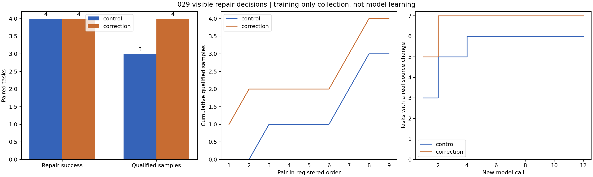

# 029: visible repair decisions

Training-data collection only; no parameter update or final-test access.

| Metric | 028 procedure rerun | Decision procedure |
|---|---:|---:|
| Complete paired tasks | 9 | 9 |
| Independent repair success | 4 | 4 |
| Qualified corrective demonstrations | 3 | 4 |
| No new source change | 3 | 2 |
| Actual new calls | 88 | 72 |

Preregistered collection gate passed: **False**.

Both arms use the same admitted historical failure snapshots and the 028 correction guard. Control is a fresh rerun of 028 correction, not the 028 unguided control. Treatment adds a generic task-contract decision prompt and factual visible-state/call-budget feedback. No task-specific solution, hidden case, extra tool execution or automatic submission is supplied. Historical actions are context, not positive targets. Both arms receive identical new budgets; repeated and rejected actions consume those budgets.

Qualification requires a changed source, standalone visible verification, explicit submission, independent training-task grading, complete state/request/cost replay and untruncated targets retaining the historical failure. Only the final successful new edit and subsequent executed actions are exported privately.

These nine states are selected training failures already inspected in 028. This experiment does not measure independent repository generalization or candidate model improvement. A byte change can be a comment-only change; the third curve measures source changes, not semantic repairs. Cumulative curves are sample yield, not training loss. Raw source, histories, commands and weights remain private.

Regenerate with `python -m one_gpu_lm.verified.decision_report --results <directory> --protocol <execution-protocol.json>`. See [discussion.md](discussion.md) for interpretation, [audit.json](audit.json) for all paths and [hardware.json](hardware.json) for GPU-only sampled telemetry.
