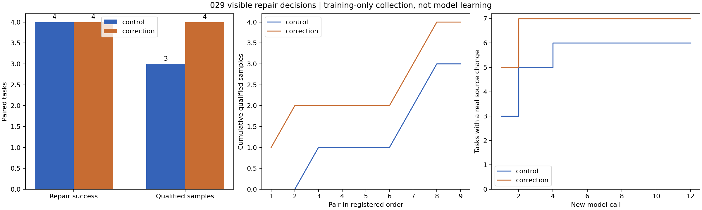

# 029：依据可见证据修复与收尾

**未通过冻结的数据采集门槛，本轮不启动候选训练。** 这是训练数据采集实验，参数更新为 0，最终测试继续封存，没有发布模型权重。

| 指标（9 组完整配对） | 028 纠错流程重跑 control | 新决策流程 correction |
|---|---:|---:|
| 独立修复成功 | 4/9 | 4/9 |
| 合格纠错示范 | 3 | 4 |
| 合格来源家族 | 3 | 3 |
| 无新源码变化 | 3 | 2 |
| 有新源码变化仍失败 | 2 | 3 |
| 新模型调用 | 88 | 72 |
| 生成 token | 10041 | 8073 |
| actor 分钟 | 15.06 | 12.25 |

- 独立修复新增：`underscore-functions-sort`；退步：`inflection-humanize-id-anchor`。
- 合格示范新增：`isodate-duration-fraction-components`、`underscore-functions-sort`；损失：`inflection-humanize-id-anchor`。

独立判分通过不要求显式提交；合格示范还要求最终单独可见验证、显式提交以及完整上下文与目标编码审计。两种结果分别列出，不能互相替代。

第二张图是登记顺序下的合格样本累积，第三张图是发生真实源码字节变化的题数。字节变化可能只是注释，不能等同于修复；两者都不是训练损失或新模型的学习曲线。

## 冻结前的诊断与设计

028 全部 6 条未接收路径已作可见轨迹复盘：重复相同探测、相同内容写回、占位注释增删、修好后尝试缺失测试依赖，以及可见通过但独立判分失败。没有读取隐藏用例构造提示。[诊断与来源哈希](../../preparation/diagnosis.json)和[预注册方案](../../execution-protocol.json)保留了规则制定时的证据。

本轮 control **重新执行 028 的 correction 流程**。两组从原来的同一份准入失败快照和完整历史出发，都使用修改后单独回归与提交前验证规则。新组额外要求依据原任务审查旧助手的错误方案，在编辑前给出一句可观察依据，并反馈实际源码变化、重复请求、当前验证状态和剩余调用。没有增加工具权限或替模型执行编辑、测试、提交，也没有注入特定正确补丁。预算仍为每条 12 次新调用、512 生成 token/次、6144 总生成 token、8192 输入 token、600 秒；全程只加载一次同版本 27B 底座。

028 旧纠错组为 4/9 修复、3 条合格；本轮同流程重跑为 4/9、3 条合格。旧数字仅用来披露轮次间变化，主比较始终是本轮两组；一次重跑不足以分析随机波动。原历史调用成本单列，不能计为本轮新增成本。

## 全部结果与拒收

| 训练状态 | 本轮 control | 本轮 correction | correction 合格 |
|---|---|---|---|
| `isodate-duration-fraction-components` | 修复通过 / 未提交；源码变化 2 次；调用 12 次 | 修复通过；源码变化 1 次；调用 4 次 | 是 |
| `underscore-functions-sort` | 修复失败 / 未提交；源码变化 0 次；调用 12 次 | 修复通过；源码变化 1 次；调用 4 次 | 是 |
| `inflection-humanize-id-anchor` | 修复通过；源码变化 3 次；调用 12 次 | 修复失败 / 未提交；源码变化 3 次；调用 12 次 | 否 |
| `humanize-naturaltime-tense` | 修复失败 / 未提交；源码变化 0 次；调用 12 次 | 修复失败 / 未提交；源码变化 0 次；调用 12 次 | 否 |
| `underscore-ismatch-missing` | 修复失败；源码变化 2 次；调用 7 次 | 修复失败；源码变化 1 次；调用 5 次 | 否 |
| `inflection-pluralize-uncountable-case` | 修复失败 / 未提交；源码变化 0 次；调用 12 次 | 修复失败 / 未提交；源码变化 0 次；调用 12 次 | 否 |
| `humanize-delta-negative` | 修复通过；源码变化 1 次；调用 5 次 | 修复通过；源码变化 1 次；调用 7 次 | 是 |
| `underscore-flatten-depth` | 修复通过；源码变化 1 次；调用 4 次 | 修复通过；源码变化 1 次；调用 4 次 | 是 |
| `inflection-camelize-lower-first` | 修复失败 / 未提交；源码变化 3 次；调用 12 次 | 修复失败 / 未提交；源码变化 4 次；调用 12 次 | 否 |

合格示范只监督最后成功的新修改及随后实际执行的动作；恢复的旧失败动作与本轮较早失败修改只作上下文。私有导出为 4 道任务、17 条动作、1881 个监督 token；不因样本稀少放松独立判分或编码条件。

| 固定条件 | 结果 |
|---|---|
| 所有路径与成本完整审计 | 通过 |
| 至少 6 道合格任务 | 未通过 |
| 至少 3 个来源家族 | 通过 |
| 至少 3 道不属于 027 唯一合格题 | 通过 |
| 合格示范数不低于本轮对照 | 通过 |
| 修复成功数不低于本轮对照 | 通过 |
| 合格示范较本轮对照至少净增 2 道 | 未通过 |

9 道题都是已经观察过的选择性训练失败，并非新仓库或未见任务。每个分支只跑一次，本实验不能证明独立泛化、稳定效率提升或新参数收益。干预是组合流程，也不能拆分各条提示的因果作用。最终测试未开启，训练数据与权重不公开。

## 具体改善与仍未解决的问题

`isodate-duration-fraction-components` 从 12 次调用、代码正确但未提交，变为 4 次调用并完成验证与提交；`underscore-functions-sort` 从没有实际源码变化变为 4 次调用修好。这两题贡献了 2 条新增合格示范。

但 `inflection-humanize-id-anchor` 丢失了原本合格的示范：实验组在第 2、6、9 次调用修改源码，仍沿错误方向处理字符串，三次单独回归都失败。第 3 次调用因回归命令加了前缀被拦截，第 12 次又在未验证通过时尝试提交，被规则拒绝。它不是生成格式错误或目标编码被截断，而是实际修复未成功；简短依据、预算提示没有保证修复假设正确。

另外四道失败也保留了具体区别：

- `humanize-naturaltime-tense`、`inflection-pluralize-uncountable-case` 各耗尽 12 次调用，仍无新的源码字节变化。
- `underscore-ismatch-missing` 修改后通过可见回归并提交，但独立训练判分失败；“可见测试通过”仍不足以作为正确性证明。
- `inflection-camelize-lower-first` 发生 4 次源码变化，仍耗尽预算并失败；更多修改没有带来正确修复。

4 条合格示范全部只有 **1 次新的源码修改**，其较早失败来自恢复的历史前缀。可以说获得了有真实失败上下文的成功接手片段，不能说当前采集得到了 4 条自主连续试错、多次修改后成功的完整新轨迹。所有行为合格路径都通过了编码检查，本轮没有因编码丢弃候选；5 条拒收的主要原因仍是任务执行结果。

源码变化更早、调用更少，是这次流程调整的可见收益；修复成功净增为 0，且有 1 道实际退步。实际 actor 时间为 15.06 → 12.25 分钟，调用少 16 次，但这只是本次配对的成本差，不能推广为稳定的性能提升。控制组与 028 correction 的逐题成功、资格、调用数、生成 token、验证和提交状态均一致；这支持本次对照的可比性，不等于已证明所有运行都确定。

因此，下一步更应验证教师能否提出并修正有效的修复假设，以及测试能否覆盖任务要求，而不是继续增加同类提醒或重复这 17 条动作扩大训练量。这是根据当前失败行为提出的后续方向，尚未验证其效果。本轮按原规则结束，不追加采样、不启动候选训练。

## 时间、成本与硬件

- 北京时间 2026-11-17 14:33:56 至 2026-11-17 15:02:57，GPU 采集流程 29.01 分钟，包含加载、工具和独立判分。
- 新增实际调用 160 次，生成 18114 token、输入 782545 token，未知生成成本记录 0。
- 历史前缀按题一次记录：64 次旧调用、4627 个旧生成 token、154546 个旧输入 token，不计入新增执行。
- GPU 记录 346 条，采样错误 0，最大间隔 5.20 秒，峰值 64℃、60.21 GiB 显存。
- 平均 GPU 采样功率 282.19 W，采样 GPU 能耗约 0.137 kWh，不能当作整机插座电量。

所有登记路径均保留，冻结输入未变，没有追加调用或采样。观察连接记录见 [observation-notes.json](observation-notes.json)，完整安全审计见 [audit.json](audit.json)。[README](README.md)提供指标、硬件统计与图形的复算命令。

结果发布后补齐了 CI 的 `029-repair-decisions` 路径过滤，以便结果更新也触发同一套测试。该维护发生在采集及审计结束后；执行时和发布时的工作流哈希均记录在观察说明中，执行协议与运行代码保持原版本。公开结果按执行提交复核，避免将后续 CI 配置维护混同于实验中修改规则。
