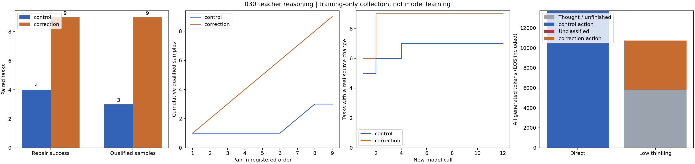

# 030: bounded teacher reasoning

Training-data collection only; no parameter update or final-test access.

| Metric | Thinking disabled | Low-effort thinking |
|---|---:|---:|
| Complete paired tasks | 9 | 9 |
| Independent repair success | 4 | 9 |
| Qualified corrective demonstrations | 3 | 9 |
| No new source change | 2 | 0 |
| Actual new calls | 76 | 48 |

Preregistered collection gate passed: **True**.

Both arms use the same pinned base weights, nine historical failed states, 029 decision guidance, regression guard and alternating pair schedule. Only the registered chat-template thinking mode differs. Both receive 12 calls, 2048 generated tokens per call, 6144 generated tokens in total, 8192 input tokens and 600 actor seconds. All thought tokens, malformed outputs and rejected calls count. The 2048 per-call limit is raised for BOTH arms relative to 029, so cross-experiment score changes are not attributed to thinking.

Thoughts remain in private generation receipts and do not enter the tool executor or later conversation. Missing/ambiguous thought boundaries execute nothing and receive the same format-error feedback. Teacher input tokens and raw output IDs are replayed with the actual tokenizer. Verified final actions are re-encoded under the frozen non-thinking student template; teacher and student input hashes are recorded separately. No thought tokens become positive targets.

Qualification requires a changed source, standalone visible verification, explicit submission, independent training-task grading, complete state/request/cost replay and untruncated targets retaining the historical failure. Only the final successful new edit and subsequent executed actions are exported privately.

These nine states are selected training failures already inspected in 028. This experiment does not measure independent repository generalization or candidate model improvement. A byte change can be a comment-only change; the third curve measures source changes, not semantic repairs. Cumulative curves are sample yield, not training loss. Raw source, histories, commands and weights remain private.

Regenerate with `python -m one_gpu_lm.verified.reasoning_report --results <directory> --protocol <execution-protocol.json>`. See [discussion.md](discussion.md) for interpretation, [audit.json](audit.json) for all paths and [hardware.json](hardware.json) for GPU-only sampled telemetry.
