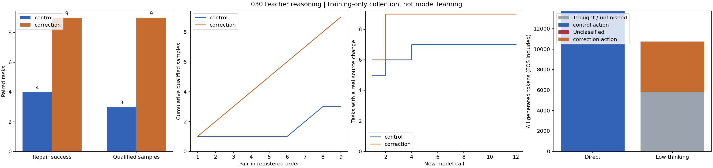

# 030：受预算约束的教师思考

**采集门槛通过，后续须另行冻结候选训练与开发验收方案。** 本轮是训练数据采集，参数更新为 0，最终测试继续封存，没有上传模型权重。

| 指标（9 组完整配对） | 关闭思考 control | 低强度思考 correction |
|---|---:|---:|
| 独立修复成功 | 4/9 | 9/9 |
| 合格纠错示范 | 3 | 9 |
| 合格来源家族 | 3 | 4 |
| 无新源码变化 | 2 | 0 |
| 有源码变化仍失败 | 3 | 0 |
| 新模型调用 | 76 | 48 |
| 全部生成 token | 13732 | 10740 |
| 思考 / 未完成思考 token | 0 | 5811 |
| 动作段 token（含结束 token） | 13732 | 4929 |
| 不可分类 token | 0 | 0 |
| 思考边界拒收次数 | 0 | 0 |
| actor 分钟 | 19.92 | 15.16 |

独立修复新增：`underscore-functions-sort`、`inflection-humanize-id-anchor`、`humanize-naturaltime-tense`、`underscore-ismatch-missing`、`inflection-camelize-lower-first`；退步：无。合格示范新增：`underscore-functions-sort`、`inflection-humanize-id-anchor`、`humanize-naturaltime-tense`、`underscore-ismatch-missing`、`inflection-pluralize-uncountable-case`、`inflection-camelize-lower-first`；损失：无。

图中的样本累积与源码变化都不是训练学习曲线；字节变化可能只是注释，不能等同于语义修复。思考和最终动作一起消耗 token 上限。独立判分通过不要求代理完成提交，合格示范还要求可见验证、显式提交及完整编码与回放证据。

## 本轮隔离了什么

先对 029 全部五条未接收路径复盘：包括错误修复、无效同内容替换、耗尽调用却没有修改，以及可见回归通过但独立训练判分失败。没有读取隐藏用例构造修复提示。[诊断记录](../../preparation/diagnosis.json)与[预注册协议](../../execution-protocol.json)先于本轮生成公开。

两组使用同一固定版本 27B 底座、相同 029 决策指导、真实历史失败快照、修改后单独验证规则和交替顺序。唯一主要干预是模型原生模板的思考开关；开启组使用 low 强度。单次输出上限两组同时调至 2048，总生成仍为 6144，每条最多 12 次调用、8192 输入 token、600 秒。新的共同系统提示覆盖历史提示中的旧预算，因此不把跨实验分数变化归因于思考。

原始输出 ID 和思考内容只在私有回执保存。思考不进入执行器或后续对话；缺失、重复、嵌套的思考边界不执行任何命令，也不免费补全。审计使用实际 tokenizer 回放全部教师请求、动作和费用。学生目标仅包含通过执行验证的最终动作，在独立的关闭思考模板下重新编码；两个输入哈希分别记录，没有将教师与学生前缀伪装成完全相同。

## 所有配对与门槛

| 训练状态 | 关闭思考 | 低强度思考 | 思考组示范合格 |
|---|---|---|---|
| `isodate-duration-fraction-components` | 修复通过；源码变化 1 次；调用 4 次 | 修复通过；源码变化 1 次；调用 4 次 | 是 |
| `underscore-functions-sort` | 修复失败 / 未提交；源码变化 0 次；调用 12 次 | 修复通过；源码变化 1 次；调用 4 次 | 是 |
| `inflection-humanize-id-anchor` | 修复失败 / 未提交；源码变化 1 次；调用 12 次 | 修复通过；源码变化 1 次；调用 6 次 | 是 |
| `humanize-naturaltime-tense` | 修复失败 / 未提交；源码变化 0 次；调用 12 次 | 修复通过；源码变化 1 次；调用 5 次 | 是 |
| `underscore-ismatch-missing` | 修复失败；源码变化 1 次；调用 6 次 | 修复通过；源码变化 2 次；调用 10 次 | 是 |
| `inflection-pluralize-uncountable-case` | 修复通过 / 未提交；源码变化 1 次；调用 8 次 | 修复通过；源码变化 1 次；调用 4 次 | 是 |
| `humanize-delta-negative` | 修复通过；源码变化 1 次；调用 6 次 | 修复通过；源码变化 1 次；调用 6 次 | 是 |
| `underscore-flatten-depth` | 修复通过；源码变化 1 次；调用 4 次 | 修复通过；源码变化 1 次；调用 4 次 | 是 |
| `inflection-camelize-lower-first` | 修复失败 / 未提交；源码变化 1 次；调用 12 次 | 修复通过；源码变化 1 次；调用 5 次 | 是 |

| 冻结条件 | 结果 |
|---|---|
| 所有路径与成本完整审计 | 通过 |
| 至少 6 道合格任务 | 通过 |
| 至少 3 个来源家族 | 通过 |
| 至少 3 道不属于 027 唯一合格题 | 通过 |
| 合格示范数不低于本轮对照 | 通过 |
| 修复成功数不低于本轮对照 | 通过 |
| 合格示范较本轮对照至少净增 2 道 | 通过 |

私有导出为 9 道任务、35 条动作、3692 个监督 token。它们只监督最后成功的新修改及随后执行过的动作，保留旧失败作为上下文，禁止截断。不能把恢复历史错误后的成功片段称为从零自主完成的长任务；也不能用这些训练题宣称独立泛化或学生质量提升。

## 成本改善与仍然缺少的证据

思考组把调用从 76 次降至 48 次（减少 36.8%），全部生成 token 从 13,732 降至 10,740（减少 21.8%），代理耗时从 19.92 分钟降至 15.16 分钟（减少 23.9%）。其中 5,811 个是思考 token，已经计入这些总数。结果支持本批错误状态上更有效的预算使用；不能据此推断所有编码任务都能省同样比例。

关闭思考的 `pluralize-uncountable-case` 虽然最终源码与可见验证都通过，却在 6,144 个生成 token 用尽后没有明确提交，因此计为修复成功、不计合格训练示范。三个格式错误和所有长输出仍计入本轮成本。

**八条合格思考组路径只有一次新的源码修改，`isMatch` 有两次。** 后者两次修改之间没有满足原规则的、执行返回失败的独立声明回归；因此本轮仍没有新增符合原严格定义的“先改错、回归失败、再改对”完整自主过程。用已冻结的 027 严格定义做描述性复查，两组均为 0 条这类新纠错链；[逐路径证据](new-corrections.json)单独公开，不改变预注册的 030 门槛。这是接手错误补丁的优质训练片段，不是九条新长任务试错轨迹。

本轮首次通过这条失败状态采集路线的冻结门槛。下一步可以冻结混合训练：保留原完整任务示范，加入这 35 条经验证的动作，再用开发集检查学生是否获得收益。不能仅凭 9 道已观察过的训练题就发布“更强的 27B”参数；也不应反复调这九道题来代替扩大独立验证。

## 时间、成本与审计

- 北京时间 2026-11-17 15:57:28 至 2026-11-17 16:34:29，完整流水线 37.02 分钟，原 3 小时截止时间未延长。
- 新增 124 次调用、24472 个生成 token、598909 个输入 token；历史前缀另计 64 次调用、4627 个生成 token，按唯一任务计一次，不算本轮新增。
- 18 条路径的身份、费用、请求、源码与编码审计通过，未知生成成本 0 条。原始 GPU 流水线已结束并卸载模型。
- 共 441 次硬件采样，采样错误 0 次，最大间隔 5.06 秒；峰值温度 65℃、显存 58.94 GiB。
- GPU 采样能耗约 0.176 kWh，含加载，不是整机插座耗电。完整硬件范围见 [hardware.json](hardware.json)。

可复用的产物是有模式与预算约束的生成入口、思考/动作分离、逐请求回放及跨教师/学生模板的监督边界。本轮没有借用外部教师服务、没有新增模型或数据许可来源，也没有公开原始命令、源码、语料、连接资料或参数。
