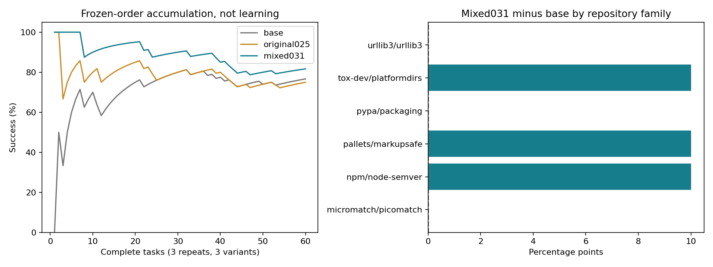
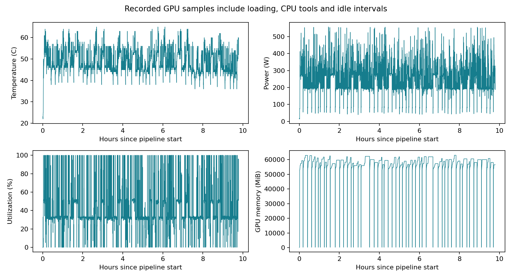

# 031 三组权重、三轮开发对照

完整配对 60／60 题；预注册参数收益门槛：未通过。

| 权重 | 核验成功／运行 | 不保留源修改 | 修改未修对 | 结果波动题 | 动作波动题 | 调用 | 生成 token |
| --- | --- | --- | --- | --- | --- | --- | --- |
| base | 138/180 | 33 | 9 | 0 | 0 | 1266 | 104565 |
| original025 | 135/180 | 45 | 0 | 0 | 0 | 1335 | 76998 |
| mixed031 | 147/180 | 33 | 0 | 0 | 0 | 1263 | 76068 |

新候选相对底座 +5.00 个百分点，家族—任务配对 bootstrap 95% 区间 [-6.67, +16.67]；相对原 025 候选 +6.67 个百分点。三轮重复保留在每题内，不当成180道独立题。

| 冻结验收项 | 结果 |
| --- | --- |
| complete_audit | 通过 |
| minimum_gain | 未通过 |
| positive_interval_lower_bound | 未通过 |
| no_excessive_repository_decline | 通过 |
| no_net_decline_vs_original025 | 通过 |

开发流水线 9.786 单卡小时，加载 52 次，已完成加载共 1576.61 秒。所有加载、CPU工具和判分包含在流水线时间内，不能等同GPU计算活跃时间。
UTC 起止：2026-11-17T09:36:46.174654+00:00 → 2026-11-17T19:23:57.490940+00:00。

逐次失败与成本见 [runs.csv](runs.csv)，逐题和逐来源配对见 [pairs.csv](pairs.csv)、[families.csv](families.csv)，动作与结果波动、全部输入/输出成本、硬件采样覆盖见 [summary.json](summary.json)。
三者使用同一关闭思考的模型接口、提示、工具、反馈规范化和预算；原025与新031之间强制卸载重载，实际权重哈希按每次轨迹核对。未通过或未完成配对不得支持正向结论。
这些是自025以来已观察的60道开发题，不是新的独立测试。来源家族与训练隔离不等于预训练去污染；六个家族、短构造故障和一次候选训练种子不足以证明通用先进编码或长任务能力。任务定义私有，外部可复算数字并复用流程，无法原样重跑全部私有任务。
031比025增加35条动作和4次更新，参数对照检验这份完整混合训练配方；它不能独立分离新增数据内容与额外更新次数的因果作用。
最终测试继续封存，本轮开发结果不授权上传 ModelScope 参数。

复算：`python -m one_gpu_lm.verified.mixed_report --results <本目录>`；可加 `--no-figures`。
