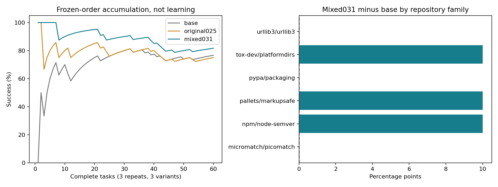
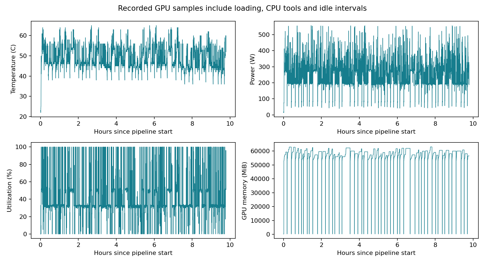

# 031：混合候选净增 3 题，开发门槛未通过

**全部 540 次运行和成本核验通过；模型收益门槛未通过，最终测试继续封存，参数不上传 ModelScope。** 新候选在本轮开发题上的成功率高于两个对照，但相对底座只提高 5.00 个百分点，低于预注册的 10 个百分点；家族—任务配对 bootstrap 95% 区间为 −6.67 至 +16.67 个百分点，包含零。

## 三组结果与配对变化

| 权重 | 每轮成功／60 题 | 三轮成功／180 次 | 成功率 | 每轮未编辑失败 | 每轮错误修改失败 | 每轮正确且显式提交 |
| --- | ---: | ---: | ---: | ---: | ---: | ---: |
| 底座 base | 46 | 138 | 76.67% | 11 | 3 | 46 |
| 原候选 original025 | 45 | 135 | 75.00% | 15 | 0 | 45 |
| 混合候选 mixed031 | 49 | 147 | 81.67% | 11 | 0 | 47 |

三轮的逐题成败和动作指纹均一致。因此这里仍然只有 **60 道不同开发题**，重复运行验证了本次配置的重复性，没有增加独立任务的数量。它们是自 025 以来已观察的开发题，包含 6 个来源家族、2 种语言；不是新留出的最终测试。

相对本轮底座，031 改善 7 题、退步 4 题，净增 3 题；相对本轮原 025，改善 5 题、退步 1 题，净增 4 题。各家族的净变化为 0 或 +10 个百分点，符合家族退步限制，也没有整体低于 025；但这两项通过不能抵消主收益和区间条件未通过。

| 相对底座的退步任务 | 底座 | 原 025 | 新 031 |
| --- | --- | --- | --- |
| `markup-replacement-escape` | 成功 | 失败 | 失败 |
| `platformdirs-site-config-key` | 成功 | 失败 | 失败 |
| `url-auth-first-separator` | 成功 | 成功 | 失败 |
| `url-zero-port` | 成功 | 失败 | 失败 |

这四题的 031 路径均在 12 次调用用尽后结束，没有发生源码编辑。其中三题沿用了原 025 的失败，`url-auth-first-separator` 是相对原 025 的新增退步。全部改善、退步与不变配对保存在 [pairs.csv](pairs.csv)，全部运行和失败保存在 [runs.csv](runs.csv)，没有删除不利结果。

新候选另有两题——`platformdirs-multipath-selection` 与 `platformdirs-site-data-order`——在 12 次调用内完成了通过独立判分的源码修改，但没有显式提交。按冻结的主指标，它们计为成功；显式结束能力单独记录，因此新候选每轮正确且明确提交的是 47/60，而非 49/60。三轮共 6 次这样的运行都保留其完整成本。

左图是按预注册顺序累加已完成配对的分数，横轴不是训练步数；它不能解释为模型持续学习。具体门槛、区间和每题三轮结果可由 [summary.json](summary.json) 与 [analysis-input.json](analysis-input.json) 复算。

## 从采集到训练，实际改变了什么

[030 的九组配对](../../../030-teacher-reasoning/results/2026-11-17-collection/discussion.md)先通过冻结采集门槛：同一教师低强度思考组取得 9 条合格的失败状态修复片段。031 保留原 025 的 127 条完整示范、971 条动作，再加入这 9 条片段、35 条动作，共 1,006 条动作、134 个不同训练任务、63,991 个监督 token。教师思考没有作为训练标签。

候选从固定底座重新初始化，完成唯一一次训练、126 次更新和完整一遍数据；实际 tokenizer、每条样本与顺序、冻结参数检查、适配器变化和保存重载探针均通过审计。[训练曲线和核验](../2026-11-17-training/)已单独公开。

三组开发运行使用相同关闭思考的接口、提示、工具、024 反馈规范化和预算：每题最多 12 次调用、每次 512 个生成 token、总计 6,144 个生成 token、8,192 个输入 token、600 秒代理时间。模型切换按冻结顺序执行；两个学生适配器之间也真实卸载重载。

这份对照检验的是完整混合配方。031 比 025 多 35 条动作和 4 次更新，无法把观察到的差异单独归因于纠错内容。030 取得的仍是接手失败状态的片段，其严格定义的新自主“改错—回归失败—再改对”链条数量为 0；本轮不能证明学生已经学会自主处理长任务。

## 实际时间、调用和硬件

训练流水线为北京时间 **2026-11-17 16:50:55 至 17:31:53**，耗时 40.97 分钟。开发流水线为北京时间 **2026-11-17 17:36:46 至 2026-11-18 03:23:57**，耗时 9 小时 47 分 11 秒（9.786 单卡小时）。监督进程于 03:23:59 正常结束，未达到原 48 小时上限，没有重启 GPU 评测或延长截止时间。

| 权重 | 模型调用 | 输入 token | 全部生成 token | 代理累计秒数 |
| --- | ---: | ---: | ---: | ---: |
| base | 1,266 | 2,611,323 | 104,565 | 8,989.02 |
| original025 | 1,335 | 2,866,536 | 76,998 | 12,301.35 |
| mixed031 | 1,263 | 2,569,623 | 76,068 | 12,045.17 |
| 合计 | 3,864 | 8,047,482 | 257,631 | 33,335.53 |

全部 52 次模型加载共 1,576.61 秒，均已计入开发流水线。代理时间包含生成和工具操作；流水线还包含加载、CPU 工具、判分等，9.786 单卡小时不等于 GPU 内核活跃时间。新候选的代理累计耗时比底座高 34.00%；较少的输出 token 没有转化成更短的实测代理时间，本轮没有隔离其中各项开销的因果贡献。

开发硬件记录共 6,987 个采样，采集错误 0 次，最大间隔 5.42 秒，起止边界合计未覆盖 2.18 秒。峰值温度 65℃、显存 62,933 MiB（约 61.46 GiB）、功率 556.58 W；样本平均 GPU 利用率 38.51%。这些是包含加载和 CPU 操作间隙的观测值。训练阶段峰值显存约 94.38 GiB、温度 80℃，见单独训练报告。

本地 SSH 观测连接曾中断，恢复连接后确认远端原运行继续推进；没有因此追加评测尝试。CPU 收尾审计约 30.68 秒，额外模型生成、优化器更新、测试命令重执行均为 0。全部 540 条轨迹和 3,864 次物理请求被纳入核验，未知生成成本为 0；180 个冻结输入保持一致。[完整审计](evaluation-audit.json)、[收尾回执](postprocess.json)和[输入完整性](integrity.json)随结果公开。

## 本轮结论与复用边界

本轮完成了有门槛的数据采集、混合训练、三个实际权重的同预算重复评测，以及从公开数字重新生成表格和曲线的流程。它保留了一项值得继续验证的观察：新配方净增 3 道开发题，同时仍有 4 道退步和 11 道未编辑失败。当前数据量、六个家族、短构造故障、单个训练种子和反复观察的开发集不足以证明稳健的通用编码提升。

下一轮应优先增加经过执行验证的真实、多文件、多语言训练任务，并建立新的开发覆盖；新增训练来源继续与开发及最终测试隔离。教师质量、推理时验证与回滚、偏好训练等仍可另行制定对照，不能从本轮未过门槛推断这些路线已被穷尽。原 60 题的三轮重复已经提供重复性证据，后续预算应更重视不同任务的覆盖。

**本轮保留底座作为默认对照，不开启最终测试，不上传候选参数。** GitHub 公开规则、实现、指标、审计和曲线；原始任务定义、源码、轨迹、语料、连接资料和权重保持私有。读者能够复算公开统计并复用流程；私有任务限制了外部原样复跑整个实验。

复算入口：`python -m one_gpu_lm.verified.mixed_report --results experiments/031-correction-mix/results/2026-11-17-development`。添加 `--no-figures` 可只用标准库重建统计和表格。
