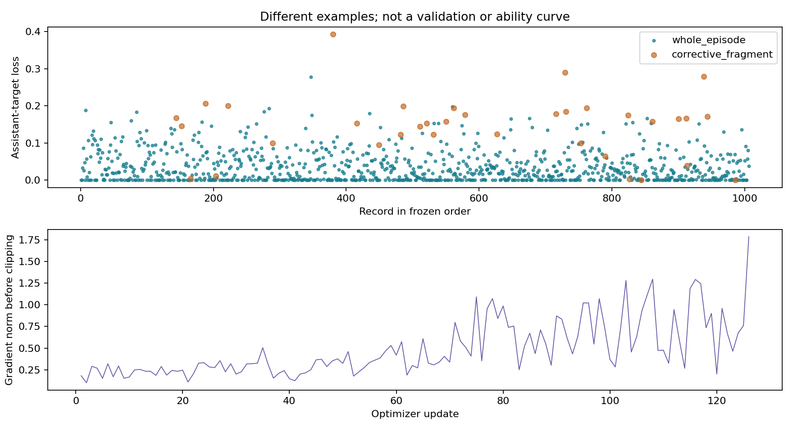
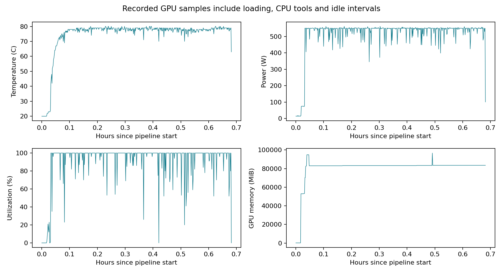

# 031 唯一候选训练核验

训练及逐条审计通过。本记录不说明开发能力已经改善。

完整示范 127 条、错误状态片段 9 条，共 1006 条动作、134 个唯一训练任务。仅监督最终动作，不监督教师思考。
实际完成 126 次更新，最后一组 6 条；监督 token 63,991，输入 token 2,352,717，可训练参数 58,363,904。
训练循环 2337.45 秒，含加载和保存重载探针的流水线 2457.91 秒（0.683 单卡小时）。相对原 025 多 4 次更新，训练循环耗时差 +138.36 秒；这是两次实际运行的差值，不是隔离测得的35条动作纯增量成本。
UTC 起止：2026-11-17T08:50:55.155728+00:00 → 2026-11-17T09:31:53.065525+00:00。

核对实际 tokenizer、全部样本及顺序、每组更新数量、有限损失和梯度、冻结参数无梯度、抽样冻结值不变、适配器改变、保存重载训练探针一致。冻结值检查仅抽样三个张量各八个值；两次训练探针各最多16生成 token，只保存输出身份哈希，不能补称精确实际生成量。
损失点来自不同训练样本，图中的下降不能当作验证成功率提高。原始样本、源代码和适配器权重不公开。

全部检查和硬件采样覆盖见 [training-summary.json](training-summary.json)；完整数字输入见 [training-input.json](training-input.json)。
最终测试保持封存。本轮只允许进入冻结的三组开发对照，不授权发布 ModelScope 参数。

复算：`python -m one_gpu_lm.verified.mixed_report --training <本目录>`；可加 `--no-figures`。
