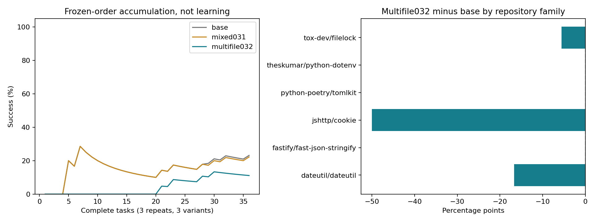
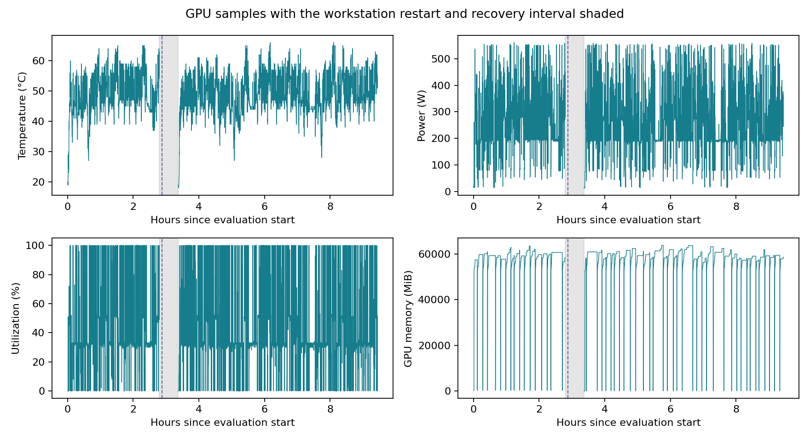

# 032 三组权重、三轮开发对照

完整重跑 324／324 次，36／36 道题配齐三轮。底座 25／108（23.15%）、031 24／108（22.22%）、032 12／108（11.11%）。032 开发门槛未通过。

032 的 108 次运行中有 90 次没有保留源码修改，底座为 77 次，031 为 78 次。三组均有 6 次在预算内修对但未提交。

按题配对，032 相对底座 -12.04 个百分点，95% 区间 [-31.48, +0.00]。相对 031 -11.11 个百分点。12 道多文件题的成功率为 底座 2.78%、031 0.00%、032 0.00%。

北京时间 2026-11-18 13:57:48 至 2026-11-18 23:24:22，端到端经过 9.443 小时，含重启和恢复间隔。估计两段 GPU 占用窗口合计 8.869～8.949 小时，范围来自最后硬件采样和下次开机时间。对计分的 324 次任务记录 3,590 次生成，回收 3 道超时任务的生成回执，累计等候 137.39 秒。后端先将响应落盘再交付，超时后的响应只用于成本核算。

| 权重 | 回收回执的超时任务 | 回执等待（秒） | 预算内修对 | 生成 token |
| --- | ---: | ---: | ---: | ---: |
| 底座 | 0 | 0.00 | 31 | 70,836 |
| 031 | 0 | 0.00 | 30 | 63,035 |
| 032 | 3 | 137.39 | 18 | 65,744 |

工作站重启前的 100 次完整任务原样保留。恢复段从中断任务重新按完整预算执行，共运行 224 次。重启中断的那次任务单独计成本，已知 445 个生成 token，最后一条请求仅有接收回执。含这次中断，实际全部生成量为 200,060～200,572 个 token。

恢复预检曾因一行损坏的遥测记录退出，当时没有加载模型或生成。首次结果审计也把恢复后的协议哈希用于恢复前的 100 次记录，导致身份检查误报。分段重新验证了各自的协议哈希，保留初次审计的哈希，原始轨迹、判分和 token 记录均未改动。

36 道开发题、模型快照、工具、上下文和任务预算与首轮相同。首轮中断记录单独保留。逐次核对结果、实际生成回执和物理请求清单见 [审计](evaluation-audit.json)。GPU 验证和重跑仅使用自建样例及开发集，最终测试继续封存。

完整配对 36／36 题；预注册参数收益门槛：未通过。

| 权重 | 正确且提交／运行 | 修对未提交 | 不保留源修改 | 修改未修对 | 结果波动题 | 动作波动题 | 调用 | 生成 token |
| --- | --- | --- | --- | --- | --- | --- | --- | --- |
| base | 25/108 | 6 | 77 | 0 | 1 | 10 | 1154 | 70836 |
| mixed031 | 24/108 | 6 | 78 | 0 | 0 | 10 | 1191 | 63035 |
| multifile032 | 12/108 | 6 | 90 | 0 | 0 | 9 | 1245 | 65744 |

新候选相对底座 -12.04 个百分点，家族—任务配对 bootstrap 95% 区间 [-31.48, +0.00]；相对 031 候选 -11.11 个百分点。三轮重复保留在每题内，不当成更多独立任务。

| 冻结验收项 | 结果 |
| --- | --- |
| complete_audit | 通过 |
| minimum_gain | 未通过 |
| positive_interval_lower_bound | 未通过 |
| no_excessive_repository_decline | 未通过 |
| no_net_decline_vs_mixed031 | 未通过 |

开发流水线 9.443 小时墙钟时间（含重启与恢复间隔），加载 53 次，已完成加载共 1564.83 秒。所有加载、CPU工具和判分包含在流水线时间内，不能等同GPU计算活跃时间。
UTC 起止：2026-11-18T05:57:48.432170+00:00 → 2026-11-18T15:24:22.894759+00:00。

逐次失败与成本见 [runs.csv](runs.csv)，逐题和逐来源配对见 [pairs.csv](pairs.csv)、[families.csv](families.csv)，动作与结果波动、全部输入/输出成本、硬件采样覆盖见 [summary.json](summary.json)。
三者使用同一关闭思考的模型接口、提示、工具、反馈规范化和预算；底座、031与032之间按冻结顺序卸载重载，实际权重哈希按每次轨迹核对。未通过或未完成配对不得支持正向结论。
这些开发任务来自本项目先前未使用的六个仓库，基于真实历史修复。来源家族隔离不等于预训练去污染；公开回归测试可见，保护副本复验不能称为隐藏测试。六个家族、12次调用及一次训练种子不足以证明通用先进编码或长任务能力。公开数字可复算；原始源码、训练样本和任务定义不直接再分发。
032保留031全部数据并增加参考上游补丁的专家示范；定位和目标补丁由参考答案指导，不是教师模型自主发现。三组推理预算相同，训练更新数未匹配，因此不能分离新增数据内容与额外训练计算量的作用。
最终测试继续封存，本轮开发结果不授权上传 ModelScope 参数。

复算：`python -m one_gpu_lm.verified.historic_report --results <本目录>`；可加 `--no-figures`。
