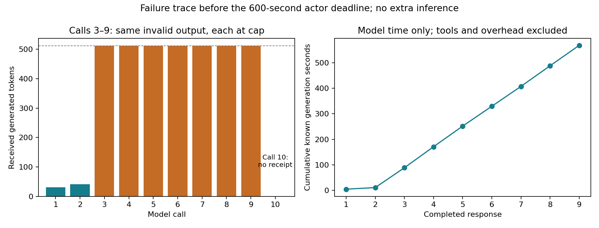
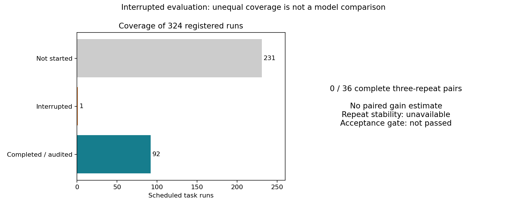
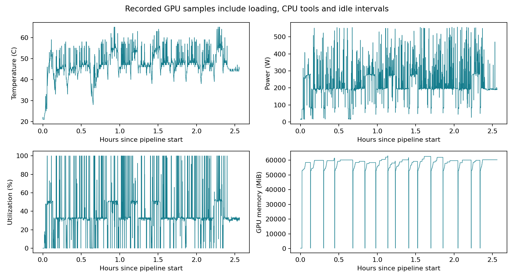

# 032 开发评测中断记录

**本轮未完成验收，不支持参数收益或重复稳定性结论。** 计划 324 次，完成且逐条审计通过 92 次，另 1 次中断、231 次未启动；三种权重各三遍的完整配对为 0／36。最终测试继续封存，不发布权重。

## 故障与停止原因

032 在 `python-dotenv-0b2880591780` 的首次运行中，前两次调用分别执行测试和读取源码；第 3～9 次生成完全相同的非法工具输出，每次达到 512 token 上限。第 10 次请求在接近 600 秒任务截止时超时。已收到的 9 次响应共 3,656 token，最后一次响应没有持久回执，其实际生成量不可恢复。

旧后端先完成生成再通过 socket 交付，没有先持久保存响应。客户端超时后，冻结的评测器按“未知生成成本即停止”规则终止整轮并释放 GPU。模型重复输出触发了任务超时；响应落盘和单任务故障隔离不足，使超时升级为整轮中断。记录未显示显卡故障，但这些记录不构成完整硬件诊断。

原现场、92 条完整轨迹和 1 条部分轨迹均保留；没有重试、补造末次 token、延长该题预算或把未运行任务记成失败。来源与协议哈希均未变化。逐条结果见 [审计](evaluation-audit.json)；故障的数值证据与轨迹哈希见 [incident.json](incident.json)。

## 覆盖与描述性结果

下表只描述已完成部分。覆盖范围不同，且每题尚无三次重复，不能横向估计参数收益；重复波动应为“不可评估”，不能写成“零波动”。

| 权重 | 已完成且审计通过 | 修对并提交 | 修对未提交 | 中断 | 未启动 |
| --- | ---: | ---: | ---: | ---: | ---: |
| base | 30 | 7 | 1 | 0 | 78 |
| mixed031 | 30 | 7 | 2 | 0 | 78 |
| multifile032 | 32 | 4 | 2 | 1 | 75 |

## 成本与报告修正

流水线从 2026-11-18T02:41:44.500912+00:00 到 2026-11-18T05:15:25.056155+00:00，共 2.561 单卡小时，包含 16 次加载、CPU 工具与判分。不能等同于 GPU 计算活跃时间。
保留了 1,033 次请求，已收到响应的生成 token 为 56,645；最后一次响应实际为 0～512 token，全部生成量只能报告为 [56,645, 57,157]，不能报告成精确总量。已完成 actor 的耗时合计不包含部分任务；总流水线时间包含中断及清理。

冻结的旧报告器把 324 个审计占位条目当作已记录条目，并在没有完整重复配对时输出零波动。本目录的事后报告修正仅调整覆盖、缺失、已知成本和“不可评估”的展示，不改判分、原始审计或冻结验收门槛。逐次数字见 [runs.csv](runs.csv)，修正后的汇总见 [summary.json](summary.json)。空的 pairs/families CSV 表示没有合格完整配对。

## 已完成的基础设施修复及边界

新增可选的 request journal 后端：先保存请求接收回执，生成完成后将完整响应 fsync 落盘，再交付 socket；相同请求身份不得再次生成。CPU 隔离测试覆盖客户端超时、迟到回执、重复请求、身份冲突、进程中断和生成异常。迟到响应仅供成本核算，不得执行其中的工具或延长 actor 预算。

修复组件没有回写这次冻结运行，也尚未完成真实 GPU 超时集成验收。进程在生成中被杀且没有最终回执时，成本仍必须标未知；journal 不会凭空恢复已经丢失的 token。下一次正式对照须先验证超时隔离和审计闭环，再冻结新的运行规则。

训练候选、输入、配置和本次原始审计都保留。独立仓库、可见测试与限定文件范围的任务，仍不足以证明生产级或通用长任务能力。训练曲线与数据来源见 [训练记录](../2026-11-18-training/)。

复算本中断报告：`python -m one_gpu_lm.verified.historic_incident_report --results <本目录>`；可加 `--no-figures`。最终测试保持封存；ModelScope 发布门槛未满足。
