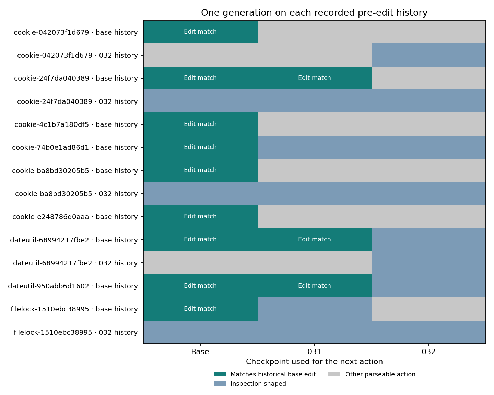
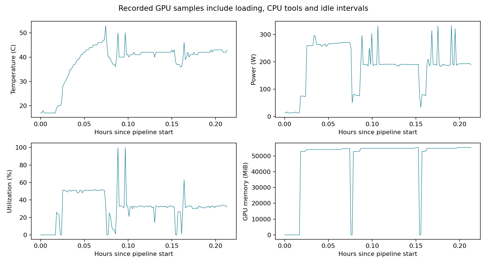

# 033 同历史下一步动作对照

14 段编辑前历史、42 次生成全部核验完成。每一段的三组输入 token 与源轨迹一致。下表计命令文本与该题已执行过的首次源码修改动作相同的次数。

| 编辑前历史 | 底座 | 031 | 032 |
| --- | ---: | ---: | ---: |
| 5 道退步题 · 底座历史 | 5／5 | 2／5 | 0／5 |
| 5 道退步题 · 032 历史 | 0／5 | 0／5 | 0／5 |
| 4 道稳定成功题 · 底座历史 | 4／4 | 1／4 | 0／4 |

使用轨迹自身的权重再次生成时，底座 9／9、032 5／5 与原输出 token 完全相同。不同命令可能是合法替代方案。记录动作文本类别，没有执行、评估补丁正确性或测完整任务成功率。

北京时间 2026-11-19 06:59:59 至 2026-11-19 07:12:51，流水线 12.86 分钟，加载 3 次。输入 95,304 token，生成 5,024 token。GPU 采样 153 条，采样峰值 53°C。

五道退步题是根据既有开发分数选出的诊断样本，四道控制题来自同一开发集。该结果只限已记录的状态和一次确定性生成，对新仓库或完整修复效果需另做对照。最终测试封存，没产生新的训练样本或模型参数。

逐次结果见 [actions.csv](actions.csv)，每题对照和成本见 [summary.json](summary.json)，独立 token 与物理请求核验见 [evaluation-audit.json](evaluation-audit.json)。

复算：`python -m one_gpu_lm.verified.first_edit_report --results <本目录> --preparation experiments/033-first-edit-probe/preparation.json`。可加 `--no-figures`。
