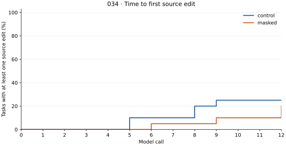

# 034 · 独立开发对照结果

屏蔽组修复且提交 **0／20**，对照组 **1／20**，成对差 **-5.0 个百分点**。屏蔽组独有成功 0 道，对照组独有成功 1 道。

| 指标 | 对照组 | 屏蔽组 |
|---|---:|---:|
| 预算内修复且提交 | 1 | 0 |
| 首步原样执行指定回归命令 | 10 | 0 |
| 从未修改源码 | 15 | 16 |
| 预算内修复但未提交 | 1 | 1 |
| 模型调用数 | 234 | 240 |
| 输入 token 数 | 818,249 | 856,836 |
| 生成 token 数 | 16,234 | 16,922 |
| 已从回执核算成本的超时任务 | 0 | 0 |

| 仓库家族 | 屏蔽组净增的完成题数 |
|---|---:|
| arrow-py/arrow | +0 |
| d3/d3-array | +0 |
| networkx/networkx | +0 |
| ramda/ramda | -1 |

3 道多文件题中，对照组完成 0 道，屏蔽组完成 0 道。按仓库家族再按题目分层重抽样，得到描述性 95% 区间 [-20.0, +0.0] 个百分点。这轮使用四个家族和一个训练种子。

到第 9 次调用时，对照组有 5 道题改过源码，屏蔽组有 2 道。首步原样运行指定命令的计数只比较命令文本。

预注册的机制复验门槛未通过。修复并提交净变化 -1 道，门槛为至少 +2 道。有正收益的仓库家族为 0 个，门槛为至少 2 个。原样执行指定首步回归命令减少 +10 次。

40 次运行共审计 474 次生成，核对了每组成对任务的首次输入 token、原请求、生成回执和保护环境的评分回执。评估从北京时间 2026-11-19 09:04:55 运行至 2026-11-19 10:40:13，用时 95.29 分钟。模型载入 5 次，GPU 采样 1,135 条，峰值显存 65,607 MiB。

[逐题数表](paired-rollouts.csv)使用匿名题号。[汇总与核验](measurements.json)含规则和结果指纹。最终测试保持封存。
