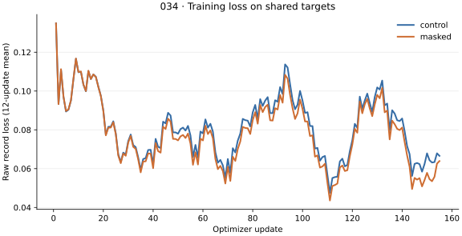

# 034 · 两组训练完成

两组按相同顺序处理了 1,238 条记录、2,718,795 个输入 token，并各做 155 次更新。训练审计逐条重算输入和标签，并核对初始 LoRA 指纹。屏蔽组把 40 条指定首步记录的损失权重设为 0，涉及 1,280 个监督 token。

| 组别 | 北京时间开始 | 北京时间结束 | 流水线耗时 | 参与梯度的监督 token | 峰值显存 | 最高温度 | GPU 样本 |
|---|---|---|---:|---:|---:|---:|---:|
| control | 2026-11-19 07:29:23 | 2026-11-19 08:15:55 | 46.53 分钟 | 92,897 | 94,581 MiB | 80 ℃ | 553 |
| masked | 2026-11-19 08:15:56 | 2026-11-19 09:02:40 | 46.72 分钟 | 91,617 | 94,581 MiB | 80 ℃ | 556 |

对照组适配器的权重哈希与 032 历史成品有差异。本轮组间比较使用同期重训的对照。

曲线使用两组均保留梯度的记录。每次更新先取这些记录的原始损失均值，再做 12 次更新的移动平均。数表另列全记录的原始损失、实际优化目标和梯度范数。开发任务的成功率由单独的成对评估测量。

[逐更新数据](training-curve.csv) · [审计与硬件汇总](measurements.json)
