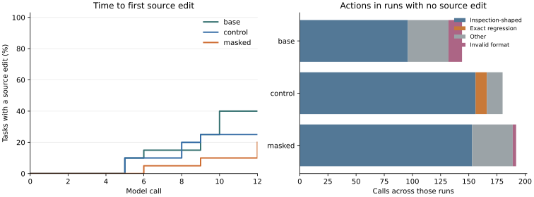

# 035 · 原始底座对照和未改码轨迹

同一批 20 道题每个版本跑一次，共 60 条轨迹，三组首次输入 token 逐题一致。本轮新增底座 20 次运行、234 次生成，另外两组来自 034 已审计的 474 次生成。

| 指标 | 原始底座 | 034 对照 LoRA | 034 屏蔽 LoRA |
|---|---:|---:|---:|
| 预算内修复且提交 | 1 | 1 | 0 |
| 首步原样执行指定回归命令 | 0 | 10 | 0 |
| 全程未改源码 | 12 | 15 | 16 |
| 预算内修复但未提交 | 0 | 1 | 1 |
| 模型调用 | 234 | 234 | 240 |
| 生成 token | 21,123 | 16,234 | 16,922 |
| 输入 token | 788,976 | 818,249 | 856,836 |
| 从回执核算成本的超时题 | 0 | 0 | 0 |

| 未改源码轨迹的特征 | 原始底座 | 034 对照 LoRA | 034 屏蔽 LoRA |
|---|---:|---:|---:|
| 用完 12 次调用 | 12 | 15 | 16 |
| 至少一半调用为查阅形态 | 9 | 15 | 15 |
| 出现相同命令、源码与反馈的重复 | 1 | 1 | 3 |
| 发生上下文裁剪 | 1 | 1 | 3 |

查阅形态仅按已执行命令的保守语法判定。计数区分首次实际源码变更、命令格式错误、非零退出和上下文裁剪，无法度量每次查阅的质量。这是跨批次开发对照，用于定位下一步干预。

底座本轮运行北京时间 2026-11-19 12:18:04 至 2026-11-19 12:50:33，用时 32.49 分钟。GPU 采样 387 条，采样错误 0 次，峰值显存 59,523 MiB，最高温度 65 °C。

[逐题数表](matched-rollouts.csv) · [首次改码曲线数据](first-edit-curve.csv) · [审计与硬件汇总](measurements.json)
