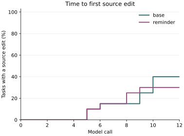

# 035 · 一次性进度提示的同预算对照

原始底座预算内修复并提交 **1／20**，提示组 **2／20**。新增成功 1 道，退步 0 道，净变化 +1 道。

| 指标 | 原始底座 | 底座 + 提示 |
|---|---:|---:|
| 预算内修复且提交 | 1 | 2 |
| 首步原样执行指定回归命令 | 0 | 0 |
| 全程未改源码 | 12 | 14 |
| 预算内修复但未提交 | 0 | 0 |
| 模型调用 | 234 | 234 |
| 生成 token | 21,123 | 20,501 |
| 输入 token | 788,976 | 772,094 |
| 从回执核算成本的超时题 | 0 | 0 |

| 仓库家族 | 提示组净增完成题数 |
|---|---:|
| arrow-py/arrow | +0 |
| d3/d3-array | +0 |
| networkx/networkx | +0 |
| ramda/ramda | +1 |

提示在 15 道题触发。在触发前或整条未触发轨迹中，1 道题的请求或生成存在差异，其中有 0 次输入 token 相同但输出 token 不同。筛到实际触发且触发前输入与输出均匹配的题，提示组新增成功 1 道、退步 0 道。

预注册的机制复验门槛未通过。这批开发题已用于诊断，结论需要另一批题复验。

本轮新增 234 次已核验生成，并匹配已审计底座的 234 次。提示只在第 5 次请求可能出现，仍计入该请求的 8,192 token 上限。

提示组运行北京时间 2026-11-19 12:54:49 至 2026-11-19 13:26:41，用时 31.86 分钟。GPU 采样 380 条，采样错误 0 次，峰值显存 59,541 MiB，最高温度 66 °C。

[逐题数据](matched-rollouts.csv) · [曲线数据](first-edit-curve.csv) · [审计与硬件汇总](measurements.json)
