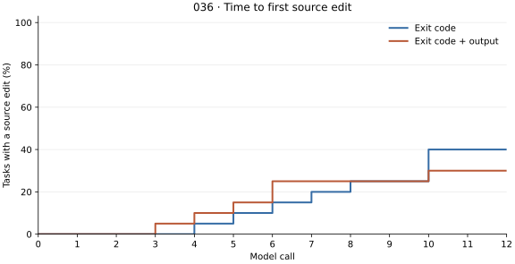

# 036 · 公开回归输出对照

仅退出码修复并提交 **3／20**，同时提供失败输出 **3／20**。新增 2 道，退步 2 道，净变化 **+0 道**。

| 指标 | 仅退出码 | 退出码 + 失败输出 |
|---|---:|---:|
| 预算内修复并提交 | 3 | 3 |
| 全程未改源码 | 12 | 14 |
| 预算内修复但未提交 | 0 | 0 |
| 首步原样执行指定回归命令 | 0 | 0 |
| 模型调用 | 231 | 221 |
| 输入 token | 799,172 | 876,938 |
| 生成 token | 22,580 | 22,059 |
| 取回回执的生成超时 | 0 | 0 |

| 仓库家族 | 追加失败输出的净增完成数 |
|---|---:|
| arrow-py/arrow | -1 |
| d3/d3-array | -1 |
| networkx/networkx | +0 |
| ramda/ramda | +2 |

035 中两次都未改码的 12 道题，在本轮分别有 2／12 和 3／12 修改过源码，最终修复并提交分别为 1／12 和 1／12。全组有 3 道从未改转为改码，5 道从改码转为未改。

预注册的复验门槛未通过。规则要求净增至少 2 道、至少 2 个家族净增、最多 1 道退步。本轮沿用已诊断的开发题。

两组共享 20 次预运行，公开测试共耗时 22.39 秒。其中 11 份输出在原有反馈上限处截断，16 份交付文本含可识别失败标记。对照同时包含额外上下文长度与具体输出内容的变化。

从北京时间 2026-11-20 11:34:23 至 2026-11-20 13:02:45，总墙钟用时 88.37 分钟，452 次计分生成均有审计回执。GPU 采样 830 条，峰值显存 62,931 MiB，最高温度 67 °C。

工作站在评估中重启。保留 30 次已完成运行，恢复 10 次未计分运行。被中断的一次评估保留了 11 个完整生成回执及 829 个可计量生成 token。另有 1 次已接受请求未生成完成回执，未知生成的上限为 512 个 token。

恢复前记录覆盖 46.23 分钟，两段之间相隔 18.72 分钟，恢复评估历时 23.41 分钟。GPU 样本分别为 551 和 279 条，恢复段采样错误 0 次。重启前的采样错误总数未知。

重启前 15 对的修复提交数为 3 和 3，恢复后 5 对为 0 和 0。前一段的未改码数为 11 和 9，后一段为 1 和 5。两段题目不同，这些分项只用于检查结论对恢复段的敏感性。

[匿名逐题表](matched-rollouts.csv) · [曲线数值](first-edit-curve.csv) · [审计与硬件汇总](measurements.json)
