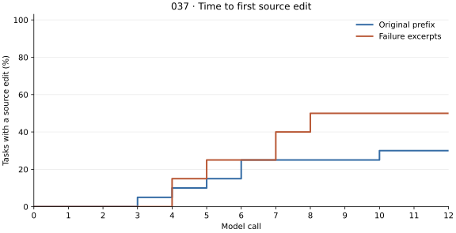

# 037 · 失败摘录对照

旧格式修复并提交 **3／20**，失败摘录组 **5／20**。新增 3 道，退步 1 道，净变化 **+2 道**。

| 指标 | 旧格式 | 失败摘录 |
|---|---:|---:|
| 预算内修复并提交 | 3 | 5 |
| 全程未改源码 | 14 | 10 |
| 预算内修复但未提交 | 0 | 1 |
| 模型调用 | 221 | 223 |
| 输入 token | 876,938 | 780,631 |
| 生成 token | 22,059 | 23,433 |
| 取回回执的生成超时 | 0 | 0 |

| 仓库家族 | 失败摘录组净增完成数 |
|---|---:|
| arrow-py/arrow | +0 |
| d3/d3-array | +1 |
| networkx/networkx | +2 |
| ramda/ramda | -1 |

| 固定子组 | 题数 | 旧格式改码 | 摘录组改码 | 旧格式修复提交 | 摘录组修复提交 |
|---|---:|---:|---:|---:|---:|
| 原前缀被截断 | 11 | 1 | 5 | 1 | 2 |
| 摘录找回至少一条失败原文 | 5 | 0 | 2 | 0 | 1 |
| 035 中两次均未改码 | 12 | 3 | 5 | 1 | 3 |

全组 6 道从未改转为改码，2 道从改码转为未改。预注册复验门槛通过。这批题已用于诊断，子组和整体结论均属于开发对照。

两组均读取同一批 036 已存档输出。旧格式 11 份截断。摘录保留了 5 道题的 10 条原格式未包含的完整失败行。20 道题开场输入合计由 24,338 降到 15,458 token，少 36.5%。摘录同时改变信息选择、排序及长度。

整题输入 token 合计变化 -11.0%，生成 token 合计变化 +6.2%。这里报告输入和生成的实测量，整体耗时按整次评估记录。

北京时间 2026-11-20 17:57:51 至 2026-11-20 19:05:56，用时 68.08 分钟。444 次生成均通过回执审计，20 对实际开场已和预检 token 哈希对齐。GPU 采样 810 条，采样错误 0 次，峰值显存 62,775 MiB，最高温度 67 °C。

[匿名逐题表](matched-rollouts.csv) · [曲线数值](first-edit-curve.csv) · [审计与硬件汇总](measurements.json)
